# Cell City 에셋 활용 가이드

구현 기준: 2D v0.89.0 / 3D v0.87.0 · 문서 갱신: 2026년 11월 5일.

## 독립 2D Cell City (v0.89.0)

`#city`는 정면과 바닥이 함께 보이는 2D 탑다운 도트 마을이다. 기존 경영 프로토타입 화면을 교체했으며 `#city3d`의 시뮬레이션·테마·저장과 공유하지 않는다. 이 절 아래 기존 3D 모델·수로·시설 기준은 **city 3D 전용**이다.

| 리소스 | 출처·라이선스 | 적용 위치·예산 |
| --- | --- | --- |
| `assets/cell-village/tiny-town.png` | [Kenney Tiny Town](https://kenney.nl/assets/tiny-town), CC0 1.0. 원본 `Tilemap/tilemap_packed.png` | 16px 지형·나무·꽃·정원 소품. PNG **1개, 5,042바이트**. 2D 탭 진입 시만 로드 |
| `KENNEY-LICENSE.txt`, `sources.json` | 원본 라이선스·출처·SHA-256 | 에셋 옆 보관. 빌드는 이 폴더만 추가 복사 |
| 장기 시설 7개·주민 8명·플레이어 1명 | 프로젝트 자체 Canvas 픽셀 도형 | 지붕·정면·장기 표식·의상·방향·보행·작업 연출. 외부 비트맵 추가 없음 |
| 게임 루프 | 기존 Kontra.js 10.0.2, MIT | 30fps, 비활성 탭 정지. 새 런타임 패키지 없음 |

- 코드는 `cell-village-world.mjs`, `cell-village-renderer.mjs`, `cell-village-ui.mjs`, `cell-village.css`로 분리한다. 지도는 48×34타일, 768×544 논리 픽셀이며 정적 배경은 메모리 캔버스 한 장에 저장한다. 화면 DPR은 최대 2다.
- CSS는 `.vlg-game`과 `.village-main` 전용이다. 기존 `.cc-game`, `.city-main` 및 공통 이미지/SVG 규칙을 변경하지 않는다. 신규 스타일에 `!important`는 없다.
- 저장 키는 `pathopedia:cell-village:v1`. 이름·옷·머리·피부·플레이어 위치·마을 시간·도움 횟수를 저장한다. 이전 2D/3D 저장을 읽거나 삭제하지 않는다.
- `CACHE_CELL_VILLAGE`가 새 모듈·CSS·PNG만 오프라인 저장한다. 3D 모델 43개·이미지 7개·4,864,667바이트 예산과는 별도다.
- 외부 ZIP은 메모리에서 필요한 두 파일만 추출했다. 원본 전체 묶음·시험 이미지·임시 캡처를 생성하지 않았다. Stardew Valley에서는 화면 구도와 생활감만 참고했으며 원본 게임 에셋은 사용하지 않는다.

도시 구조·외관·에셋을 변경할 때 먼저 읽는 작업 문서다. 보유 원본에서 무엇을 고르고, 어느 코드에 연결하며, 어떤 외관·용량·시뮬레이션 조건을 지켜야 하는지 기록한다. 개별 모델의 정확한 경로·바이트·체크섬·라이선스는 [`sources.json`](../assets/city3d/bundle/sources.json), 실제 표시 조건은 아래 연결 코드가 기준이다. 구현과 문서가 달라지면 함께 갱신한다.

## 작업 시작 순서

1. 아래 작업별 표에서 현재 쓸 수 있는 모델과 수정할 파일을 찾는다. 이미 추출된 모델을 먼저 재사용하고, 부족하면 보유 팩에서 후보를 고른다.
2. 테마 2의 저장 배치와 공통 주변 객체를 기준으로 테마 1·2의 대응을 정한다. 신규 에셋 ON·OFF도 확인하며, 공통 좌표와 테마별 경로 형태·외형을 구분한다.
3. 모델의 재질·이미지 참조·크기·삼각형 수와 반복 배치 개수를 확인한다. ZIP 용량으로 웹 다운로드나 GPU 메모리를 판단하지 않는다.
4. 기존 토지 경계와 실제 입항·손상·복구 상태에 연결하고, 아래 용량·병합·인스턴스 기준을 지킨다.
5. 필요한 범위만 확인하고, 선택 목록·출처·적용 위치·예산 변경을 이 문서에 반영한다. 배포하는 작업이면 AGENTS.md의 버전·GitHub 배포 확인 규칙도 따른다.

## 현재 화면과 유지할 동작

| 항목 | 현재 동작 / 변경 시 지킬 점 |
| --- | --- |
| 테마 1 | 설정 → 도시 테마 → ‘평원 마을 · 격자 대로’. 새 환경의 기본 선택. 테마 2와 같은 부지에 낮은 회벽 주택·다층 상점·큰 장기 시설, 잔디 마당과 정사각형 대로를 표시한다. |
| 테마 2 | 설정 → 도시 테마 → ‘수로 마을 · 원형 혈관’. 같은 배치에 베네치아풍 주택·돌 광장·부두와 원형 동맥·정맥 수로를 표시한다. |
| 테마 전환 | 현재 테마 2의 저장 배치와 주변 객체의 공통 위치를 사용한다. 진행 시간·자원·감염·세포 ID·화물을 초기화하지 않는다. 적혈구와 물자 운반물은 현재 위치에서 선택한 테마의 길로 합류한다. |
| 신규 에셋 적용 | 설정의 체크박스. 새 환경은 기본 ON, 사용자가 저장한 OFF는 유지한다. 테마 선택과 별개이며 기존 24종과 추가 19종을 포함한 선택 묶음 전체에 적용된다. |
| 로딩과 캐시 | ON이면 manifest의 모델 전체를 3개씩 병렬 로드한다. 최초 OFF에서는 요청을 시작하지 않는다. 로딩 중 OFF로 바꿔도 늦게 도착한 결과를 화면에 적용하지 않는다. 이미 받은 묶음은 재체크용으로 캐시하므로 OFF가 즉시 메모리 해제를 뜻하지는 않는다. |
| 기본 도형 | 큰 장기 시설·공공건물·연립주택은 코드 도형이므로 ON/OFF 모두 남는다. 선택 묶음의 소품·수입 건물만 체크에 따라 달라진다. 체크 전환은 도시 저장·시뮬레이션을 바꾸지 않는다. |

체크 OFF/ON 비교는 ‘선택 묶음 전체 미적용/적용’ 비교다. v0.66.1과 v0.67.0의 차이만 보여주는 비교로 표기하지 않는다. 새로 추가한 19종은 도시 전체 실루엣 교체보다 항구·보급·정원·조직 복구의 세부 표현을 보강한다.

## 공통 배치와 테마별 객체 대응

`city-theme-layout.mjs`의 `compileThemeLayout`이 두 테마의 공통 진입점이다. `compileCanalLayout`에서 기존 수로 도시의 주변 주택, 마당, 조직 주택, 폐 작업 구역, 입구와 신장 배출구 위치를 가져온다. 두 테마는 같은 `blocks`, `entries`, `outlet`을 참조한다. 테마별로 새 도시나 별도 저장 배치를 만들지 않는다.

| 역할 키 | 테마 1: 평원 | 테마 2: 수로 | 에셋·연결 위치 |
| --- | --- | --- | --- |
| `frontage` | 낮은 회벽 주택, 구역별 지붕색의 회관·상점·연립주택 | 창 덧문·발코니가 있는 수변 주택, 테라코타 지붕의 큰 건물 | 일반 주택은 기존 Kenney 지붕·굴뚝, `architecture`가 지정된 부지는 `city-three-architecture.mjs` 사용. 두 테마의 부지·크기 공유 |
| `courtyard` | `village-green`: 잔디 마당과 십자 보행로 | `stone-court`: 돌 광장과 수변 화단 | 같은 정원 부지에 `tree-round`, `tree-cube`, `garden-bench`, `garden-shrub` 등 재사용 |
| `tissue` | `meadow-cottage`: 평원 색상의 낮은 주택 | `lagoon-townhouse`: 수로 도시 색상의 주택 | 같은 조직·폐 작업 부지에 기존 인스턴스 풀 사용. HP·화재·잔해·비계는 실제 상태와 연결. `city-three-tissue.mjs` |
| `landing` | `supply-yard`: 보급 마당과 하역 설비 | `quay`: 부두와 하역 설비 | 같은 소화기 입구에 `harbour-crane`, 자루·바구니·통·건초 재사용. `city-three-ports.mjs` |
| `freight` | `supply-wagon`: 코드 도형으로 만든 화물 마차 | `harbour-boat`: 배와 `harbour-anchor` | 같은 원료 배송의 입고·하역·출고 시계 사용. 적재물 `supply-bags` 공유 |
| `bankPlant` | `garden-flower`: 꽃·정원 식재 | `canal-reed`: 갈대·수변 식재 | 공통 정원의 같은 가장자리. 기존 GLB 재사용 |
| `drainage` | `filter-pond`: 배관과 정화 연못 | `lagoon-culvert`: 배관과 석조 배출구 | 같은 신장 배출 경로·성벽 밖 출구에 기본 도형 사용. 실제 노폐물 처리 상태와 연결 |

대응 이름은 `city-theme.mjs`의 `CITY_THEME_OBJECTS`와 `cityThemeObject`에 정의한다. 표의 `cottage`·`supply-wagon` 같은 이름은 장면 생성 방식이며 새 GLB 파일명이 아니다. 기능성 장기·창고·생산·보수 시설은 같은 ID·역할·저장 좌표를 유지한다.

테마 1의 큰길은 `compileVascularLayout(layout, 'square', obstacles)`에서 직각 위주로 계산한다. 공통 주변 건물과 조직 주택까지 장애물로 취급해 관통을 피한다. 테마 2는 원형 큰 혈관과 건물 사이를 돌아가는 분기 수로망을 사용한다. 각 네트워크의 일방향 순환, 장기·작업 지점과 전달 관계는 유지하며 별도 입구 데크를 혈관에 연결하지 않는다. 배치 편집 후에는 수정된 공통 배치를 기준으로 다시 계산한다.

테마별 변경으로 GLB·이미지·manifest를 추가하거나 재추출하지 않았다. 테마 1에서도 공통 주변 주택과 정원이 표시되므로 표시 메시 수는 이전 테마 1보다 늘 수 있다. 고유 에셋 다운로드·텍스처 예산과 장면의 draw·tris는 별도로 본다.

### 동네 배치와 공용 공간

`city-canal-blocks.mjs`는 저장된 기능성 건물과 작업 주택, 양쪽 테마의 큰 순환로 공간을 먼저 확보한다. 원형 수로는 기존 물길을 유지하고, 평원의 정사각형 대로는 주변 주택 때문에 모서리가 지그재그로 밀려나지 않도록 공통 배치 단계에서 폭을 예약한다. 이후 큰 공공건물+광장 → 가로변 주택 → 산책로·식재 → 연립주택 골목 → 작은 주택 순서로 배치한다. 저장한 건물 좌표·배치 버전은 변경하지 않는다.

| 구역 | 공용 공간 | 평원 / 수로 대응 |
| --- | --- | --- |
| 심장 | 장터 | 잔디 마당의 목재 가판대 / 돌 광장의 줄무늬 차양과 적재물 |
| 폐 | 바람 정원 | 나무·벤치·풍향 표식 / 수변 화단·휴식 공간 |
| 소화기 | 식량 마당 | 텃밭·건초·보급 가판대 / 돌 화분·바구니·저장 통 |
| 신장 | 정화 정원 | 작은 연못·꽃 / 석조 수조·갈대 |
| 골수 | 공방 마당 | 작업대·판재·차양 / 포장된 공방 앞 작업 공간 |
| 림프 | 회랑 정원 | 목재 퍼골라·허브 화단 / 석조 기둥·그늘 벤치 |

큰 공공건물과 광장은 8×8.5, 7×7, 6×6m의 한 필지로 확보하며 기존 마른 길까지 폭 1.05m의 진입 골목을 연결한다. 구역당 최대 한 곳이며, 연결 가능한 부지가 없으면 폭 2.5–7.5m의 작은 공용 공간으로 대체한다. 현재 기본 배치에는 심장 회관·림프 회랑의 큰 필지 2곳과 여섯 구역의 공용 공간이 생긴다. 사용자 배치에 따라 개수는 달라지며 기존 건물·혈류·출입구를 침범하지 않는다.

연립주택은 최대 8블록이다. 3.8×4.2m 필지에 두 집이 붙은 건물 두 줄을 마주 세우고 중앙 0.9m 골목을 비운다. 기본 배치는 8블록·16줄이며 기존 작은 주택 일부를 대체한다. 주변에는 최대 4채의 작은 주택군과 식재를 배치한다. 광장 십자 통로와 골목은 1인칭 보행에 사용하지만 새 혈관·입구 다리·물자 수송 경로를 만들지는 않는다. 건물 증축·이동 시 빈 부지를 다시 계산한다.

`city-three-neighbourhoods.mjs`에서 기존 `tree-round`, `tree-cube`, `garden-shrub`, `garden-bench`, `supply-bags`, `supply-basket`, `supply-barrel`, `hay-bale`, `repair-planks`, `table`, `hammer`, `garden-flower`, `canal-reed`를 재사용한다. 차양·퍼골라·포장·풍향 표식은 기존 재질을 쓰는 기본 도형이며, 정적 장면의 지역별 메시 병합에 포함된다. 신규 에셋 OFF에서도 기본 도형으로 공용 공간과 통로가 남는다. 조경 소품을 실제 생산량·노폐물 처리량을 표시하는 장치로 취급하지 않는다.

평원 주택은 구역별 적갈·청록·황토·보라·분홍·세이지 지붕군으로 묶는다(`NEIGHBOURHOOD_ROOFS`). 수로 주택은 테라코타 지붕을 유지하고 일부를 2층으로 올려 수변 동네의 높낮이를 만든다. 실제 조직 HP·화재·복구 연출은 그대로 연결한다. 정원·외곽 나무는 줄기 비중이 큰 TerraToon 모델 대신 이미 묶음에 있는 Cute Park의 둥근·각진 수관 모델을 적용해 원거리에서도 녹지가 보이게 한다. 수관과 줄기는 장면 복제본에서 기존 무광 녹색·목재 팔레트로 맞춘다. 기존 TerraToon 파일은 원본·묶음에 보존하며 새 파일을 추가하지 않는다. 다운로드 예산은 **43개 모델·7개 이미지·4,864,667바이트**로 동일하다. 공용 공간·주택·폐 작업 주택·산책로의 수는 현재 혈관 폭과 저장 배치의 빈 부지에 따라 달라진다. 실제 수량은 `compileCanalLayout(layout).blocks`에서 확인하며 이전 반지름의 주택 수를 고정 요구하지 않는다.

### 큰 장기와 건물 크기의 위계 (v0.87.0)

Assassin’s Creed II의 피렌체·베네치아 배경에서 참고한 것은 큰 공공건물, 이어진 입면, 좁은 골목에서 열리는 광장의 대비다. 실사 질감이나 게임 에셋은 가져오지 않는다. 기존 MIT Three.js, 자체 지붕 도형, Kenney 부품과 구입한 소품을 조합해 회벽·무광·단순한 지붕의 귀여운 마을을 유지한다.

`city-three-architecture.mjs`의 `townBuilding`은 회관(`hall`), 창고(`warehouse`), 날개 공방(`guildhall`), 다층 상점(`merchant`), 열린 회랑(`cloister`), 붙은 집(`terrace`)을 만든다. 건물 몸체를 크게 해도 문·창문 크기는 비슷하게 유지해 층수와 규모가 읽히게 한다. 저장 민가의 약 1/5은 다층 상점으로, 보급·생산·보수 시설은 큰 창고·공방으로 표시한다. 실제 기능과 배치 ID는 그대로다.

| 주요 장기 | 원거리에서 읽히는 형태 | 유지하는 실제 작업 표시 |
| --- | --- | --- |
| 심장 | 큰 회관·중앙 탑·높은 하트 문장 | 앞쪽 두 펌프·밸브·혈류 설비 |
| 폐 | 청록색 쌍둥이 풍탑 | 기존 팬 회전·호흡 작업 |
| 소화기 | 넓은 가공 창고와 높은 곡물탑 | 앞쪽 원료 가공·입고 |
| 신장 | 두 여과탑·위쪽 연결관·열린 수조 | 여과·물레·배출 설비 |
| 골수 | 높은 중앙 동과 낮은 날개·뼈 기둥 | 기존 조혈 작업·세포 생성 지점 |
| 림프 | 초록 원형 회관·큰 Y 표식 | 기존 면역 작업 |
| 뇌 | 외곽의 큰 관제관·연보라 뇌 문장 | 항상성 신호와 산소 막대 |
| 간·담낭 | 넓은 저장고·갈색 간과 초록 담낭 문장 | 저장량·간문맥·담즙 표시 |

문장과 건물은 고정 도형이다. 새 애니메이션·광원·이미지·GLB를 추가하지 않는다. 기본 장기의 라벨 높이와 외곽 장기의 실제 경계 높이를 조정해 지붕 안으로 표시가 들어가지 않도록 한다. 큰 건물의 주변 부품도 기존 부지·교환 지점을 비우며 실제 메시를 1인칭 충돌에 포함한다.

선택 에셋 ON 상태로 v0.86.4와 같은 기본 확장 도시를 비교했다. 아래는 마을과 외곽 건물의 **비인스턴스 메시** 합계다. 실제 번들 GLB 기하와 공유 텍스처 식별을 사용했지만 Kenney 부품·인스턴스 풀·그림자 패스·화면 밖 제외는 집계에서 빠진다. 따라서 전체 draw call·GPU 메모리·FPS 수치로 사용하지 않는다.

| 비교 항목 | 평원: 이전 → 현재 | 수로: 이전 → 현재 |
| --- | --- | --- |
| 비인스턴스 메시 수 | 284 → 290 | 192 → 202 |
| 삼각형 수 | 257,433 → 255,582 | 320,560 → 291,673 |
| 기하 속성 배열 바이트 | 29,464,916 → 30,372,872 | 40,704,904 → 36,982,108 |

평원 기하 버퍼는 약 3.1% 늘고 수로는 약 9.1% 줄었다. 넓은 단순 건물로 복잡한 수입 몸체 일부를 대체하고 기존 지역별 병합을 사용한다. 외곽 장기 정적 배치는 기존 검사 한도 29개를 유지한다. 다운로드 **43개 모델·7개 이미지·4,864,667바이트**, 선택 묶음 텍스처 약 **27.28MiB**는 변함없다. 새 JavaScript 코드 용량은 위 에셋 합계와 별도다.

검증: 기존 저장 도시의 PC 두 테마와 모바일 세로 390×844·가로 844×390을 확인했다. 모바일 캔버스는 각각 390×704·844×250이고 문서 가로 넘침은 없었다. 이름표는 기존 전용 스타일의 10/11px·짙은 녹색을 유지하며 신규 에셋 ON, 브라우저 오류 없음도 확인했다. 관련 검사는 증축 후 빈 부지·광장·실제 건물 메시 사이 골목 통행, 테마 전환·저장 불변성, 외곽 부지·공유 자원 보존을 다룬다.

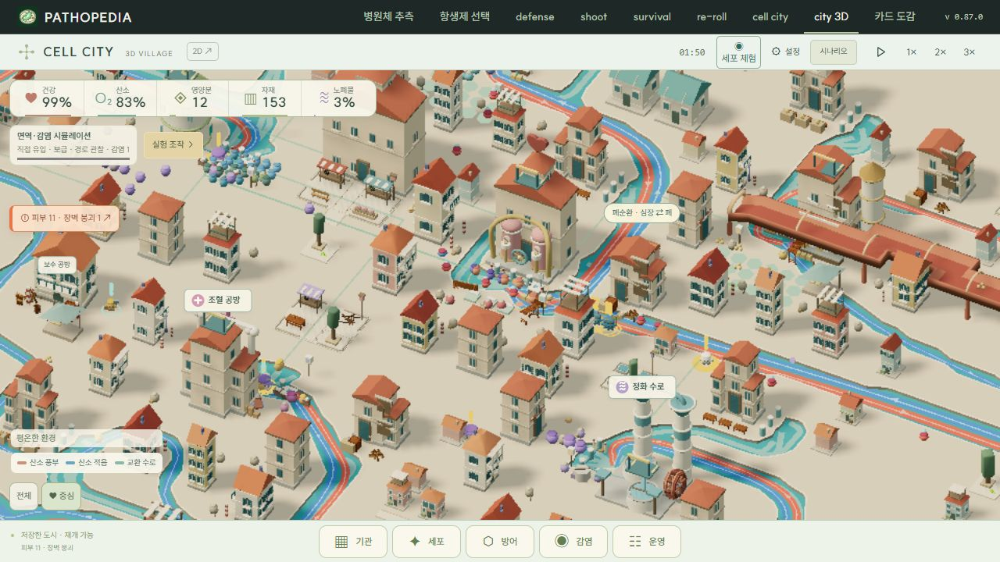

### 주택 형태의 변주

`city-three-housing.mjs`의 공통 형태 규칙을 큰 민가·가로변 주택(`city-three-village.mjs`, `city-three-canals.mjs`)과 작은 조직 주택(`city-three-tissue.mjs`)에 적용한다. 색뿐 아니라 몸체 폭·깊이·높이, 지붕 방향과 외부 장치를 함께 바꾼다.

| 유형 | 평원 마을 | 수로 마을 |
| --- | --- | --- |
| 1 | 넓고 낮은 농가, 가로 박공·현관 처마 | 좁은 연립집, 세로 박공·발코니 |
| 2 | 사각 뿔 지붕의 정원집, 창 덧문 | 낮은 사방 경사 지붕, 기둥 있는 발코니 |
| 3 | 가로 박공·돌출 다락창 주택 | 가로 박공의 상점집, 차양·작은 간판 |
| 4 | 높은 목조 주택, 외벽 보강재·상층 창 | 좁고 높은 연립집, 층별 창문·덧문 |
| 5 | 한쪽으로 기울어진 지붕의 작은 공방 | 낮은 지붕 위 목재 테라스·차양 |
| 6 | 사각 뿔 지붕과 현관을 가진 주택 | 낮은 수변집, 가로 박공·전면 난간 |

기존 Kenney `roof-gable`, `roof-point`, `chimney`를 계속 활용한다. 작은 조직 주택은 박공·사각 뿔·편경사 지붕을 세 개의 저폴리 인스턴스 풀로 나누며 창·처마·발코니는 공통 박스 풀을 사용한다. 다락창은 박공 풀에 합친다. 기존 지붕 풀 하나에서 최대 세 개로 늘지만 건물별 draw call이나 별도 애니메이션은 추가하지 않는다. 박스 풀은 주택당 최대 32개로 제한하며, 실제 조립 수만 표시한다. 새 GLB·이미지·외부 의존성은 없고 기존 묶음의 다운로드 예산은 그대로다.

작은 주택의 종류·색상은 위치 해시로 정해 목록 순서가 바뀌어도 유지한다. 건물 기능·저장 좌표·도로·혈류는 바꾸지 않는다. 회전한 집의 처마·발코니·차양도 기존 1.35m 부지 안에 머무르며, 변경한 지붕 세 종류를 모두 1인칭 충돌 표면에 포함한다. 실제 조직 손상·붕괴·복구 상태와 연결하고 폐 작업장의 호흡 장치는 유지한다. `tests/city-housing.test.mjs`는 부지 경계, 재생성 안정성, 지붕 충돌, 붕괴 후 높이를 확인한다.

## 작업별 리소스 선택과 연결

| 하려는 작업 | 우선 재사용할 런타임 모델 | 적용 위치·조건 / 연결 코드 | 아직 미적용인 후속 후보 |
| --- | --- | --- | --- |
| 식량 입구·하역 설비 | `harbour-crane`, `supply-bags`, `supply-basket`, `supply-barrel`, `hay-bale` | 테마 1은 보급 마당, 테마 2는 같은 위치의 부두. 하역 설비와 적재물은 정적 배치. `city-three-ports.mjs` | Food Extended의 식품, Pirate Island의 상자·로프 |
| 식량 수송·하역 연출 | 테마 1은 코드 도형 마차, 테마 2는 `harbour-boat`·`harbour-anchor`. `supply-bags` 공유 | 실제 원료 shipment가 생성된 뒤 8초 미만 동안 표시. 하역물은 3초 이상 5초 미만에 표시. 일시정지 시점에 따라 마차·배가 없을 수 있다. `city-three-ports.mjs` | 더 큰 배는 부두 폭·가림·삼각형 수를 먼저 검토 |
| 보수 공방·자재 | `repair-scaffold`, `repair-ladder`, `repair-planks`, 기존 `logs`, `crate`, `table`, `hammer`, `bucket` | 피부 보수 공방의 고정 소품. 조직 복구 중에만 나오는 비계와 구분한다. `city-three-village.mjs` | Medieval의 추가 도구, Old Town의 소형 자재 |
| 정원·마을 조경 | `tree-round`, `tree-cube`, `garden-shrub`, `garden-flower`, `canal-reed`, `garden-bench` | 공통 정원 부지. 평원은 잔디·꽃, 수로는 석조·갈대로 대응. 수관이 포함된 Cute Park 나무 2종을 정원·평원 외곽에 사용. `city-three-canals.mjs`, `city-three-village.mjs` | Cute Park·Nature Extended의 꽃·풀·작은 조경 |
| 파괴·잔해·복구 | `rubble-rock`, `rubble-stone`, `repair-scaffold` | 실제 조직/기관 건강이 15 미만인 주택에 잔해, 실제 복구 작업 중에 비계. 기존 불·연기·복구 표시와 함께 사용. `city-three-tissue.mjs` | 파손 석벽·울타리, 작은 돌. 별도 가짜 손상 상태를 만들지 않는다. |
| 민가·창고·장기 시설 | 코드 회관·창고·공방·회랑·연립주택과 기존 `house-a`, `house-b`, `workshop`, `market`, `tank`, `silo`, `station`, `jar` | 큰 몸체는 `city-three-architecture.mjs`, 실제 설비·동작은 `city-three-facilities.mjs`. 두 테마에서 큰 건물의 크기를 유지 | 기존 팩의 선반·병·도구를 역할 소품으로 재사용. 대형 Old Town 원본을 통째로 반복 배치하지 않는다 |
| 성벽·방어·병원체 전투 | 기존 `stone-wall`, `stone-tower`, `palisade`, `gate` | 기존 장벽 HP·파손·수리와 연결. 세포·병원체 실루엣, 사격·작업 지점을 가리지 않는다. `city-three-bundle.mjs`, `city-three-frontier.mjs` | Medieval의 방패·활·검·도끼, Cute Dungeon의 문·횃불·석재 부품 |
| 입구 데크·다리·경계 | 기존 부두·입구의 코드 생성 도형과 선택 묶음 소품 | `city-entry-tracks.mjs`, `city-tile-layout.mjs`, `city-three-ports.mjs`. 이동 경로·단차·토지 점유를 먼저 확인한다. | Backroad Bridges·Roadside Fences. 장식용 다리를 혈관의 새 이동 경로로 연결하지 않는다. |

후속 후보는 보유 원본에서 검토할 수 있다는 뜻이다. 아직 웹용 추출·재질 정리·화면 적용을 마친 모델로 취급하지 않는다. 파일명만 비슷한 모델을 임의로 같은 리소스로 교체하지 않는다.

## 외관과 도시 배치 기준

밝은 크림색 외벽, 적갈색 기와, 청록 설비, 채도가 낮은 목재·녹색과 무광 표면을 맞춘다. 세포·병원체·장기 색상은 기능 식별에 사용한다. 사람 캐릭터와 실사풍 건물로 세포를 교체하지 않는다.

주택의 손상·화재·복구는 실제 조직 상태에 연결한다. 혈관, 서비스 지점, 피부 조직, 호흡기 착지점, 신장 배출구와 감염 경보의 공간을 비워 둔다. 새로운 통로를 장식 목적으로 혈관에 연결하지 않는다. 정원 소품은 이미 확보한 정원 부지 안에 둔다.

- 작은 소품은 기존 건물·목재·설비 색에 맞춰 재질을 공유한다. 바구니·배·나무를 넣기 위해 도시 전체의 색감이나 축척을 바꾸지 않는다.
- 땅·건물·부두의 점유 범위가 바뀌면 렌더러만 옮기지 말고 저장 배치, 혈관·보행 경로, 서비스 지점과 입구 단차도 확인한다. 고정 좌표 대신 기존 배치 변환·토지 경계를 사용한다.
- 카툰 마을과 병원체 전투가 함께 읽혀야 한다. 장비·불·잔해는 역할과 실제 상태를 보여주는 데 사용하고, 선택 표식·경보·작업자의 동작을 가리지 않는다.
- Godot/Unity의 바람·물·하늘 셰이더와 데모 씬은 복사하지 않는다. 현재 Three.js 재질과 기존 연출을 우선 사용한다.

## 보유 팩에서 찾을 리소스

원본은 `cell-city-assets/`에 보관한다. 파일 수에는 색상·크기·조합 변형이 포함된다. 원본 프로젝트 전체를 배포하지 않고 선택한 메시와 필요한 이미지·라이선스만 `assets/city3d/bundle/`로 추출한다.

| 팩과 보관 파일 | 찾을 수 있는 리소스 | 현재 사용과 후속 후보 |
| --- | --- | --- |
| Medieval Megapack · `MedievalMegapack_Godot.zip` | 집, 창고, 시장, 성벽, 목책, 배·부두, 로프, 도구, 무기 32종 | 기존 공방·보급·방어선에 사용. 활·방패·검·도끼는 시설과 역할 장비 후보 |
| Cute Park · `Cute Park.zip` | 나무·관목·꽃·가로등·벤치·분수 | 기존 나무·관목 사용. 분수는 별도 이미지가 필요한 모델이 있어 선별 |
| Kitchen Restaurant · `Restaurant_Godot.zip` | 작업대, 선반, 병, 식품 자루, 조리 도구 | 기존 작업대·병 사용. 선반·자루는 후속 보급 시설 후보 |
| FarmLand · `Farm Pack Godot.zip` | 저장 탱크, 사일로, 창고, 농촌 소품 | 기존 탱크·사일로 사용. 작은 화분·저장 소품 후보 |
| Food Extended · `Food Extended.zip` | 빵·과일·식품 자루와 음식 장식 | 부두·영양 가공소 후보. 기존 Farm·Kitchen과 같은 이미지 공유 가능 |
| Cute Dungeon · `DUNGEON EXPORT.zip` | 석재 기단·계단·문·횃불·돌 | 방어 시설 부품 후보. 던전 전체 외관은 후순위 |
| Roadside Fences · `Fences and walls glb.zip` | 파손 석벽, 목문, 울타리, 경계 장식 | GLB의 이미지 연결은 별도 작업. 전용 PNG는 `EmaceRoadSideTales_Texture_01A.zip` |
| Backroad Bridges · `Gltf.zip` | 판자 통로·교각·다리 부품 | glTF·BIN·동봉 이미지를 함께 취급. 입구 데크 보강 후보 |
| Old Town · `old town Glb.zip` 또는 `OldTown_Glb.zip` | 크레인, 비계, 판자, 사다리, 식량 자루·바구니·통 | v0.67.0 부두·공방·조직 복구에 사용. 대형 주택은 기존 카툰 주택을 유지 |
| Pirate Island · `PirateIsland_Godot.zip` | 배, 닻, 상자, 사다리와 항구 소품 | 작은 배·닻 사용. 대형 해적선과 열대 섬 전체는 후순위 |
| TerraToon · `terratoon-stylized-tree-pack-low-poly-forest-foliage-godot.zip` | 나무, 관목으로 쓸 수관, 뿌리·지형 조각 | 정원의 나무 2종·관목 사용. Godot 재질을 웹용 아틀라스로 연결 |
| Rocks and Stone · `Glb.zip`, `RocksAndStone_Godot_2026-09-29.zip` | 돌·돌무더기·절벽 103개 | 조직 파괴 현장 잔해 사용. 같은 팩의 두 배포본 중 GLB판을 추출 |
| Nature Extended · `Low Poly Nature_Godot.zip` | 변형 포함 GLB 3,300개. 꽃·갈대·돌·나무·버섯 | 꽃·클로버·갈대 사용. 기존 Farm·Kitchen 아틀라스와 해시가 동일 |
| NatureForge · `NatureForge 3.0 - Godot 4 project (Godot 4.7+).zip` | glTF·BIN 127세트. 건초·농촌 가구·꽃·풀·울타리·돌 | 건초·벤치 사용. 작은 소품의 색은 정점에 담아 2K 이미지 추가 방지 |

같은 `EmaceRoadSideTales_Texture_01A.png` 이름이라도 울타리와 다리 팩의 파일 내용은 다르다. 반대로 Farm·Kitchen·Food·Nature Extended의 공통 아틀라스는 내용 해시로 공유한다. NatureForge 원본 ZIP에는 별도 보관한 Old Town ZIP과 동일한 파일도 중첩돼 있다. 보관 원본과 중복본은 추출 스크립트가 변경하거나 삭제하지 않는다.

## 이미 추출된 런타임 모델

선택 묶음에 포함된 것과 특정 테마·시점에 실제 보이는 것은 다르다. 아래 키는 `bundleModel`/`newModel`로 재사용하며 `models/*.glb`를 장면마다 별도 로더로 중복 로드하지 않는다.

### 기존 24종

| 용도 | 런타임 이름 | 원본 팩 |
| --- | --- | --- |
| 건물·시장 6종 | `house-a`, `house-b`, `hall`, `workshop`, `tower`, `market` | Medieval Megapack |
| 방벽·문 4종 | `stone-wall`, `stone-tower`, `palisade`, `gate` | Medieval Megapack |
| 공방·보급·가구 7종 | `crate`, `logs`, `hammer`, `bucket`, `bench`, `table`, `cart` | Medieval Megapack |
| 조경 3종 | `tree-cube`, `tree-round`, `bush` | Cute Park |
| 작업대·병 2종 | `station`, `jar` | Kitchen Restaurant |
| 탱크·사일로 2종 | `tank`, `silo` | FarmLand |

### v0.67.0 추가 19종

삼각형은 파일 내 메시 합계, KB는 1,000바이트 기준이다. 재질·물리 보조 메시 때문에 실제 장면의 표시량과 차이가 있을 수 있다. 반복 배치량과 화면에 보이는 영역에 따라 프레임 부하는 달라진다.

| 런타임 이름 | 출처 팩 | 삼각형 | 모델 KB | 사용 위치 |
| --- | --- | ---: | ---: | --- |
| `harbour-crane` | old-town | 58 | 5.0 | 평원 보급 마당·수로 부두의 하역 설비 |
| `repair-scaffold` | old-town | 126 | 13.5 | 보수 공방, 실제 조직 복구 |
| `repair-planks` | old-town | 204 | 15.4 | 보수 공방 자재 |
| `repair-ladder` | old-town | 132 | 10.3 | 보수 공방 |
| `supply-bags` | old-town | 166 | 15.5 | 보급 마당·부두, 마차·식량선 적재와 하역 |
| `supply-basket` | old-town | 1440 | 133.2 | 보급 마당·부두 식량 |
| `supply-barrel` | old-town | 512 | 30.8 | 보급 마당·부두 저장물 |
| `harbour-boat` | pirate-island | 406 | 27.3 | 실제 원료 입항 시 식량선 |
| `harbour-anchor` | pirate-island | 436 | 32.5 | 식량선 장식 |
| `garden-tree` | terratoon | 196 | 22.7 | 묶음에 보존, 현 배치에서는 `tree-round`로 대응 |
| `garden-tree-small` | terratoon | 102 | 11.8 | 묶음에 보존, 현 배치에서는 `tree-cube`로 대응 |
| `garden-shrub` | terratoon | 114 | 13.0 | 공통 정원 |
| `rubble-rock` | rocks-and-stone | 72 | 11.3 | 실제 조직 파괴 현장 |
| `rubble-stone` | rocks-and-stone | 466 | 41.8 | 실제 조직 파괴 현장 |
| `garden-flower` | nature-extended | 592 | 50.9 | 공통 정원 화분, 평원 정원 가장자리 |
| `garden-clover` | nature-extended | 44 | 5.4 | 공통 정원 지피 식물 |
| `canal-reed` | nature-extended | 36 | 3.9 | 수로 정원 가장자리 |
| `hay-bale` | natureforge | 619 | 86.3 | 보급 마당·부두 적재물 |
| `garden-bench` | natureforge | 292 | 46.9 | 공통 정원 벤치 |

### 원본 파일 경로

| 런타임 이름 | 원본 ZIP | ZIP 내부 경로 |
| --- | --- | --- |
| `harbour-crane` | `old town Glb.zip` | `EA_crane_01a.glb` |
| `repair-scaffold` | `old town Glb.zip` | `EA_scaffolding_l_small_01a.glb` |
| `repair-planks` | `old town Glb.zip` | `EA_Planks_01a.glb` |
| `repair-ladder` | `old town Glb.zip` | `EA_ladder_small_01a.glb` |
| `supply-bags` | `old town Glb.zip` | `EA_bags_01b.glb` |
| `supply-basket` | `old town Glb.zip` | `EA_Basket_apple_01a.glb` |
| `supply-barrel` | `old town Glb.zip` | `EA_Barrel_01a.glb` |
| `harbour-boat` | `PirateIsland_Godot.zip` | `PirateIsland/Models/Ships/SM_Boat_A.glb` |
| `harbour-anchor` | `PirateIsland_Godot.zip` | `PirateIsland/Models/Ships/SM_Anchor_A.glb` |
| `garden-tree` | `terratoon-stylized-tree-pack-low-poly-forest-foliage-godot.zip` | `TerraToonStylizedTreePack/Meshes/EA02_Env_Tree_01a.glb` |
| `garden-tree-small` | `terratoon-stylized-tree-pack-low-poly-forest-foliage-godot.zip` | `TerraToonStylizedTreePack/Meshes/EA02_Env_Tree_01d.glb` |
| `garden-shrub` | `terratoon-stylized-tree-pack-low-poly-forest-foliage-godot.zip` | `TerraToonStylizedTreePack/Meshes/EA02_Env_TreeCrown_01.glb` |
| `rubble-rock` | `Glb.zip` | `Glb/EA01_Env_Rock_01a.glb` |
| `rubble-stone` | `Glb.zip` | `Glb/EA01_Env_Stone_Cobble_06.glb` |
| `garden-flower` | `Low Poly Nature_Godot.zip` | `low-poly-nature--extended/LowPolyNature_Godot/Models/Flowers/Flower_1_1_A.glb` |
| `garden-clover` | `Low Poly Nature_Godot.zip` | `low-poly-nature--extended/LowPolyNature_Godot/Models/Flowers/Clover_1_1_A.glb` |
| `canal-reed` | `Low Poly Nature_Godot.zip` | `low-poly-nature--extended/LowPolyNature_Godot/Models/Farm Plants/Reed_Single.glb` |
| `hay-bale` | `NatureForge 3.0 - Godot 4 project (Godot 4.7+).zip` | `NatureForgeStylizedMeadowFarmKit/Meshes/EA_M_HayBale_Dry_01a_PRE.gltf` |
| `garden-bench` | `NatureForge 3.0 - Godot 4 project (Godot 4.7+).zip` | `NatureForgeStylizedMeadowFarmKit/Meshes/EA_M_Furniture_Bench_Wooden_01_PRE.gltf` |

## 용량과 렌더링 기준

현재 선택 묶음은 10개 팩에서 고른 **43개 모델·7개 이미지·4,864,667바이트**다. 기존 3,587,172바이트에서 약 1.28MB 늘었다. manifest·라이선스·코드·기존 Three.js/Kenney 파일은 이 모델·이미지 합계와 별도다. 보유 원본 ZIP 전체 크기나 사이트 전체 배포 크기와 혼동하지 않는다.

| 항목 | 현재 기준 | 추가·확장 작업에서 확인할 것 |
| --- | --- | --- |
| 모델+이미지 파일 합계 | 5,000,000바이트 미만 | 현재 여유 **135,333바이트(약 135KB)**. 새 아틀라스나 큰 모델을 추가하기 전에 기존 리소스 재사용·교체·축소를 검토한다. |
| 공유 이미지 | 7개, 각 변 1080 이하 | `tests/city-assets.test.mjs`에도 수·크기 제한이 있다. 예산 변경은 근거와 새 상주량을 문서·검증 기준에 함께 반영한다. |
| 추가 소품의 삼각형 | v0.67.0 추가 19종은 파일당 2,000 미만 | 모델 하나의 수치와 화면상 반복 개수를 함께 본다. 기존 `hall` 6,641, `house-a` 3,657, `cart` 2,828 등은 같은 소품 수준으로 무제한 반복하지 않는다. |
| 텍스처 메모리 | 선택 묶음 약 27.28MiB, Kenney 포함 약 28.61MiB | RGBA8·전체 밉맵 가정의 추정치. 메시·렌더 타깃·그림자·브라우저 RAM은 별도다. PNG가 작아져도 픽셀 수가 같으면 이 추정치는 줄지 않는다. |
| 동적 소품 | 비계 8개, 바위 12개, 돌무더기 8개 | 조직 수와 무관한 인스턴스 풀. 기존 조직 갱신 간격 0.18 게임 초를 사용한다. |

v0.68.0의 두 테마 호환에서도 **43개 모델·7개 이미지·4,864,667바이트**를 유지한다. 평원의 마차·연못·지붕 변형은 기존 도형과 메시를 재사용하므로 새 모델·이미지 다운로드가 없다. 테마 1에서 배를 표시하지 않아도 ON 상태의 로더는 같은 manifest 전체를 받으므로 테마 변경만으로 고유 텍스처 상주량이 줄어드는 것은 아니다.

현재 로더는 화면에 보이지 않는 모델도 manifest에 있으면 받는다. ‘추후 사용할 수도 있음’만을 이유로 런타임 목록을 늘리지 않는다. 도시 규모·반복 배치 개수의 확대와 고유 모델·이미지 종류의 추가는 별도로 평가한다.

- 이미지의 내용 해시를 사용해 중복을 제거한다. Pirate 아틀라스는 픽셀을 바꾸지 않고 PNG 데이터 압축만 개선해 4,202,618바이트에서 538,774바이트로 줄였다.
- NatureForge의 벤치·건초는 UV 색상표를 선형 RGB 정점색으로 변환했다. 세밀한 이미지 무늬 대신 카툰 색면을 사용하며 2048² 텍스처는 배포하지 않는다.
- 고정 소품은 기존 16단위 지역별 재질 병합에 포함한다. 개별 가로등 광원과 신규 실시간 그림자 광원을 추가하지 않는다.
- 병합 시 정점색·UV를 보존한다. NatureForge처럼 정점색으로 바꾼 모델은 색 속성을 지우면 외관이 깨진다.
- 복제·인스턴싱한 모델의 원본 geometry·material은 공유 캐시 소유다. 장면 재생성 때 공유 원본을 임의로 dispose하지 않는다.
- 장식 수만 늘리기 위해 새 AI·경로탐색·물리 시뮬레이션을 추가하지 않는다. 반복 애니메이션은 기존 갱신 루프와 실제 상태를 사용한다.
- 실제 추가 후의 FPS·draw·tris는 환경 설정의 성능 표시로 확인한다. 위 파일·메모리 예산이 모든 기기의 FPS를 보장하지는 않는다.

## 코드에서 연결할 위치

### 반복 렌더링 갱신 최적화 (2026-10-25)

- `city-three-instances.mjs`는 기존 MIT Three.js 색 변환을 최대 256색의 캐시로 재사용한다. 세포의 인스턴스 수·표현·작업 동작은 유지한다.
- `city-three-tissue.mjs`는 주택의 정상·손상·붕괴 상태가 달라질 때 벽·창문·지붕을 다시 쓴다. 같은 상태에서는 기존 인스턴스 슬롯을 유지하고 폐의 움직이는 부속물만 갱신한다. 화재·연기·보수·잔해는 기존 0.18 게임 초 간격으로 갱신하며, 붕괴·복원 시 충돌 표면도 갱신한다.
- GPU에는 변경한 인스턴스 구간만 전송한다. 렌더링 전에 여러 번 갱신되더라도 미전송 구간을 합쳐 유지한다. 별도 배치·광원·텍스처·에셋을 추가하지 않는다.
- `node scripts/benchmark-city-render.mjs --baseline=4f7e83e`로 같은 도시 상태를 비교했다. 활동 세포 151개·체세포 188개·일반 주택 부지 184개에서 세포 표시 CPU 평균은 **2.604 → 1.743ms**, 주택 갱신은 **3.597 → 0.275ms**였다. 안정 상태의 주택 갱신당 전송 대상은 **649,264 → 3,776바이트**이며 손상 단계가 바뀌면 전체 주택 갱신이 필요하다.
- 비교한 인스턴스 행렬·색상은 동일하고, 세포+주택 배치는 23개로 유지된다. 위 수치는 해당 CPU 작업과 버퍼 갱신 범위이며 도시 전체 프레임 시간·실기기 모바일 FPS가 아니다. 에셋 예산 **43개 모델·7개 이미지·4,864,667바이트**와 저장 데이터는 그대로다.

### 저사양 표시 예산 (2026-11-03)

설정 → 그래픽에서 자동·표준·저사양·최저를 선택한다. 선택은 `city-quality.mjs`의 별도 환경설정 키에 저장하며 도시 저장·배치·실제 세포 수를 바꾸지 않는다. 품질 변경은 장면을 재생성하지 않고 다음 화면부터 적용한다. 기존 MIT Three.js 기하·인스턴스 풀을 재사용해 신규 모델·이미지·의존성은 없다.

| 설정 | 목표 | 체세포 표시 | 적혈구 표시 | 그림자 | 내부 픽셀 상한 |
| --- | --- | --- | --- | --- | --- |
| 표준 | 60fps | 전체 | 전체 | 기존 건물·세포 | 2560×1440 상당 |
| 저사양 | 60fps | 구역별 약 1/2 | 안정된 ID 기준 약 3/4 | 세포 OFF, 건물 256/512 | 1280×720 상당 |
| 최저 | 30fps | 구역별 약 1/3, 작은 구역은 최소 1개 | 약 1/2 | OFF | 960×540 상당 |
| 자동 | 60fps 우선 | 지속 부하 2단계부터 절감 | 지속 부하 2단계부터 절감 | 기존 단계 조절 | 현재 단계에 맞춤 |

- 화면 밖 세포 제외는 유지한다. 표시 비율은 화면 밖 제외 이전의 예산이며 실제 수량과는 다르다. 선택·따라가기 중인 세포 및 종류 위치 강조는 표시 축소보다 우선한다. 실제 운반·생산·전투·수명·화물과 모집 상한은 유지한다.
- 조감도에서 세포의 화면 크기가 작을 때 몸체·직업색·화물·작업 신호를 기존 저폴리 풀로 표시한다. 가까이 확대하거나 개별 관찰할 때는 원래 모델·작업 동작으로 돌아온다. 1인칭에서는 기존 상세 묘사를 유지한다. 인스턴스 풀은 16개 그대로다.
- `createResidentView`는 렌더러별 주민 표시 객체와 상태 색인을 재사용하며 제외할 주민의 좌표 계산을 먼저 건너뛴다. UI·관찰용 `residentView`는 독립된 스냅샷을 반환한다. 체세포 건강 갱신이 한 틱에 두 번 실행되던 부분은 유효한 시뮬레이션 틱에서 한 번만 실행하도록 수정했다.
- v0.81.4와 같은 정상 도시 스냅샷(활동 세포 151개, 주민 188개)을 전체 표시하여 CPU 작업만 비교했다. 표준 근접 표시의 행렬·색상은 일치하고 저장 문자열은 변하지 않았다. 해당 표본에서 기존 5.041ms → 표준 근접 4.376ms / 저사양 근접 3.480ms / 저사양 전체 보기 1.737ms였다. 세포 삼각형은 183,036 → 131,584 / 17,916개였다. 브라우저·GPU·전체 FPS 측정이 아니므로 기기별 프레임 보장 수치로 쓰지 않는다.
- 관련 회귀 검사는 `tests/city-low-spec.test.mjs`에서 설정 복원·픽셀 상한·표시 대상 안정성·선택 우선·원상 복원·저장 불변·주민 건강 갱신을 확인한다. 모델 43개·이미지 7개·4,864,667바이트 예산은 그대로다.

### 연결 파일

| 작업 | 파일 |
| --- | --- |
| 원본 선택, GLB 추출, 출처·체크섬 기록 | `scripts/import-city-assets.py`, `scripts/city_asset_exports.py` |
| 선택 모델·이미지·팩·라이선스 목록 | `assets/city3d/bundle/sources.json` |
| 텍스처·재질 공유, 크기 정규화 | `src/city-three-bundle.mjs` |
| 체크박스 기본값·저장·로딩 중 해제 처리 | `src/city-asset-preference.mjs`, `src/city-ui.mjs` |
| 테마 목록·객체 대응표·선택 저장 | `src/city-theme.mjs` |
| 테마 2 기준의 공통 배치·주변 객체·테마별 경로 | `src/city-theme-layout.mjs`, `src/city-canal-blocks.mjs` |
| 테마별 장면 재생성·카메라·입구 이름표 | `src/city-three-renderer.mjs` |
| 정적 배치와 정점색 보존, 마을 공방 | `src/city-three-village.mjs` |
| 큰 회관·창고·공방·회랑·연립주택, 뇌·간 문장 | `src/city-three-architecture.mjs` |
| 장기별 설비와 작업 동작 | `src/city-three-facilities.mjs`, `src/city-three-actors.mjs` |
| 외곽 9개 장기의 모델·소품 조합과 부지 내 병합 | `src/city-homeostasis-assets.mjs`, `src/city-three-homeostasis.mjs` |
| 실제 원료 입고·하역과 마차·배 | `src/city-three-ports.mjs` |
| 공통 주변 주택·정원과 평원·수로 표현 | `src/city-three-canals.mjs`, `src/city-canal-blocks.mjs` |
| 실제 조직 HP·복구에 연결한 소품 | `src/city-three-tissue.mjs` |
| 성벽 HP·입구·방어선 표시 | `src/city-three-bundle.mjs`, `src/city-three-frontier.mjs` |
| 저장 배치·점유·작업 위치·입구 단차 | `src/city-tile-layout.mjs`, `src/city-three-layout.mjs`, `src/city-entry-tracks.mjs` |
| 혈관·수로·토지와 도시 경계 | `src/city-vascular-layout.mjs`, `src/city-canal-layout.mjs`, `src/city-world.mjs`, `src/city-boundary.mjs` |
| 카메라·품질 자동 조절·성능 표시 | `src/city-three-renderer.mjs`, `src/city-three-performance.mjs` |
| 에셋 무결성·예산·체크 전환·정원·잔해 검증 | `tests/city-assets.test.mjs` |
| 공통 배치·사각 대로·전환 중 화물·저장 검증 | `tests/city-themes.test.mjs` |

수입 모델의 배치 크기는 `bundleModel(bundle, name, height, maxWidth)`로 제한한다. 원본의 단위·방향·바닥 높이가 팩마다 다르므로 ZIP 안의 기본 크기로 바로 놓지 않는다. 코드 건물은 `townBuilding`의 폭·깊이·벽 높이로 지정한다. 테마 2에서 수입 건물을 모두 작은 주택으로 치환하던 규칙은 제거했으며 `newModel`의 작업장 `cart` 생략은 유지한다.

묶음의 `cart`는 작업장 소품이다. 테마 1의 원료 화물 마차는 `city-three-ports.mjs`의 별도 도형 생성물이며, 이를 테마 2에서 숨기는 `cart` 키와 혼동하지 않는다. 테마 1의 꽃과 테마 2의 갈대처럼 역할 대응을 바꾸면 대응표·연결 코드·이 문서의 세 항목을 함께 맞춘다.

## 추가·교체 작업 절차

1. 보유 팩 표에서 원본을 고르고 ZIP 내부의 정확한 모델·이미지·라이선스 경로를 확인한다. glTF는 BIN과 이미지 참조도 함께 확인한다. 같은 파일명이라고 이미지가 같다고 가정하지 않는다.
2. 원본 선택 목록을 수정한다. 기존 Medieval·Cute Park·Kitchen·Farm은 `scripts/import-city-assets.py`의 `PACKS`, 추가 6개 팩은 `scripts/city_asset_exports.py`의 `PACKS`에 있다. 출처와 라이선스도 함께 기록한다.
3. 프로젝트 루트에서 `python -B scripts/import-city-assets.py`를 실행한다. Python 3와 Pillow가 필요하다. 원본 ZIP은 읽기만 하며 선택한 GLB·공유 이미지·manifest를 생성/갱신한다. 출력 GLB를 직접 고쳐 재추출 시 사라지는 변경을 만들지 않는다.
4. 해당 장면 코드에서 런타임 키로 연결한다. 크기·회전·점유 범위·표시 조건·OFF 시 기본 표현·캐시 자원 소유를 함께 맞춘다.
5. 변경한 범위를 확인한다. 새 모델을 추가/교체했다면 `node --test tests/city-assets.test.mjs`를 한 번 실행하고 실패 원인만 수정한다. 배치·연출이 바뀌면 관련 테마·ON/OFF와 실제 상태를 화면에서 확인한다. 문서만 수정한 경우 게임 테스트·빌드를 돌리지 않는다.
6. 이 문서의 현재 사용 목록·수치·적용 위치·후속 후보 상태를 갱신한다. 새 원본 파일명이나 팩이 추가되면 보유 팩 표도 수정한다. 원본·중복 ZIP·작업 산출물 정리는 AGENTS.md의 허락 규칙을 따른다.

아이콘·SVG·이미지 등 UI 에셋은 연결 전에 공통 `button svg`·`img` 규칙과 미디어쿼리의 우선순위·상속을 확인한다. 크기·색상·선·채우기 스타일은 컴포넌트 전용 클래스 범위로 지정하고, 전역 선택자 변경이나 무분별한 `!important`로 해결하지 않는다. CSS에 선언한 값만으로 완료 판단하지 말고 실제 브라우저의 계산된 스타일과 표시 영역을 확인한다. 변경한 UI에 한해 관련 테마와 PC·모바일 세로/가로의 크기·색상·잘림·선택 상태를 점검한다. v0.75.1의 공통 `.cc-game button svg`가 퀵슬롯 아이콘을 15px로 줄이던 사례가 재발하지 않도록 한다.

화면 확인 시 식량선은 실제 입항·하역 중인지, 잔해는 조직 손상 상태인지, 복구 비계는 복구 작업 중인지 먼저 확인한다. 건강하고 일시정지된 도시에서 조건부 모델이 안 보이는 것을 로딩 실패로 단정하지 않는다. 확대·전체 보기 모두에서 가림과 길막을 살피고, 부하를 기록할 때는 테마·배율·재생 상태·DPR·그림자 설정을 함께 남긴다.

## 출처와 라이선스

RG Poly 모델은 CC0 1.0, EmacEArt 모델은 각 원본의 EmacEArt Asset License를 사용한다. 혼합 묶음 전체를 CC0로 표기하지 않는다. 모델별 저작자·라이선스·원본 판매 페이지는 `sources.json`, 동봉 라이선스와 Old Town 출처 요약은 `assets/city3d/bundle/licenses/`에 기록한다. 게임에 필요한 가공 리소스만 배포하고 원본 팩 자체를 재배포하지 않는다.

이전 작업 기록은 [v0.57부터 v0.59 에셋 계획](cell-city-asset-plan.md)에 남아 있다. 옛 배치·개수·예산을 현재 기준으로 복사하지 않는다. 전체 도시 구조는 [Cell City 3D 구현 문서](cell-city-3d.md)를 함께 참고한다.

## 화면 예시

주택 외형 개선의 로컬 비교 화면이다. 같은 저장 도시·09:57·같은 자원·중심가 104% 시점에서 촬영했다. 저장 상태와 테마 전환, 에셋 ON/OFF·손상 연동의 관련 기존 검사 4개와 주택 부지·재생성·지붕 충돌 검사 1개를 통과했다. PC 두 테마, 모바일 세로 390×844의 수로·가로 844×390의 평원을 확인했다. 브라우저 오류와 가로 넘침은 없었으며 모바일 캔버스는 각각 390×704, 844×250이다.

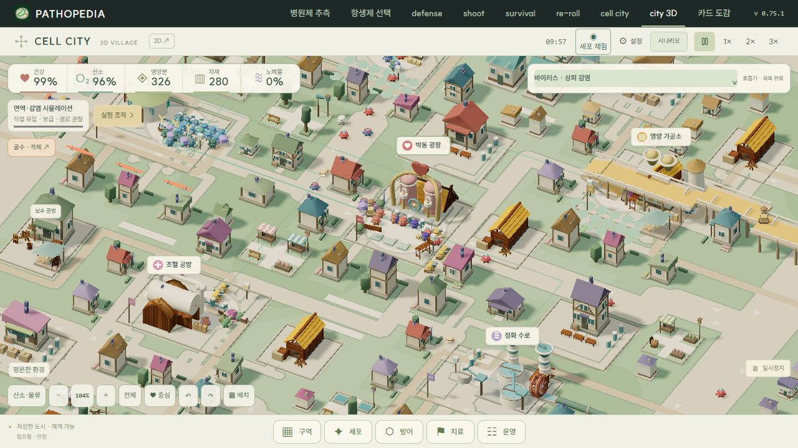

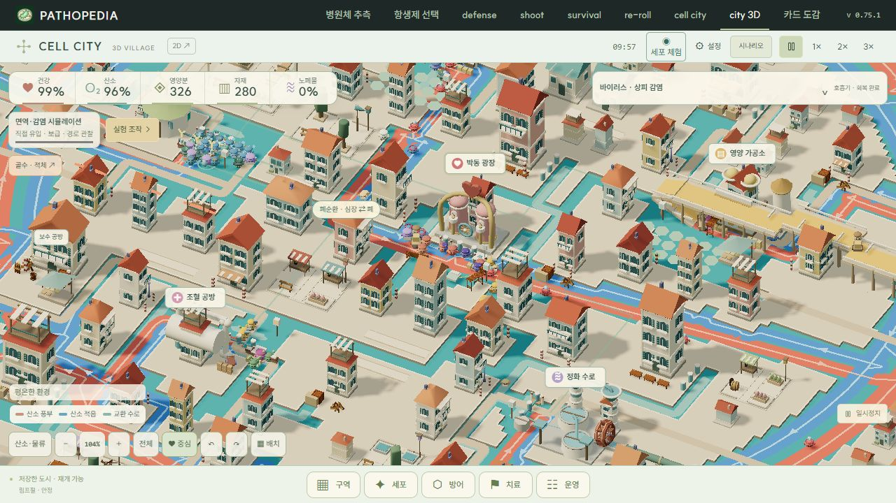

아래는 앞선 동네 배치 개선의 전체 보기 화면이다. 같은 저장 도시·09:57·같은 자원에서 촬영했다. 당시 테마·저장·운송·증축 회귀 11개와 에셋 참조·ON/OFF·손상 연동 검사 6개를 확인했다. 광장 중앙과 네 방향 출입 부분의 1인칭 보행 가능 여부도 검사한다.

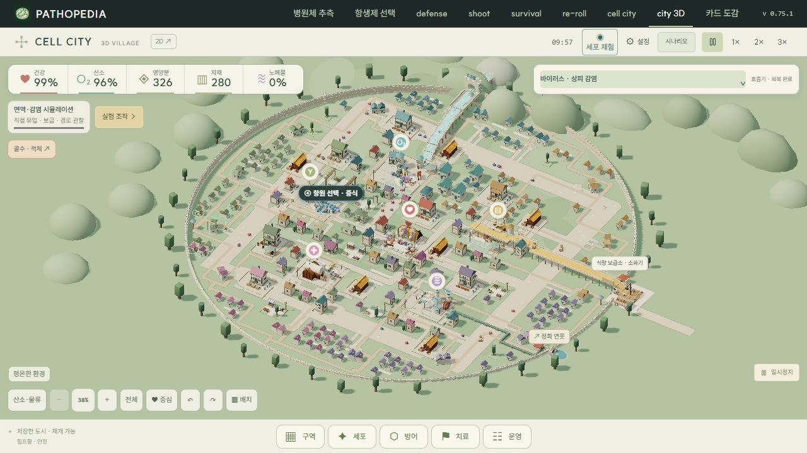

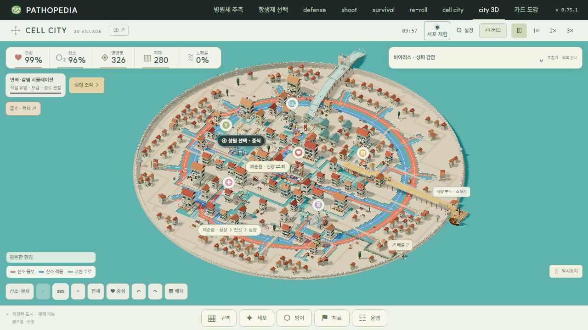

아래는 v0.68.0 공통 배치 호환 기능의 비교 기록이다. 같은 저장 도시·14:52·같은 자원과 카메라에서 촬영했다. [테마 호환 구현·검증 기록](cell-city-3d.md#같은-저장-배치의-두-테마-2026-10-23)에서 동작 조건을 확인할 수 있다.

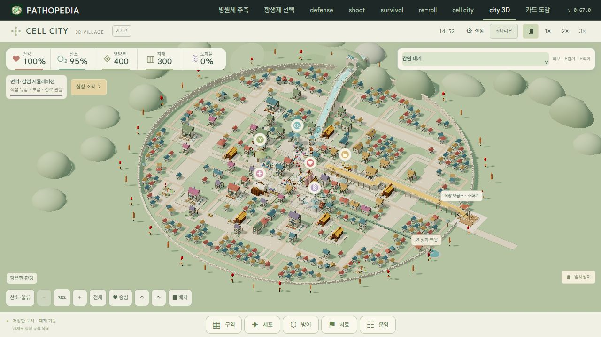

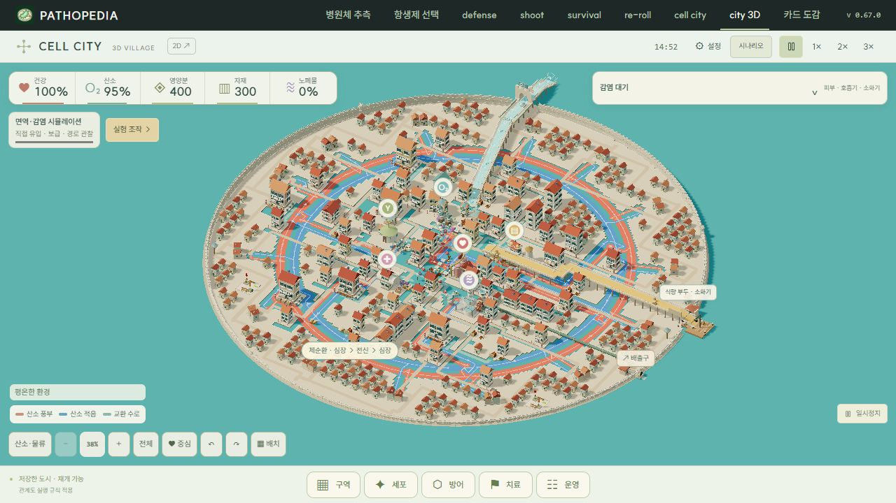

아래는 v0.67.0 당시 식량 부두와 신규 에셋 설정의 기록이다.

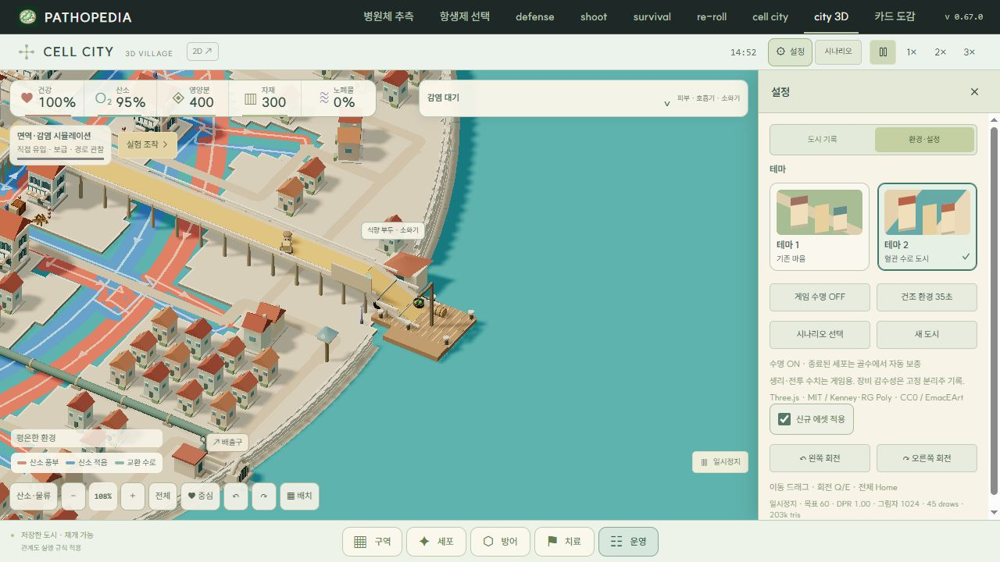

## 감염·면역 현장 표시 (v0.69.0)

기존 마을 주택·공방·복구 비계·잔해와 세포 모델을 재사용한다. 별도 이미지·GLB·원본 팩은 추가하지 않는다. `city-three-host-response.mjs`는 혈관과 구별되는 녹색 림프선, 항원 운반물, 정상·감염·재생 상피, 바이러스와 반응 고리를 Three.js 기하로 표시한다. 모델 파일의 수·용량 기준은 그대로다.

추가 렌더링 풀은 5개로 고정한다: 림프선 2,400, 반응 고리 420, 항원·표지 입자 900, 상피 100, 유리 바이러스 192 인스턴스. 사용량은 각 풀 상한을 넘지 않는다. 림프선은 주요 장기 경로 및 활성 피부 진입 구간만 표시하며, 패널과 별도의 현장 이름표는 데스크톱 4개·모바일 2개 이내다. 구르기·혈관 통과 동작은 기존 세포 풀의 변형을 사용한다. `tests/city-host-response.test.mjs`에서 풀 개수·상한·유한 좌표와 저장 복원을 확인한다.

## 세포 1인칭 체험 (v0.73.0)

테마 2의 수로와 테마 1의 격자 대로에서 기존 도시·세포·병원체 모델을 같은 크기로 재사용한다. 새 외부 모델·이미지·패키지를 추가하지 않아 에셋 파일 수와 용량 예산은 그대로다. `city-pilot-tools.mjs`는 기존 MIT Three.js의 공유 기하 4종으로 9개 휴대 도구를 만든다. 공용 손·소매 8개를 포함한 57개 메시를 한 번 만들고 현재 도구와 함께 최대 15개만 표시한다. 별도 원근 카메라와 그림자 없는 조명 2개로 도시 렌더링 뒤에 그려 수면·건물에 가려지지 않는다. 화면 비율에 맞춰 크기·위치를 조절하고 교체·걷기·사용에 반응한다. 퀵슬롯 아이콘은 Shoot처럼 코드 내 SVG를 사용한다. `city-first-person.mjs`의 목적지 고리 1개와 최대 100개의 인스턴스 경로 점은 유지한다. 시작 위치 선택은 기존 구역 선택 고리를 재사용하며 새 메시를 만들지 않는다. 카메라 안쪽에 겹치는 아군과 직접 조종하는 세포는 숨긴다.

`city-pilot-world.mjs`는 저장 건물 점유와 공통 주변 주택·조직·폐 시설 배치를 충돌에 사용한다. 통합 탐험가는 도구와 관계없이 수로·대로·조직 사이를 이동하며, 점프도 건물 충돌을 유지한다. 미니맵과 경로 표식은 같은 배치에서 계산한다. UI·조작과 검증 화면은 [세포 체험 구현 기록](cell-city-pilot.md)에 정리했다.

## 조준한 시설과 객체 작업 (v0.74.0)

기존 산소 주입구 6곳·하역 상자 6곳·림프절 작업대 1곳의 `workStation` 좌표를 재사용한다. `city-pilot-sites.mjs`는 실제 설비 위치와 건물 점유 밖의 작업 접근 지점을 분리하고, `city-pilot-interactions.mjs`는 조준 대상과 현재 가능한 도구를 연결한다. 시설 위치나 AI의 기존 작업 배치는 옮기지 않는다. 테마 1·2는 공통 배치를 사용한다.

`city-pilot-fixtures.mjs`는 1인칭에서만 작은 밸브·상자 뚜껑 부속을 표시한다. 기존 MIT Three.js 기하와 도시 색상을 사용하며 외부 모델·이미지 다운로드는 추가하지 않는다. **43개 모델·7개 이미지·4,864,667바이트**의 파일 예산은 그대로다.

- 고정 풀: 부속 메시 39개, 시설 아이콘 스프라이트 13개, 조준 테두리 1개, 진행 막대 1개, 완료 효과용 12개 인스턴스 풀 1개.
- 부속은 거리 22 이내, 아이콘은 거리 14 이내의 가까운 3개만 표시한다. 추가 드로 호출 상한은 45이며 실제 시야·거리에 따라 줄어든다.
- 아이콘은 128×80 캔버스 텍스처 3개를 공유한다. RGBA8·전체 밉맵 가정 약 0.16MiB이며 기존 모델·이미지 파일 용량과 별도다.
- 밸브 회전과 뚜껑 열림은 실제 작업 진행에 반응한다. 완료 효과는 자원 변경 성공 이후에만 발생한다. 별도 광원·그림자·물리 시뮬레이션은 추가하지 않는다.
- 기존 휴대 도구 57개 메시·최대 15개 표시 예산은 유지한다. 부속·아이콘의 공유 자원은 1인칭 컨트롤러 종료 시 정리한다.

## 제트팩·견인·충격 도구와 표면 충돌 (v0.75.0)

기존 모델과 Shoot의 휠·누름 입력·도구 피드백 방식을 재사용한다. 외부 GLB·이미지를 추가하지 않아 **43개 모델·7개 이미지·4,864,667바이트**의 에셋 파일 예산은 유지한다.

- 휴대 도구는 11개다. 공유 기하 4종을 유지하며 손·소매 8개 + 도구 64개 + 제트 노즐·분사 4개 = 총 76개 메시, 동시에 최대 20개를 그린다. 견인기·충격기·노즐은 코드 기하이며 아이콘은 SVG다.
- 견인 광선 1개·충격 고리 1개·12개 입자의 고정 인스턴스 풀 1개를 추가한다. 광선과 입자는 실제 견인 동작, 충격 고리는 에너지 소비 성공에만 표시한다. 새 텍스처·광원·외부 모델이 없다.
- city-pilot-physics.mjs는 배치 예약 구역 대신 정적 건물과 조직 메시의 실제 삼각형을 캡슐 충돌에 사용한다. 낮은 포장과 미세 부속은 제외하며 조직 붕괴 단계가 바뀌면 해당 표면을 갱신한다. 지붕·처마·경사면은 원본 모양을 유지한다. 작동 중인 펌프·세포·배송선은 충돌 장애물에 포함하지 않는다.
- 공식 [Three.js r180 Octree](https://github.com/mrdoob/three.js/blob/r180/examples/jsm/math/Octree.js)와 [Capsule](https://github.com/mrdoob/three.js/blob/r180/examples/jsm/math/Capsule.js)을 MIT 라이선스로 추가했다. 기존 Three.js r180과 같은 버전이며 src/vendor/three/LICENSE가 적용된다. 두 소스 합계 18,618바이트는 위 모델·이미지 예산과 별도다.
- 로컬 변경은 상대 import와 Octree 자식 노드의 분할 한도 상속이다. 최대 깊이 6·분할 기준 24개 삼각형으로 제한해 큰 도시에서 과도한 세분화를 막는다. 배치/테마별 충돌·길 안내 캐시를 갱신한다.

캡슐은 이동을 0.07 단위 이하로 나눠 돌진 중 벽 관통을 막고, 벽을 따라 미끄러지며 낮은 턱을 넘는다. 이 표면은 비행·착지·작업 시야 검사에도 공통으로 적용된다. 아군은 카메라 근처에서 점진적으로 작아져 조준을 가리지 않는다.

## 아이템 퀵슬롯 (v0.75.1)

`src/city-pilot-icons.mjs`의 자체 제작 32×32 SVG 11종으로 기존 단색 선 아이콘을 교체한다. 손에 든 장비의 형태·색을 재사용하며 정수 좌표와 단색 면으로 픽셀 실루엣을 그린다. PC 표시 크기는 44px, 모바일은 36px다. 정사각 슬롯·선택 테두리는 CSS로 그리며 새 비트맵·텍스처·GLB가 없어 모델 43개·이미지 7개·4,864,667바이트 예산과 휴대 도구 메시 예산을 유지한다.

참고 자료: [Minecraft 공식 조작 안내](https://www.minecraft.net/en-us/article/minecraft-controls)의 아이템 중심 퀵슬롯과 [Kenney Pixel UI Pack](https://kenney.nl/assets/pixel-ui-pack)(CC0)을 확인했다. 세포 장비 11종과 기존 손 모델의 일관성을 위해 아이콘은 프로젝트 코드로 제작했다. 외부 팩 이미지나 Minecraft 원본 텍스처를 포함하지 않는다.

## 항상성 외곽 구역 (v0.76.0)

도시 반지름을 44에서 58로 늘린다(면적 약 1.74배). 기존 중심 동맥·정맥 줄기의 반지름은 유지하며 외곽 9개 장기·조직에 공급·회수 가지를 연결한다. 장·비장 정맥은 간문맥으로 간에 들어간다. 기존 도시 배치는 보존하고 새 시설은 기존 건물·원형 장벽을 피해 배치한다.

- `city-homeostasis-data.mjs` / `city-three-homeostasis.mjs`: 시상하부·뇌하수체 회관, 갑상선·부갑상선 공방, 췌장 공방, 간·담낭 창고, 비장 작업장, 뼈 광물 공방, 부신 조절소, 근육 공방, 지방 저장고. 아래 조합표로 역할을 구분하며 같은 저장 위치와 낮은 안뜰을 사용한다.
- `city-homeostasis-assets.mjs`의 `HOME_BUILDINGS`에서 큰 본체를, `HOME_ASSET_KITS`에서 수입 본체와 소품을 배정한다. 기존 모델을 재사용해 **43개 모델·7개 이미지·4,864,667바이트**를 유지한다. 큰 코드 건물 5종은 번들 OFF에도 유지하며 다른 수입 본체가 없을 때는 같은 위치의 코드 민가로 대체한다.
- 고정 인스턴스 풀 7개: 석조 230, 지붕 40, 저장·작업 160, 전달 입자 160, 연결 선분 2,400, 반응 고리 72, 기체·땀 72. 수입 모델은 장기 부지 안에서 재질별로 병합한다. 현재 선택 묶음의 정적 메시 검사 예산은 29개 이하(석조·지붕 풀 포함)이며 동적 5개 풀은 별도다. v0.76.0 초기 표현의 ‘총 19회’ 수치는 새 소품 조합의 기준으로 사용하지 않는다. 새 광원·그림자 패스는 없다.
- 실제 저장량에 따른 창고 적재, 호르몬 도착, 효소·담즙 관, ADH 재흡수, CO₂ 배출, 발한, 운동 공방 모션을 표시한다. 신호 상태는 0.1초 간격으로 갱신하고 공유 풀을 재사용한다.
- 지도 라벨은 기본 PC 3개·좁은 화면 1개, 과정 선택 중 PC 6개·좁은 화면 3개로 제한한다. 기본 장기·반응 카드와 겹침을 피하고 `cc-homeostasis`·`cc-home-marker` 전용 CSS 범위를 쓴다.
- 건물 표면은 기존 Three.js 캡슐 충돌에 합쳐 1인칭에서 관통을 막는다. 외곽 경계·카메라 최대 축소 범위도 확대된 도시를 따른다.

기전·표현 범위와 출처는 [항상성 문서](cell-city-homeostasis.md)에 정리한다.

### 외곽 장기별 에셋 지정

`HOME_BUILDINGS`가 있는 장기는 코드 건물을 우선 사용한다. 나머지 본체는 `HOME_ORGANS[].model`, 수입 본체의 크기와 소품은 `HOME_ASSET_KITS`가 기준이다. 두 테마에서 같은 역할·부지를 사용하고 벽·지붕·바닥 팔레트를 주변 테마에 맞춘다. 아래 문장과 소품은 고정 장식이며 실제 저장량·호르몬·활동을 보여주는 기존 동적 표시를 대신하지 않는다.

| 장기·조직 | 본체 | 배정 소품과 마을 속 역할 |
| --- | --- | --- |
| 시상하부·뇌하수체 | 코드 `hall`, 폭 5.6·벽 높이 4.8 | 높은 중앙 탑·연보라 뇌 문장, `bench`, `table`, `jar`. 신호를 모으는 관제관 |
| 갑상선·부갑상선 | `workshop` 두 동 | `station`, `jar` 두 개. 한 쌍의 분비 공방과 공동 작업대 |
| 췌장 | `workshop` | `station`, `jar`, `tank`, `bucket`. 분비·가공 공방과 작은 저장 설비 |
| 간·담낭 | 코드 `warehouse`, 폭 4.35·벽 높이 4.5 | 갈색 간·초록 담낭 문장, `silo`, `crate`, `supply-barrel`. 넓은 영양 저장고 |
| 비장 | `workshop` | `cart`, `bucket`, `logs`. 회수물을 받는 재활용 작업장 |
| 뼈 | 코드 `guildhall`, 폭 5.6·벽 높이 4.1 | 중앙 동과 낮은 양 날개, `repair-scaffold`, `table`, `hammer`, `rubble-stone`. 광물 공방 |
| 부신 | `house-a` | `tank` 두 개, `bucket`. 물·염분 설비가 붙은 작은 조절소 |
| 근육 | 코드 `warehouse`, 폭 4·벽 높이 3.8 | `table`, `hammer`, `logs`, `repair-planks`. 활동 공방과 자재 야적 공간 |
| 지방 | 코드 `warehouse`, 폭 4·벽 높이 3.5 | `silo`, `hay-bale`, `supply-bags`. 에너지 보급 저장고 |

- 코드 본체는 위 치수를 사용하며 지붕·탑·문장을 포함한 실제 높이를 이름표와 산소 막대에 반영한다. 수입 본체는 최대 폭 3.55·높이 2.8, 쌍 공방은 각 폭·높이 2.35로 제한한다. 수입 모델은 회전 후 실제 경계를 측정해 기존 부지 안으로 추가 축소한다.
- 소품까지 기존 `homeFootprint` 안에 두고 앞쪽 혈관 교환 지점은 비운다. 저장 배치·장기 좌표·순환로·시뮬레이션 수치를 변경하지 않는다. 작업대 위의 병·망치는 높이를 따로 지정한다.
- 코드 도형은 색을 정점에 구워 공유 재질 하나로, 수입 모델은 UV·정점색·재질을 보존해 부지별로 병합한다. 장면 소유 기하·재질만 해제하고 캐시의 원본은 유지한다. NatureForge 건초의 정점색을 지우거나 공유 원본을 dispose하지 않는다.
- `tests/city-homeostasis-assets.test.mjs`는 실제 배포 GLB를 디코딩해 두 테마·ON/OFF의 부지 경계, 건물 충돌, 교환 지점 통행, 정적 메시 예산, 저장 불변성과 공유 자원 보존을 확인한다. 묶음 무결성·실제 벽·소품 재사용은 `tests/city-assets.test.mjs`에서 확인한다.
- 아래 화면은 v0.76.1 당시 기록이다. v0.87.0의 본체·높이 기준은 위 표와 아래 개편 기록을 따른다.

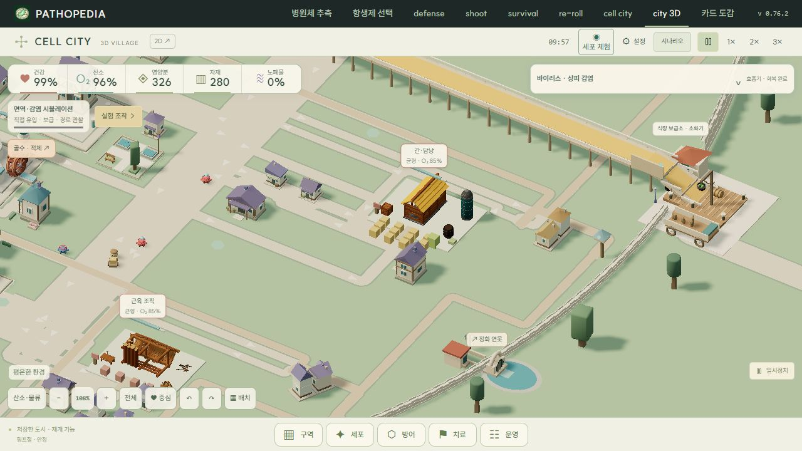

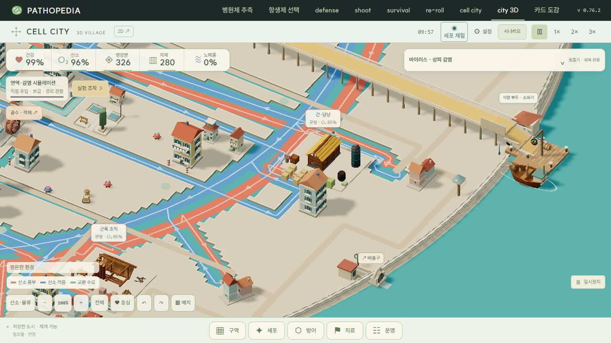

## 원형 체순환로 비례 조정 (v0.76.2)

`city-vascular-layout.mjs`의 원형 동맥 반지름을 31 → 41, 정맥을 28.6 → 38.6으로 확대한다. 심장 줄기·장기 가지·피부 가지의 연결점은 두 반지름의 중간값 39.8을 공통으로 사용한다. 기본 배치의 새 장기 9곳으로 가는 동맥 가지 평균 길이는 약 22.5 → 11.7로 줄어든다. 건물 주변에서만 경로를 우회하며 피부 장벽까지 조직 공간을 남긴다.

사각 대로는 기존 범위를 유지하고 폐순환은 심장–폐의 독립 경로를 사용한다. 기존 수로·혈관 리본과 분기 렌더러를 재사용하여 새 GLB·이미지·텍스처·드로 호출은 추가하지 않는다. 에셋 파일 수와 용량 예산은 그대로다.

검증: PC 1280×720, 모바일 세로 390×844·가로 844×390에서 원형 수로의 전체 보기와 도시 경계를 확인했다. 모바일 캔버스는 각각 390×704·844×250이며 가로 넘침과 브라우저 오류는 없었다. 순환·장기 공급·실제 식사 처리·건물 회피·적혈구 이동·테마 전환의 관련 기존 검사 7개를 통과했다.

## 수로·석축 윤곽 정리 (v0.78.3)

수로 테마의 대각선·곡선 경계에 보이던 계단 모양은 0.5칸 단위의 육지 테두리에서 발생했다. `city-canal-shore.mjs`가 격자 테두리를 닫힌 윤곽으로 연결하고 국소 평활화·직선 단순화를 적용한다. 건물 배치용 격자와 혈류 중심 경로는 유지하며, 저장 배치를 바꾸거나 새 배치 버전으로 변환하지 않는다. 평원 테마의 사각 대로와 공통 주택 위치도 그대로다.

- `city-three-shore.mjs`는 기존 MIT Three.js의 `ShapeUtils.triangulateShape`를 재사용한다. 새 GLB·이미지·패키지 없이 **43개 모델·7개 이미지·4,864,667바이트**의 에셋 파일 예산을 유지한다.
- 육지 윗면·수직 석축·밝은 가장자리 띠가 같은 윤곽을 공유한다. 섬 안의 물 구멍은 삼각형에서 제외하며, 모서리만 닿던 별도 섬은 이어 붙이지 않는다. 가장자리 띠는 꼭짓점을 함께 사용해 이음새가 벌어지지 않게 한다.
- 육지·물 판정도 같은 윤곽을 사용한다. 세포와 1인칭 체험의 물 경계가 화면과 일치하며, 지면 좌표 구간별 경계 목록을 캐시해 매번 도시 전체를 탐색하지 않는다. 윤곽은 배치 변경 시 다시 생성한다.
- 기본 배치의 석축 경계는 5,758개 선분에서 1,640개로, 지형 삼각형은 **25,678개 → 8,142개**로 감소한다. 이는 도시 전체가 아닌 육지 윗면·석축·가장자리 띠의 합계다. 기존 정적 병합에 넣으며 추가 재질·광원·프레임별 기하 생성은 없다.
- 관련 검사 8개 통과: 사선·직선 경계, 내부 물 구멍과 분리된 섬, 삼각형 면적·이음새, 혈류 경로, 증축 부지, 공동 골목, 저장 상태와 테마 전환, 공통 배치 보존. 전체 테스트·빌드는 반복하지 않았다.
- 저장 도시 09:57에서 PC 1280×720 및 모바일 세로 390×844·가로 844×390의 실제 렌더링을 확인했다. 새 외곽선을 따라 석축이 이어지며 가로 넘침과 브라우저 오류가 없었다.

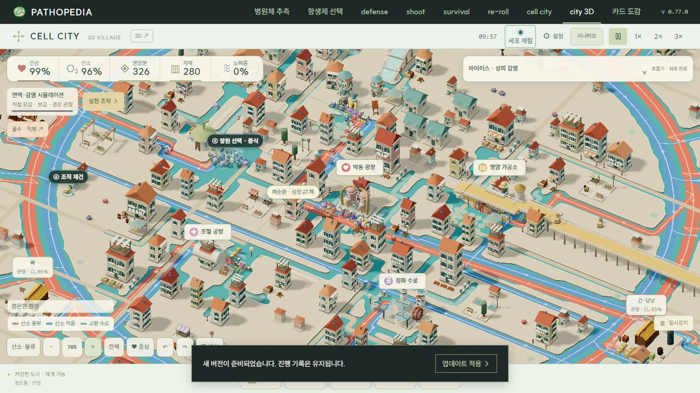

## 1인칭 현장 샌드박스 (v0.78.0)

기존 MIT Three.js r180의 Octree·Capsule 및 Shoot의 `createCombatAudio`를 재사용한다. 공개 에셋 후보인 [Kenney Impact Sounds](https://kenney.nl/assets/impact-sounds)(CC0)도 확인했으며, 현재 음향은 기존 합성기를 확장해 외부 음원 다운로드 없이 구현했다. 모델·이미지 파일은 기존 **43개·7개·4,864,667바이트**를 유지한다.

- `city-pilot-landmarks.mjs`: 주요 시설 6곳의 실제 지붕 높이를 광선으로 찾고 1.6×1.25 착지판·부착 가로대·표식을 배치한다. 기존 부지 안의 지붕만 사용하며 지상 도로·혈류·AI 작업 지점은 바꾸지 않는다. 최대 36개의 원본 메시·672개 삼각형을 기존 지역 배치에 병합한다. 장면 충돌에도 같은 삼각형을 사용한다.
- 휴대 도구는 11개를 유지한다. 첫 슬롯의 글러브를 총·발사광으로 교체해 전체 78개 메시, 동시 표시 최대 20개를 사용한다. 아이콘은 기존 32px 코드 SVG를 교체하며 기존 전용 CSS의 44px/36px 표시 크기를 유지한다.
- `city-pilot-effects.mjs`: 기존 견인·충격·입자 풀에 그래플 줄 1개와 사격 궤적 1개를 추가한다. 탄흔은 기존 12개 입자 풀을 재사용한다.
- `city-pilot-life.mjs`: 근거리 세포 표식 스프라이트 최대 8개, 현장·관찰 고리 최대 8개 인스턴스 1풀, 물자 입자 최대 32개 인스턴스 1풀이다. 최대 10개 추가 드로 호출이며 시야 밖은 깊이 검사로 가린다. 작업별 128×64 캔버스 텍스처는 최대 18개, 전체 밉맵 RGBA8 가정 약 0.75MiB다. 새 광원·그림자·GLB를 추가하지 않는다.
- 음향은 재사용 잡음 버퍼 1개와 가까운 시설 최대 2개의 루프, 기존 Shoot의 최대 12개 단발 음성을 사용한다. 종료 시 소스·필터·텍스처·기하를 해제한다. 관찰 이력은 세포당 최근 6건의 세션 상태로 제한하고 세포 수 상한은 늘리지 않는다.

기능·조작·동작 검증은 [세포 체험 기록](cell-city-pilot.md#v0780--현장-관찰협력전투입체-이동)에 정리한다. 두 도시 테마와 PC·모바일의 전용 HUD를 함께 사용한다.

## POV 이동·사격 효과 (v0.79.0)

기존 MIT Three.js의 Sphere·Cylinder·Torus 기하와 Shoot의 자동화기 합성 사격음을 재사용한다. 외부 모델·이미지·음원을 추가하지 않아 **43개 모델·7개 이미지·4,864,667바이트** 예산을 유지한다.

`city-pilot-effects.mjs`는 전체 사격 선을 16개 용량의 펄스·꼬리 인스턴스 풀 2개로 교체한다. 그래플은 원통 줄 1개와 움직이는 갈고리 1개로 표시한다. 기존 견인 선·충격 고리·12개 탄흔 입자 풀을 공유하며 효과 모듈의 최대 드로 호출은 7회다. 매 프레임 기하·재질을 생성하지 않고 종료 시 인스턴스·기하·재질을 모두 해제한다. 건물·지붕 부착물·도시 구조와 기존 도구 아이콘의 구성은 유지한다.

## 관리 화면·체세포 생활·분기 수로 개편 (v0.81.0)

기존 MIT Three.js 기하, Kenney 주택·지붕과 공통 색상을 재사용한다. 외부 모델·비트맵·패키지를 추가하지 않아 **43개 모델·7개 이미지·4,864,667바이트**의 런타임 파일 예산은 유지한다.

### 물길과 주택

- 테마 2에서는 평원용 고가 진입로 데크·난간·기둥을 생성하지 않는다. 입구의 병원체·운반물·바람·바이러스 높이도 수면 기준으로 맞춘다. 테마 1은 기존 진입로를 사용한다.
- `city-waterways.mjs`는 연속된 베지어 곡선을 먼저 검사하고, 막힌 곳에서는 건물 사이로 보이는 경로를 연결한 뒤 모서리를 둥글게 처리한다. 실제 혈류 경로에 적용하므로 수면·흐름 표시·적혈구·물자 이동이 같은 선을 쓴다. 동맥·정맥 방향, 폐순환·간문맥과 교환 지점 연결은 유지한다.
- `city-canal-layout.mjs`는 큰 혈관·분기·교환 수로와 실제 진입 경로에서 육지를 계산한다. 평원용 직선 도로망 전체를 물로 파던 방식을 제거한다. 저장된 건물 배치는 공통으로 사용한다. 오래된 혈류 이동 캐시는 `vascularRevision`으로 구분해 현재 위치와 화물을 유지하며 새 물길로 합류시킨다.
- 작은 주택 후보 범위를 ±39에서 ±49로 넓히고 간격을 5에서 4.8로 조정했다. 상한은 300채이며 실제 수는 수로와 저장 건물 배치에 따라 달라진다. 실제 건물, 양쪽 테마의 큰길, 부두·골목과 작업 부지를 피한다. 작은 광장은 필요하면 2.5×2.5까지 줄여 여섯 동네의 공용 공간을 확보한다. 기존 정적·인스턴스 병합을 사용한다.

### 체세포와 운반물

- `city-residents.mjs`는 15개 기관의 지역 주민과 기존 조직 주택 주변 주민을 같은 배치에서 정한다. 최대 **192개**, 기본 배치 **188개**다. 폐포·심근·장 상피·세뇨관·간·근육·지방 등 기관에 맞는 체세포 이름을 사용한다.
- 물과 실제 건물·주변 주택을 피해 짧은 왕복 동선을 잡는다. 산책, 공방 작업, 영양 섭취, 이웃과 휴식, 주변 정돈, 시설 점검을 시간·고정 변형 값으로 나눈다. 일시정지하면 생활 동작도 멈춘다.
- 실제 `injure` 이벤트를 가까운 체세포에 연결해 피격·건강 저하·사멸을 표시한다. 조직 건강·산소와 복구 인력에 따라 회복하며, 손상된 체세포는 세포 대시보드에서 영양을 써 재생할 수 있다. ID·건강·피격·재생 상태는 `somatic`에 저장하고 기존 저장에는 필요한 시점에 추가한다.
- `city-three-actors.mjs`의 기존 **16개 풀**을 재사용한다. 용량에 체세포 상한 192개를 포함하며 세포별 메시·재질·텍스처를 만들지 않는다. 별도 선택용 좌표 목록은 실제 보이는 세포·체세포·운반물·병원체를 담는다.
- ‘보급 운반원’ 사람 모델은 표시하지 않는다. 기존 배송의 적재·이동·하역 시계에 맞춰 영양은 입자 묶음, 약품·자재는 작은 운반물로 표시한다. 배송·투여·생산 수치는 기존 전달 로직을 따른다. 관계도와 관찰 이름도 ‘혈류 운반물’로 정리한다.

### 선택과 관리 화면

- `city-management-ui.mjs`·`city-management.css`는 3D의 `cc-management` 범위에 적용한다. PC 정보 패널과 모바일 관리 시트는 일정한 캔버스 위에 겹친다. 일반 세포·병원체·건물 선택과 배치 편집 진입에서 자동 이동·확대를 하지 않는다. 전체·중심과 명시적인 따라가기로 움직인다.
- 기관: 기본 6곳과 새 9곳의 건강·산소·작업·확장·복구 목록. 외곽 기관의 복구·확장은 `city-organ-work.mjs`의 작업을 섬유아세포가 현장에서 완료한다. 초소 추가 버튼은 표시하지 않는다.
- 세포: 전 종류의 현재 수·생산 대기와 생산 버튼, 종류별 전체 강조. 대식세포·형질세포 충원은 단핵구·B세포 생산과 기존 분화를 사용한다. 체세포 행에서는 손상 개체 재생을 요청한다.
- 방어: 피부·호흡기·소화기 상태와 강화 버튼을 한 화면에 표시하고 경고·실시간 면역 대응·항생제 보급을 이어서 표시한다. 자동 대응·자동 투약 선택과 하위 분류 탭은 표시하지 않는다.
- 감염: 실시간 병원체 현황과 종류·정수 개수·침투 위치·시작 버튼. 실제 모델의 입구 강조를 위치 목록과 연동한다. 강조 고리는 **17개 용량의 인스턴스 풀 1개**, 지도 버튼은 화면 안의 입구만 표시한다. 종료·취소·다른 메뉴에서는 감춘다. 병원체 모델과 현황 표에서 같은 관찰 정보를 열 수 있다.
- 운영: 전체 자원·건강·산소·세포 현황과 기존 항상성·기록·설정 하위 화면. 배치 편집은 설정에 둔다.
- 지도 도구는 전체·중심만 남기고 독립된 하단 일시정지 표시와 전역 면역 단계 창을 제거한다. 상단 일시정지는 정지 중 재생 아이콘이 되며 누르면 1배속으로 재개한다.

### 검증 기록

- 신규 회귀 검사 6개 통과: 15개 기관·전체 세포·장벽 대시보드, 정수 개수 침투, 체세포의 건조한 이동 동선·피격·재생·저장, 실제 섬유아세포의 기관 작업, 병원체 관찰, 이전 저장 경로의 새 수로 합류.
- 관련 기존 검사 통과: 병원체 경로·생물학, 선택 관찰, 해안선, 두 테마의 건물·광장·혈류 연결과 저장, 테마 반복 전환, 렌더링 인스턴스 풀. 전체 빌드와 전체 테스트 반복은 하지 않았다.
- 브라우저에서 PC 1280×720, 모바일 세로 390×844·가로 844×390과 평원·수로 테마를 확인했다. 가로 넘침은 없었으며 모바일 세로 기관 카드 폭은 165px, 확장·복구 버튼은 71.5×44px였다. 기존 모바일 `.cc-detail` 그리드가 카드 폭을 절반으로 줄이던 충돌은 관리 화면 범위에서 해결했다.
- 실제 체세포를 선택하기 전후 캔버스는 1280×576, 심장 표시 위치는 x=624.086·y=219로 동일했다. 배치 편집 진입·취소 전후에도 같은 위치를 유지했다. 주택 정보, 병원체 표에서 현재 HP 관찰, 침투 개수 7 입력·유입, 실제 입구 클릭과 목록 연동, 정지 후 1배속 재개를 확인했다. 확인 중 브라우저 콘솔 오류는 없었다.

## 수로 분기와 평원 순찰로 분리 (v0.81.2)

- `city-three-canals.mjs`에서 별도로 그리던 `canals.patrol`은 평원 테마에서만 표시한다. 수로 테마의 도시 횡단 직선·공중 다리처럼 보이던 선을 제거하며, 피부 순찰·복구의 시뮬레이션 경로와 평원 도로는 보존한다.
- 원형 혈관의 분기 위치를 동네별로 묶고, 안쪽·바깥쪽 조직이 각 분기 구간을 공유한다. 동맥 출발과 정맥 합류는 큰 줄기의 접선 방향을 따르며, 건물에 막힌 합류부는 인접 지점을 탐색한다. 기본 배치의 동맥 분기 27곳에서 접선 정렬을 확인한다.
- `city-waterways.mjs`는 베지어 곡선, 시야가 열리는 건물 사이 연결, 충돌을 확인한 모서리 곡선을 사용한다. 비장→간 문맥은 남쪽 작업 동네를 돌아 장의 문맥과 같은 합류 구간을 이용한다. 렌더링만 굽히지 않고 실제 운송 경로와 토지·수면 경계를 같이 생성한다.
- 곡선은 최대 0.025m 오차와 건물 충돌 검사를 거쳐 불필요한 점을 줄인다. 긴 경로의 저장 상한 때문에 목적지가 잘리지 않도록 하며, `VASCULAR_REVISION=3`으로 기존 이동 캐시를 재연결한다. 저장된 건물·현재 위치·화물은 유지한다.
- 기존 Three.js 도형과 묶음 모델을 재사용하며 런타임 다운로드 예산은 동일하다. 분기 방향·건물 회피·수면·전체 기관 간 경로·산소 배송·저장 복원과 두 테마 전환을 검사했다. 브라우저에서 평원 도로 보존과 수로 테마의 직선 순찰로 제거를 확인했다. 검증 이미지는 저장소에 추가하지 않는다.

## 분기 수로 폭과 침입자 비례 (v0.81.5)

큰 원형 수로는 폭 1.65/1.5를 유지하고, 테마 2의 가지와 합류부만 좁힌다. 평원 테마의 사각 대로·가지 폭은 기존 값을 사용한다.

| 수로 역할 | 이전 폭 → 현재 폭 |
| --- | --- |
| 심장과 큰 줄기 연결 | 1.2 → 0.66 |
| 기관 분기 | 0.95 → 0.46 |
| 간문맥 | 0.8 → 0.4 |
| 폐순환 | 1.25 → 0.62 |
| 피부 동맥 / 정맥 | 0.65/0.58 → 0.3/0.28 |
| 기관 교환 수로 | 0.62 → 0.38 |
| 외부 진입 수로 | 2.1 → 1.5 |

- 분기의 두 이동선 간격을 1.36에서 0.52(심장 연결 0.72, 폐순환 0.64)로 줄인다. 원형 줄기의 두 합류점 간격은 10°에서 5°로 좁히고, 동네 쪽 합류 범위도 줄인다. 큰 줄기 접선 연결·건물 회피·동맥/정맥 방향·폐순환과 문맥 연결은 유지한다.
- `city-canal-layout.mjs`는 가지의 수면 격자 여유 폭을 줄이되 대각선에서 물이 끊기지 않도록 최소 범위를 둔다. 실제 석축·육지 경계도 함께 좁아지며 흰 강조선·흐름 화살표도 수로 폭을 따른다. 기본 배치의 기관 가지를 세 지점씩 측정한 실제 수면 폭 중앙값은 3.25 → 1.55로 약 52% 감소했다.
- `VASCULAR_REVISION=4`는 이전 저장의 이동 경로만 현재 수로에 다시 합류시킨다. 저장된 건물 위치·세포 ID·화물·의학적 연결 관계를 유지한다.
- `CITY_STYLE.pathogenScale`은 외부 침입자 높이 3배·폭 2배의 공통 표시 기준이다. `city-three-actors.mjs`의 세균·기생충과 `city-three-host-response.mjs`의 바이러스에 적용한다. 기존 Three.js의 구·정이십면체·원뿔과 인스턴스 풀을 재사용한다. 세균의 눈·가시·공격 자세·항체와 보체 표지, 체력 막대도 새 비례에 맞춘다. 감염된 체세포와 주민 크기는 유지한다.
- 병원체 선택 위치는 커진 몸통 중심을 사용하고, 선택 고리는 지면·선택 표식은 머리 위에 둔다. 시뮬레이션 좌표·HP·공격 수치·이동·전투 판정은 변경하지 않는다. 기존 16개 세포 풀과 5개 숙주 반응 풀을 유지해 새 메시 풀·광원·그림자 패스·텍스처는 추가하지 않는다.
- 외부 파일을 추가하지 않아 **43개 모델·7개 이미지·4,864,667바이트**의 에셋 예산을 유지한다. 수면 연결·실제 폭과 침입자 비례·선택 위치·저장 불변성은 집중 검사로 확인하며, 검증 이미지는 저장소에 추가하지 않는다.
- 집중 검사 6개 통과: 전체 수로 중심선의 수면 연결, 실제 가지 폭, 병원체 방향·비례·선택 표식·풀 상한·저장 불변성, 숙주 반응 저장과 풀, 보간 좌표. 브라우저에서 두 테마의 같은 외벽 장면과 커진 MRSA 몸체 클릭 후 정보 표시를 확인했다. 선택 전후 시점은 유지됐다.

## 1인칭 침입자 크기 확대 (v0.81.6)

`CITY_STYLE.pathogenScale`을 높이 3 → 6, 폭 2 → 4로 바꿔 v0.81.5보다 각 방향으로 2배 확대한다. 세균·바이러스·기생충의 기존 몸체와 눈·가시·공격 자세, 체력·항체·보체 표시, 선택 위치가 같은 공통 비례를 따른다. 1인칭 눈높이 0.58에 비해 세균의 가시 끝은 약 5.7 높이로 보인다. 주민·감염된 체세포·카메라 시야각과 실제 이동·전투 수치는 유지한다.

기존 Three.js 도형과 16개 세포·5개 숙주 반응 인스턴스 풀을 재사용한다. 모델·이미지·텍스처·광원·드로 호출을 추가하지 않으며 **43개 모델·7개 이미지·4,864,667바이트**의 파일 예산은 동일하다. 선택 고리는 지면을 유지하고 머리 위 표식은 커진 높이를 따른다.

검증: 기존 방향·몸체 비례·선택 위치·풀 상한·저장 불변성 검사 2개 통과. 수로 테마의 외벽 안쪽에서 1인칭 0.0m 시점으로 시작해, 성벽 위 병원체를 올려다보는 실제 렌더링을 확인했다. 검증 이미지는 저장소에 추가하지 않는다.

## 기관지·식도와 혈관 경로 (v0.84.0)

- 두 테마에 같은 유입 좌표를 쓰는 전용 관을 배치한다. 기관지는 아이보리 벽과 녹회색 아치를 통해 공기 입자와 섬모를 보여준다. 식도는 식량 부두에서 소화기까지 이어지는 적갈색 투입 관으로, 위쪽을 열어 운반물을 볼 수 있다. 수로 테마에서는 두 경로의 바닥을 육지로 계산하고 혈관을 건너는 곳에서 관을 최대 1.65m 높이로 올린다.
- `city-entry-tracks.mjs`에서 바닥 높이와 중심 경로를 계산한다. 공기 입자, 음식 원료, 유입 중인 세균과 바이러스가 같은 높이를 따라가며 부두 하역과 폐 장벽 반응은 기존 상태와 연결된다. 식도의 마지막 하역 구간이 겹치는 부분은 관을 한 번만 그린다.
- `city-vascular-layout.mjs`에서 장애물 검사 기준을 가지 생성·간격 조정·단순화에 함께 적용한다. 격자 우회는 필요한 구간을 한 번에 연결하고, 장애물이 없는 짧은 되돌림은 잘라낸다. 작업장으로 가는 교환 가지는 건물을 피하면서 교환 지점과 직접 잇는다. 기본 배치에서 1.25m 미만 선분에 붙은 55° 이상 굽이가 혈관 64 → 10곳, 교환 가지 59 → 0곳으로 줄었다.
- `VASCULAR_REVISION=5`는 저장한 혈류 운송 위치와 화물을 이어받아 새 길에 합류시킨다. 주택 후보는 짧은 원형 제방 구간까지 보고 관과 혈관에 필요한 여유를 남긴다.
- 관의 단면·아치는 기존 MIT Three.js 기본 도형과 정적 배치 병합을 사용한다. 새 모델·이미지 없이 **43개 모델·7개 이미지·4,864,667바이트**의 에셋 예산을 유지한다.

## 1인칭 만능 복구 도구와 슬롯 축소 (v0.82.0)

- 1·2·3·4·0의 5개 도구만 유지한다. 4번은 기존 렌치 메시·SVG를 재사용하는 만능 복구 도구다. 삭제한 6개 도구 모델과 충격파 고리의 기하·재질을 제거한다.
- 휴대 도구 전체 메시 **78→44개**, 손·소매·현재 도구·제트팩의 동시 표시 상한은 **20개**다. 반복 효과는 기존 풀을 유지하며 드로 호출 상한은 **7→6**이다. V 돌진의 시야각·휴대 자세·HUD·터치 버튼도 제거한다.
- 모델·이미지·텍스처·패키지를 추가하지 않아 **43개 모델·7개 이미지·4,864,667바이트**의 파일 예산은 유지한다. 새 전역 CSS 규칙 없이 기존 1인칭 전용 선택자에서 고도 표시와 터치 버튼 3행을 정리한다.

## POV 사격·세포 반응 (v0.85.0)

- 기존 MIT Three.js와 `play-audio.mjs`의 자동화기·산탄 합성음을 재사용한다. 충전탄은 기존 총·총구·펄스의 크기, 반동과 발광을 조절한다. 새 GLB·이미지·음원 없이 **43개 모델·7개 이미지·4,864,667바이트** 예산을 유지한다.
- `city-pilot-effects.mjs`에 처치 파편 96개·충전 충격 고리 8개의 고정 인스턴스 풀을 추가한다. 기존 펄스·꼬리는 각 16개이며 효과 모듈의 최대 드로 호출은 6→8회다. 생성한 기하·재질·인스턴스는 종료 시 해제한다.
- 인사·영양 섭취·복구 반응은 기존 세포 몸체·손·물자 풀로 표현한다. 근거리 이름표 8개·고리 8개·물자 입자 32개의 기존 예산 안에서 동행 표시와 전달 연출을 공유한다. 휴대 도구 44개 메시·최대 20개 표시 예산과 도시 구조는 그대로다.
- 새 버튼과 충전 조준점은 `.cc-pilot` 범위로 적용한다. 모바일 가로 화면에서 인사·동행 버튼이 나타날 때만 도구 이름을 숨겨 퀵슬롯과 겹치지 않게 한다.

## 병원체 접근 행렬과 장벽 타격 (v0.86.0)

- 피부·기관지·식도 입구 바깥 24m에서 병원체가 6.2m 간격의 한 줄로 출발한다. 세균·바이러스가 같은 입구의 대기열을 공유하며 초당 1.6m로 전진한다. 앞 병원체가 장벽을 상대하는 동안 뒤쪽은 간격을 유지한다.
- 걷기·몸을 뒤로 빼기·들이받기·반동을 기존 MIT Three.js 구체·원뿔·상자 인스턴스로 표현한다. 1.4초 공격 주기의 접촉 순간에만 고리와 파편 6개를 표시한다. 호흡기·소화기는 입구의 방어막 타격 후 기존 점액·위산·정착 처리로 이어지며, 정상 피부의 차단과 복구 기능도 유지한다.
- 접근 중인 입구에 폭 4.5m, 길이 128m의 외곽 접근로를 표시한다. 초원에서는 흙길, 수로에서는 판재 이음선이 있는 낮은 다리로 보인다. 기존 `box` 풀을 재사용하며 개체마다 별도 도로나 메시를 만들지 않는다. 장벽 공격 경보는 기존 버튼을 재사용한다.
- 세균의 손·발 풀은 각각 `(기존 수송·주민 용량 + 최대 세균 수) × 2`, 바이러스 장식·발·파편 풀은 900→1,400개다. 기존 액터 **16개**, 숙주 반응 **5개** 인스턴스 배치는 유지한다. 새 모델·이미지·CSS·패키지 없이 **43개 모델·7개 이미지·4,864,667바이트**의 파일 예산을 유지한다.
- 기존 저장은 그대로 읽으며 신규 접근 단계만 저장·검증한다. 임의의 대량 투여 수에서도 저장이 복구되도록 방출 묶음을 정수로 고정한다. 경로별 간격·속도·공격 주기·재차단·저장 복원·PC/모바일 렌더 풀 검사를 포함한 관련 검사 28개가 통과했다. 실제 PC 브라우저에서 세 경로의 투여와 한 줄 접근을 확인했다. 검증 이미지는 파일로 저장하지 않는다.

## 완만한 혈관 우회와 수변 배치 (v0.86.3)

- `city-vascular-layout.mjs`는 우회 구간에서 건물과 최대 1.2m의 여유를 먼저 확보한다. 좁은 저장 배치에서는 건물 가까이 지나는 경로에 비용을 더해 넓은 통로를 우선하며, 목적지 출입구에서는 여유를 점진적으로 줄인다.
- `city-waterways.mjs`는 최대 4m 길이의 모서리 완화와 경로 전체의 이웃 지점 보정을 결합한다. 보정마다 충돌을 검사하며, 원형 큰 혈관의 접합점도 보정된 고리에 다시 연결한다. 화면의 수로와 실제 혈류 이동은 같은 선을 사용한다.
- 기본 배치의 1.25m 미만 선분에 붙은 55° 이상 급회전은 10 → 0곳이다. 좁은 사용자 배치에서는 건물 회피와 도착 가능성을 우선하므로 모든 굽이에 동일한 반경을 강제하지 않는다. `VASCULAR_REVISION=6`으로 저장 화물·위치를 이어받는다.
- `city-canal-blocks.mjs`는 짧은 곡선 선분 수와 무관하게 제방 길이로 주택 후보를 배치한다. 산책로는 실제 육지와 빈 부지의 폭에 맞춰 길이·간격을 조절한다.
- 기존 Three.js·주택·소품을 재사용한다. 새 모델·이미지·외부 의존성 없이 **43개 모델·7개 이미지·4,864,667바이트**의 예산을 유지한다.

## 피부 장벽의 실제 타격·붕괴 (v0.86.4)

- 피부 침범 가능한 세균은 1.4초 공격 주기의 접촉 순간에 기존 병원체별 조직 파괴력을 벽 체력에 적용한다. 입구 24m 안의 후속 세균은 최대 3마리까지 압박을 보태며, 멀리 대기하는 대량 투여분은 즉시 피해를 늘리지 않는다. 유리 바이러스는 정상 피부를 파괴하지 않고 상처를 통해 들어간다.
- 벽 체력 0에서 붕괴하고, 응급 봉합으로 체력이 조금 회복되어도 25에 도달하기 전까지 틈이 유지된다. 봉합 후에는 다시 파괴해야 통과한다. 기존 섬유아세포·혈소판·복구 도구의 수리 과정과 연결하며 피부 안쪽 조직부터 공격한다.
- 상세 벽 모델과 기본 도형 벽이 같은 붕괴 상태를 사용한다. 피격 섬광·균열·체력 막대·짧게 흩어지는 잔해는 기존 MIT Three.js `box` 풀을 재사용한다. 체력 막대는 커진 병원체보다 높게 띄우고 카메라 방향을 향해 가려짐을 줄인다. 전선의 고정 인스턴스 배치 7개를 유지하며 새 모델·이미지·CSS·외부 의존성 없이 **43개 모델·7개 이미지·4,864,667바이트**의 파일 예산을 유지한다.
- 접촉 횟수·피격 시각·붕괴 상태를 저장·검증해 불러온 직후 중복 타격을 방지한다. 이전 저장에서 장벽 앞에 멈춘 개체는 현재 위치에서 공격을 이어 간다.
- 타격 동기화·병원체 차이·대량 투여 상한·방어세포가 있는 도시의 자연 붕괴와 조직 침입·저장 복원을 포함한 관련 검사 25개를 통과했다. 로컬 전체 빌드는 반복하지 않는다.
- 실제 PC 브라우저에서 세균의 장벽 붕괴·안쪽 침입·복구 작업과 평원·수로 테마를 확인했다. 모바일 390×844·844×390에서도 경보가 화면 안에 표시된다. 세로 화면 경보는 369×44px, 계산된 글자색은 `rgb(135, 63, 40)`이며 기존 전용 스타일을 재사용한다. 검증 이미지는 파일로 저장하지 않는다.
