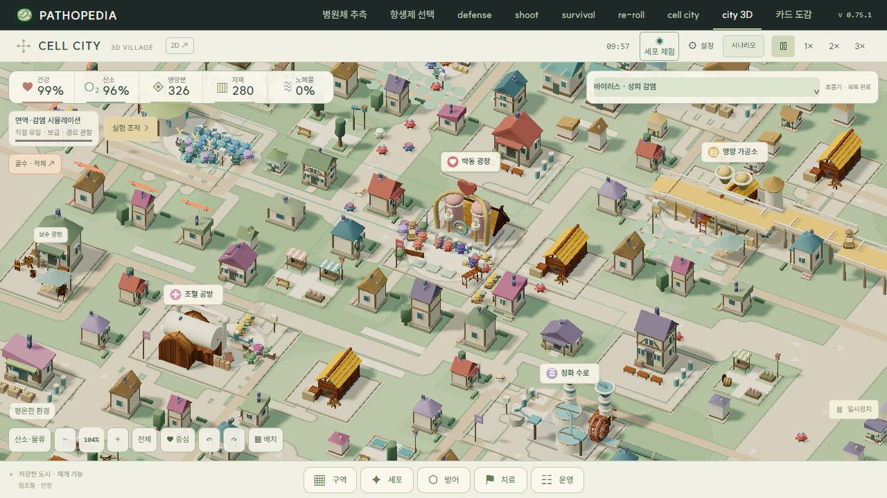
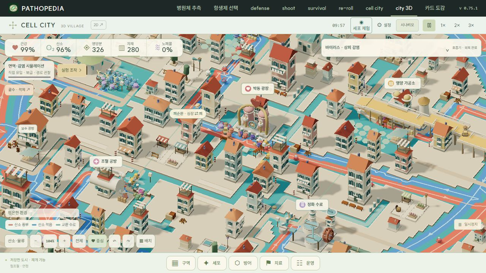
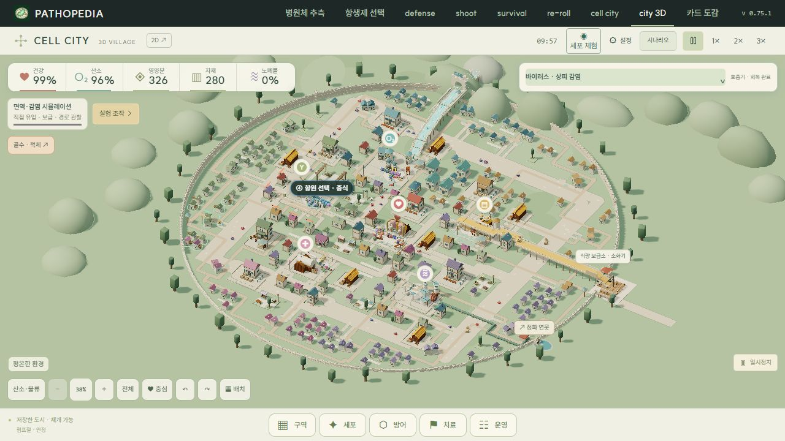
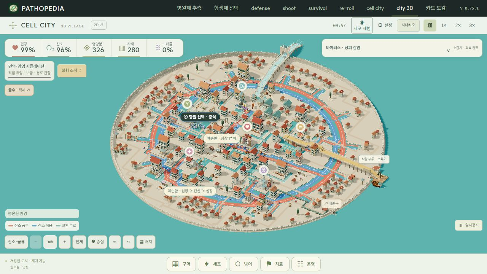
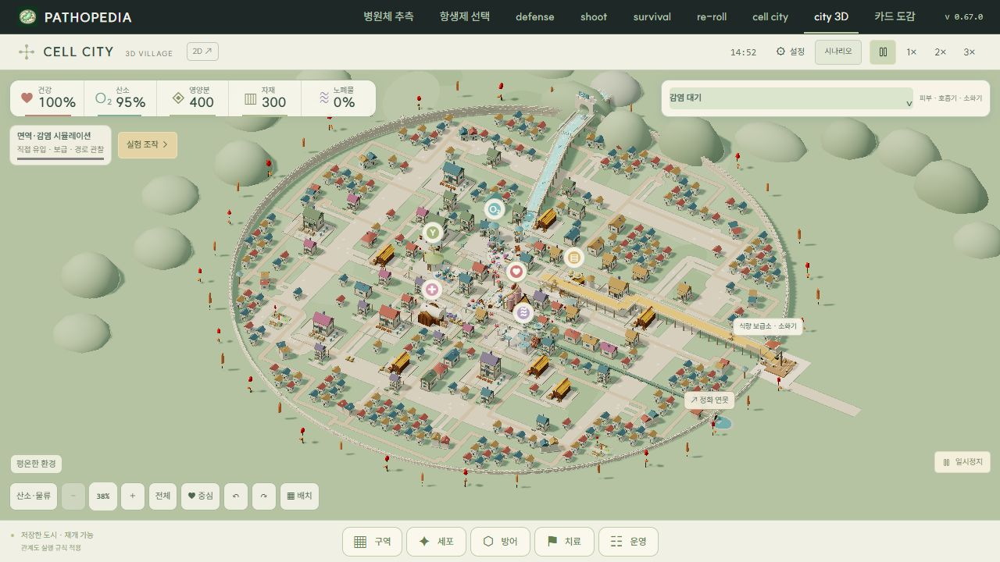
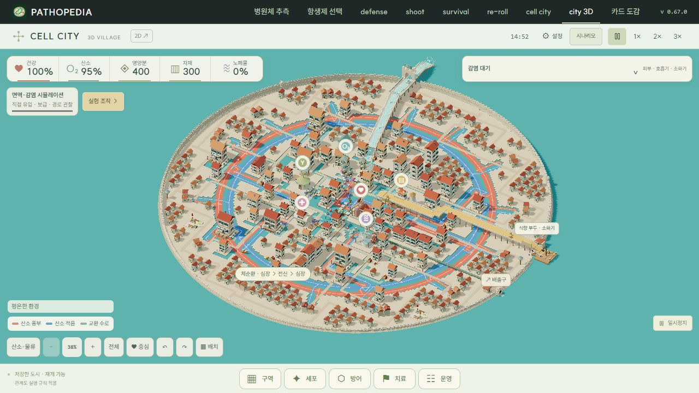
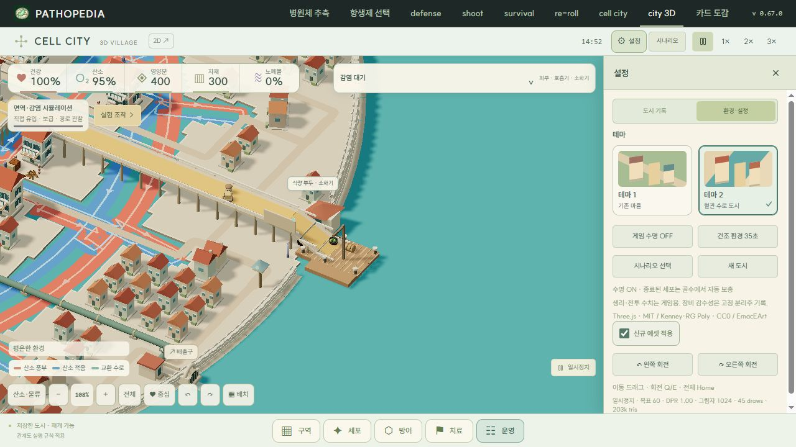
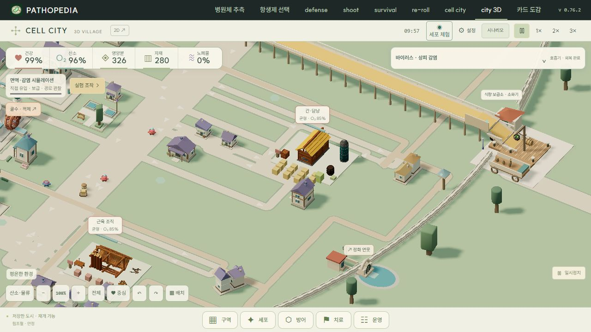
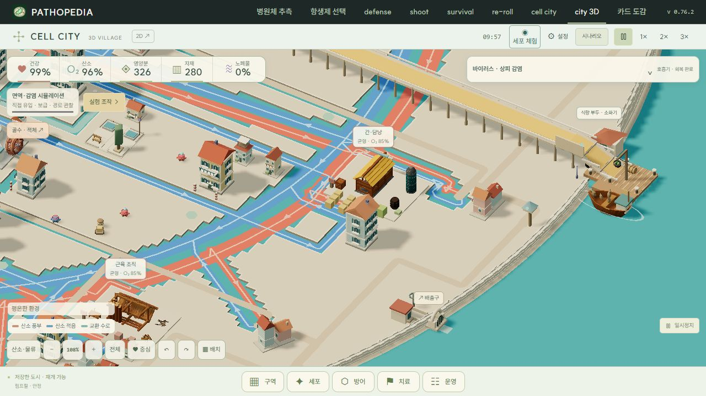

# Cell City 에셋 활용 가이드

구현 기준: v0.77.0 · 문서 갱신: 2026년 10월 24일.

도시 구조·외관·에셋을 변경할 때 먼저 읽는 작업 문서다. 보유 원본에서 무엇을 고르고, 어느 코드에 연결하며, 어떤 외관·용량·시뮬레이션 조건을 지켜야 하는지 기록한다. 개별 모델의 정확한 경로·바이트·체크섬·라이선스는 [`sources.json`](../assets/city3d/bundle/sources.json), 실제 표시 조건은 아래 연결 코드가 기준이다. 구현과 문서가 달라지면 함께 갱신한다.

## 작업 시작 순서

1. 아래 작업별 표에서 현재 쓸 수 있는 모델과 수정할 파일을 찾는다. 이미 추출된 모델을 먼저 재사용하고, 부족하면 보유 팩에서 후보를 고른다.
2. 테마 2의 저장 배치와 공통 주변 객체를 기준으로 테마 1·2의 대응을 정한다. 신규 에셋 ON·OFF도 확인하며, 공통 좌표와 테마별 경로 형태·외형을 구분한다.
3. 모델의 재질·이미지 참조·크기·삼각형 수와 반복 배치 개수를 확인한다. ZIP 용량으로 웹 다운로드나 GPU 메모리를 판단하지 않는다.
4. 기존 토지 경계와 실제 입항·손상·복구 상태에 연결하고, 아래 용량·병합·인스턴스 기준을 지킨다.
5. 필요한 범위만 확인하고, 선택 목록·출처·적용 위치·예산 변경을 이 문서에 반영한다. 배포하는 작업이면 AGENTS.md의 버전·GitHub 배포 확인 규칙도 따른다.

## 현재 화면과 유지할 동작

| 항목 | 현재 동작 / 변경 시 지킬 점 |
| --- | --- |
| 테마 1 | 설정 → 도시 테마 → ‘평원 마을 · 격자 대로’. 새 환경의 기본 선택. 테마 2와 같은 건물·주변 객체 위치에 낮은 회벽 주택, 잔디 마당과 정사각형 대로를 표시한다. |
| 테마 2 | 설정 → 도시 테마 → ‘수로 마을 · 원형 혈관’. 같은 배치에 베네치아풍 주택·돌 광장·부두와 원형 동맥·정맥 수로를 표시한다. |
| 테마 전환 | 현재 테마 2의 저장 배치와 주변 객체의 공통 위치를 사용한다. 진행 시간·자원·감염·세포 ID·화물을 초기화하지 않는다. 적혈구와 내부 운송원은 현재 위치에서 선택한 테마의 길로 합류한다. |
| 신규 에셋 적용 | 설정의 체크박스. 새 환경은 기본 ON, 사용자가 저장한 OFF는 유지한다. 테마 선택과 별개이며 기존 24종과 추가 19종을 포함한 선택 묶음 전체에 적용된다. |
| 로딩과 캐시 | ON이면 manifest의 모델 전체를 3개씩 병렬 로드한다. 최초 OFF에서는 요청을 시작하지 않는다. 로딩 중 OFF로 바꿔도 늦게 도착한 결과를 화면에 적용하지 않는다. 이미 받은 묶음은 재체크용으로 캐시하므로 OFF가 즉시 메모리 해제를 뜻하지는 않는다. |
| 기본 도형 | OFF 또는 모델을 쓸 수 없는 경우의 기존 표현을 유지한다. 체크 전환은 도시 저장·시뮬레이션을 바꾸지 않는다. |

체크 OFF/ON 비교는 ‘선택 묶음 전체 미적용/적용’ 비교다. v0.66.1과 v0.67.0의 차이만 보여주는 비교로 표기하지 않는다. 새로 추가한 19종은 도시 전체 실루엣 교체보다 항구·보급·정원·조직 복구의 세부 표현을 보강한다.

## 공통 배치와 테마별 객체 대응

`city-theme-layout.mjs`의 `compileThemeLayout`이 두 테마의 공통 진입점이다. `compileCanalLayout`에서 기존 수로 도시의 주변 주택, 마당, 조직 주택, 폐 작업 구역, 입구와 신장 배출구 위치를 가져온다. 두 테마는 같은 `blocks`, `entries`, `outlet`을 참조한다. 테마별로 새 도시나 별도 저장 배치를 만들지 않는다.

| 역할 키 | 테마 1: 평원 | 테마 2: 수로 | 에셋·연결 위치 |
| --- | --- | --- | --- |
| `frontage` | `cottage`: 낮은 회벽 주택, 여러 지붕색 | `canal-house`: 창 덧문·발코니가 있는 수변 연립 주택 | 기존 Kenney 지붕·굴뚝과 기본 도형. `city-three-canals.mjs`, `city-three-village.mjs` |
| `courtyard` | `village-green`: 잔디 마당과 십자 보행로 | `stone-court`: 돌 광장과 수변 화단 | 같은 정원 부지에 `tree-round`, `tree-cube`, `garden-bench`, `garden-shrub` 등 재사용 |
| `tissue` | `meadow-cottage`: 평원 색상의 낮은 주택 | `lagoon-townhouse`: 수로 도시 색상의 주택 | 같은 조직·폐 작업 부지에 기존 인스턴스 풀 사용. HP·화재·잔해·비계는 실제 상태와 연결. `city-three-tissue.mjs` |
| `landing` | `supply-yard`: 보급 마당과 하역 설비 | `quay`: 부두와 하역 설비 | 같은 소화기 입구에 `harbour-crane`, 자루·바구니·통·건초 재사용. `city-three-ports.mjs` |
| `freight` | `supply-wagon`: 코드 도형으로 만든 화물 마차 | `harbour-boat`: 배와 `harbour-anchor` | 같은 원료 배송의 입고·하역·출고 시계 사용. 적재물 `supply-bags` 공유 |
| `bankPlant` | `garden-flower`: 꽃·정원 식재 | `canal-reed`: 갈대·수변 식재 | 공통 정원의 같은 가장자리. 기존 GLB 재사용 |
| `drainage` | `filter-pond`: 배관과 정화 연못 | `lagoon-culvert`: 배관과 석조 배출구 | 같은 신장 배출 경로·성벽 밖 출구에 기본 도형 사용. 실제 노폐물 처리 상태와 연결 |

대응 이름은 `city-theme.mjs`의 `CITY_THEME_OBJECTS`와 `cityThemeObject`에 정의한다. 표의 `cottage`·`supply-wagon` 같은 이름은 장면 생성 방식이며 새 GLB 파일명이 아니다. 기능성 장기·창고·생산·보수 시설은 같은 ID·역할·저장 좌표를 유지한다.

테마 1의 큰길은 `compileVascularLayout(layout, 'square', obstacles)`에서 직각 위주로 계산한다. 공통 주변 건물과 조직 주택까지 장애물로 취급해 관통을 피한다. 테마 2는 기존 원형 수로망을 사용한다. 각 네트워크의 일방향 순환, 장기·작업 지점과 전달 관계는 유지하며 별도 입구 데크를 혈관에 연결하지 않는다. 배치 편집 후에는 수정된 공통 배치를 기준으로 다시 계산한다.

테마별 변경으로 GLB·이미지·manifest를 추가하거나 재추출하지 않았다. 테마 1에서도 공통 주변 주택과 정원이 표시되므로 표시 메시 수는 이전 테마 1보다 늘 수 있다. 고유 에셋 다운로드·텍스처 예산과 장면의 draw·tris는 별도로 본다.

### 동네 배치와 공용 공간

`city-canal-blocks.mjs`는 저장된 기능성 건물과 작업 주택, 양쪽 테마의 큰 순환로 공간을 먼저 확보한다. 원형 수로는 기존 물길을 유지하고, 평원의 정사각형 대로는 주변 주택 때문에 모서리가 지그재그로 밀려나지 않도록 공통 배치 단계에서 폭을 예약한다. 이후 공용 공간 → 가로변 주택 → 산책로·식재 → 작은 주택 순서로 배치한다. 저장한 건물 좌표·배치 버전은 변경하지 않는다.

| 구역 | 공용 공간 | 평원 / 수로 대응 |
| --- | --- | --- |
| 심장 | 장터 | 잔디 마당의 목재 가판대 / 돌 광장의 줄무늬 차양과 적재물 |
| 폐 | 바람 정원 | 나무·벤치·풍향 표식 / 수변 화단·휴식 공간 |
| 소화기 | 식량 마당 | 텃밭·건초·보급 가판대 / 돌 화분·바구니·저장 통 |
| 신장 | 정화 정원 | 작은 연못·꽃 / 석조 수조·갈대 |
| 골수 | 공방 마당 | 작업대·판재·차양 / 포장된 공방 앞 작업 공간 |
| 림프 | 회랑 정원 | 목재 퍼골라·허브 화단 / 석조 기둥·그늘 벤치 |

공간은 실제 부지에 맞춰 3.5–5.5m 폭으로 선택하고, 건물이 늘어나거나 이동하면 다시 계산한다. 자리가 없는 사용자 배치에서는 공용 공간을 생략하며 기존 건물·혈류·출입구를 침범하지 않는다. 각 광장의 십자 통로를 비워 1인칭 보행에도 사용한다. 외곽은 최대 4채가 골목을 마주 보는 작은 주택군과 식재 공간으로 구성하고, 물길 옆의 짧은 산책로는 이미 있는 육지에만 둔다. 이 산책로는 새 혈관이나 입구 다리가 아니다.

`city-three-neighbourhoods.mjs`에서 기존 `tree-round`, `tree-cube`, `garden-shrub`, `garden-bench`, `supply-bags`, `supply-basket`, `supply-barrel`, `hay-bale`, `repair-planks`, `table`, `hammer`, `garden-flower`, `canal-reed`를 재사용한다. 차양·퍼골라·포장·풍향 표식은 기존 재질을 쓰는 기본 도형이며, 정적 장면의 지역별 메시 병합에 포함된다. 신규 에셋 OFF에서도 기본 도형으로 공용 공간과 통로가 남는다. 조경 소품을 실제 생산량·노폐물 처리량을 표시하는 장치로 취급하지 않는다.

평원 주택은 구역별 적갈·청록·황토·보라·분홍·세이지 지붕군으로 묶는다(`NEIGHBOURHOOD_ROOFS`). 수로 주택은 테라코타 지붕을 유지하고 일부를 2층으로 올려 수변 동네의 높낮이를 만든다. 실제 조직 HP·화재·복구 연출은 그대로 연결한다. 정원·외곽 나무는 줄기 비중이 큰 TerraToon 모델 대신 이미 묶음에 있는 Cute Park의 둥근·각진 수관 모델을 적용해 원거리에서도 녹지가 보이게 한다. 수관과 줄기는 장면 복제본에서 기존 무광 녹색·목재 팔레트로 맞춘다. 기존 TerraToon 파일은 원본·묶음에 보존하며 새 파일을 추가하지 않는다. 다운로드 예산은 **43개 모델·7개 이미지·4,864,667바이트**로 동일하다. 기본 배치에서는 공용 공간·식재 10곳, 작은 주택 107채, 가로변 주택 5채, 폐 작업 주택 4채, 골목·산책로 18개를 생성하며 편집된 배치에서는 수가 달라질 수 있다.

### 주택 형태의 변주

`city-three-housing.mjs`의 공통 형태 규칙을 큰 민가·가로변 주택(`city-three-village.mjs`, `city-three-canals.mjs`)과 작은 조직 주택(`city-three-tissue.mjs`)에 적용한다. 색뿐 아니라 몸체 폭·깊이·높이, 지붕 방향과 외부 장치를 함께 바꾼다.

| 유형 | 평원 마을 | 수로 마을 |
| --- | --- | --- |
| 1 | 넓고 낮은 농가, 가로 박공·현관 처마 | 좁은 연립집, 세로 박공·발코니 |
| 2 | 사각 뿔 지붕의 정원집, 창 덧문 | 낮은 사방 경사 지붕, 기둥 있는 발코니 |
| 3 | 가로 박공·돌출 다락창 주택 | 가로 박공의 상점집, 차양·작은 간판 |
| 4 | 높은 목조 주택, 외벽 보강재·상층 창 | 좁고 높은 연립집, 층별 창문·덧문 |
| 5 | 한쪽으로 기울어진 지붕의 작은 공방 | 낮은 지붕 위 목재 테라스·차양 |
| 6 | 사각 뿔 지붕과 현관을 가진 주택 | 낮은 수변집, 가로 박공·전면 난간 |

기존 Kenney `roof-gable`, `roof-point`, `chimney`를 계속 활용한다. 작은 조직 주택은 박공·사각 뿔·편경사 지붕을 세 개의 저폴리 인스턴스 풀로 나누며 창·처마·발코니는 공통 박스 풀을 사용한다. 다락창은 박공 풀에 합친다. 기존 지붕 풀 하나에서 최대 세 개로 늘지만 건물별 draw call이나 별도 애니메이션은 추가하지 않는다. 박스 풀은 주택당 최대 32개로 제한하며, 실제 조립 수만 표시한다. 새 GLB·이미지·외부 의존성은 없고 기존 묶음의 다운로드 예산은 그대로다.

작은 주택의 종류·색상은 위치 해시로 정해 목록 순서가 바뀌어도 유지한다. 건물 기능·저장 좌표·도로·혈류는 바꾸지 않는다. 회전한 집의 처마·발코니·차양도 기존 1.35m 부지 안에 머무르며, 변경한 지붕 세 종류를 모두 1인칭 충돌 표면에 포함한다. 실제 조직 손상·붕괴·복구 상태와 연결하고 폐 작업장의 호흡 장치는 유지한다. `tests/city-housing.test.mjs`는 부지 경계, 재생성 안정성, 지붕 충돌, 붕괴 후 높이를 확인한다.

## 작업별 리소스 선택과 연결

| 하려는 작업 | 우선 재사용할 런타임 모델 | 적용 위치·조건 / 연결 코드 | 아직 미적용인 후속 후보 |
| --- | --- | --- | --- |
| 식량 입구·하역 설비 | `harbour-crane`, `supply-bags`, `supply-basket`, `supply-barrel`, `hay-bale` | 테마 1은 보급 마당, 테마 2는 같은 위치의 부두. 하역 설비와 적재물은 정적 배치. `city-three-ports.mjs` | Food Extended의 식품, Pirate Island의 상자·로프 |
| 식량 수송·하역 연출 | 테마 1은 코드 도형 마차, 테마 2는 `harbour-boat`·`harbour-anchor`. `supply-bags` 공유 | 실제 원료 shipment가 생성된 뒤 8초 미만 동안 표시. 하역물은 3초 이상 5초 미만에 표시. 일시정지 시점에 따라 마차·배가 없을 수 있다. `city-three-ports.mjs` | 더 큰 배는 부두 폭·가림·삼각형 수를 먼저 검토 |
| 보수 공방·자재 | `repair-scaffold`, `repair-ladder`, `repair-planks`, 기존 `logs`, `crate`, `table`, `hammer`, `bucket` | 피부 보수 공방의 고정 소품. 조직 복구 중에만 나오는 비계와 구분한다. `city-three-village.mjs` | Medieval의 추가 도구, Old Town의 소형 자재 |
| 정원·마을 조경 | `tree-round`, `tree-cube`, `garden-shrub`, `garden-flower`, `canal-reed`, `garden-bench` | 공통 정원 부지. 평원은 잔디·꽃, 수로는 석조·갈대로 대응. 수관이 포함된 Cute Park 나무 2종을 정원·평원 외곽에 사용. `city-three-canals.mjs`, `city-three-village.mjs` | Cute Park·Nature Extended의 꽃·풀·작은 조경 |
| 파괴·잔해·복구 | `rubble-rock`, `rubble-stone`, `repair-scaffold` | 실제 조직/기관 건강이 15 미만인 주택에 잔해, 실제 복구 작업 중에 비계. 기존 불·연기·복구 표시와 함께 사용. `city-three-tissue.mjs` | 파손 석벽·울타리, 작은 돌. 별도 가짜 손상 상태를 만들지 않는다. |
| 민가·창고·장기 시설 | 기존 `house-a`, `house-b`, `hall`, `workshop`, `tower`, `market`, `tank`, `silo`, `station`, `jar` | 테마별 건물·시설 표현을 먼저 확인. 테마 2는 일부 수입 건물 대신 기존 수로식 건물을 사용한다. `city-three-village.mjs`, `city-three-facilities.mjs` | 기존 팩의 작은 창고·선반·병·식품. 대형 Old Town 주택 일괄 교체는 후순위 |
| 성벽·방어·병원체 전투 | 기존 `stone-wall`, `stone-tower`, `palisade`, `gate` | 기존 장벽 HP·파손·수리와 연결. 세포·병원체 실루엣, 사격·작업 지점을 가리지 않는다. `city-three-bundle.mjs`, `city-three-frontier.mjs` | Medieval의 방패·활·검·도끼, Cute Dungeon의 문·횃불·석재 부품 |
| 입구 데크·다리·경계 | 기존 부두·입구의 코드 생성 도형과 선택 묶음 소품 | `city-entry-tracks.mjs`, `city-tile-layout.mjs`, `city-three-ports.mjs`. 이동 경로·단차·토지 점유를 먼저 확인한다. | Backroad Bridges·Roadside Fences. 장식용 다리를 혈관의 새 이동 경로로 연결하지 않는다. |

후속 후보는 보유 원본에서 검토할 수 있다는 뜻이다. 아직 웹용 추출·재질 정리·화면 적용을 마친 모델로 취급하지 않는다. 파일명만 비슷한 모델을 임의로 같은 리소스로 교체하지 않는다.

## 외관과 도시 배치 기준

밝은 크림색 외벽, 적갈색 기와, 청록 설비, 채도가 낮은 목재·녹색과 무광 표면을 맞춘다. 세포·병원체·장기 색상은 기능 식별에 사용한다. 사람 캐릭터와 실사풍 건물로 세포를 교체하지 않는다.

주택의 손상·화재·복구는 실제 조직 상태에 연결한다. 혈관, 서비스 지점, 피부 조직, 호흡기 착지점, 신장 배출구와 감염 경보의 공간을 비워 둔다. 새로운 통로를 장식 목적으로 혈관에 연결하지 않는다. 정원 소품은 이미 확보한 정원 부지 안에 둔다.

- 작은 소품은 기존 건물·목재·설비 색에 맞춰 재질을 공유한다. 바구니·배·나무를 넣기 위해 도시 전체의 색감이나 축척을 바꾸지 않는다.
- 땅·건물·부두의 점유 범위가 바뀌면 렌더러만 옮기지 말고 저장 배치, 혈관·보행 경로, 서비스 지점과 입구 단차도 확인한다. 고정 좌표 대신 기존 배치 변환·토지 경계를 사용한다.
- 카툰 마을과 병원체 전투가 함께 읽혀야 한다. 장비·불·잔해는 역할과 실제 상태를 보여주는 데 사용하고, 선택 표식·경보·작업자의 동작을 가리지 않는다.
- Godot/Unity의 바람·물·하늘 셰이더와 데모 씬은 복사하지 않는다. 현재 Three.js 재질과 기존 연출을 우선 사용한다.

## 보유 팩에서 찾을 리소스

원본은 `cell-city-assets/`에 보관한다. 파일 수에는 색상·크기·조합 변형이 포함된다. 원본 프로젝트 전체를 배포하지 않고 선택한 메시와 필요한 이미지·라이선스만 `assets/city3d/bundle/`로 추출한다.

| 팩과 보관 파일 | 찾을 수 있는 리소스 | 현재 사용과 후속 후보 |
| --- | --- | --- |
| Medieval Megapack · `MedievalMegapack_Godot.zip` | 집, 창고, 시장, 성벽, 목책, 배·부두, 로프, 도구, 무기 32종 | 기존 공방·보급·방어선에 사용. 활·방패·검·도끼는 시설과 역할 장비 후보 |
| Cute Park · `Cute Park.zip` | 나무·관목·꽃·가로등·벤치·분수 | 기존 나무·관목 사용. 분수는 별도 이미지가 필요한 모델이 있어 선별 |
| Kitchen Restaurant · `Restaurant_Godot.zip` | 작업대, 선반, 병, 식품 자루, 조리 도구 | 기존 작업대·병 사용. 선반·자루는 후속 보급 시설 후보 |
| FarmLand · `Farm Pack Godot.zip` | 저장 탱크, 사일로, 창고, 농촌 소품 | 기존 탱크·사일로 사용. 작은 화분·저장 소품 후보 |
| Food Extended · `Food Extended.zip` | 빵·과일·식품 자루와 음식 장식 | 부두·영양 가공소 후보. 기존 Farm·Kitchen과 같은 이미지 공유 가능 |
| Cute Dungeon · `DUNGEON EXPORT.zip` | 석재 기단·계단·문·횃불·돌 | 방어 시설 부품 후보. 던전 전체 외관은 후순위 |
| Roadside Fences · `Fences and walls glb.zip` | 파손 석벽, 목문, 울타리, 경계 장식 | GLB의 이미지 연결은 별도 작업. 전용 PNG는 `EmaceRoadSideTales_Texture_01A.zip` |
| Backroad Bridges · `Gltf.zip` | 판자 통로·교각·다리 부품 | glTF·BIN·동봉 이미지를 함께 취급. 입구 데크 보강 후보 |
| Old Town · `old town Glb.zip` 또는 `OldTown_Glb.zip` | 크레인, 비계, 판자, 사다리, 식량 자루·바구니·통 | v0.67.0 부두·공방·조직 복구에 사용. 대형 주택은 기존 카툰 주택을 유지 |
| Pirate Island · `PirateIsland_Godot.zip` | 배, 닻, 상자, 사다리와 항구 소품 | 작은 배·닻 사용. 대형 해적선과 열대 섬 전체는 후순위 |
| TerraToon · `terratoon-stylized-tree-pack-low-poly-forest-foliage-godot.zip` | 나무, 관목으로 쓸 수관, 뿌리·지형 조각 | 정원의 나무 2종·관목 사용. Godot 재질을 웹용 아틀라스로 연결 |
| Rocks and Stone · `Glb.zip`, `RocksAndStone_Godot_2026-09-29.zip` | 돌·돌무더기·절벽 103개 | 조직 파괴 현장 잔해 사용. 같은 팩의 두 배포본 중 GLB판을 추출 |
| Nature Extended · `Low Poly Nature_Godot.zip` | 변형 포함 GLB 3,300개. 꽃·갈대·돌·나무·버섯 | 꽃·클로버·갈대 사용. 기존 Farm·Kitchen 아틀라스와 해시가 동일 |
| NatureForge · `NatureForge 3.0 - Godot 4 project (Godot 4.7+).zip` | glTF·BIN 127세트. 건초·농촌 가구·꽃·풀·울타리·돌 | 건초·벤치 사용. 작은 소품의 색은 정점에 담아 2K 이미지 추가 방지 |

같은 `EmaceRoadSideTales_Texture_01A.png` 이름이라도 울타리와 다리 팩의 파일 내용은 다르다. 반대로 Farm·Kitchen·Food·Nature Extended의 공통 아틀라스는 내용 해시로 공유한다. NatureForge 원본 ZIP에는 별도 보관한 Old Town ZIP과 동일한 파일도 중첩돼 있다. 보관 원본과 중복본은 추출 스크립트가 변경하거나 삭제하지 않는다.

## 이미 추출된 런타임 모델

선택 묶음에 포함된 것과 특정 테마·시점에 실제 보이는 것은 다르다. 아래 키는 `bundleModel`/`newModel`로 재사용하며 `models/*.glb`를 장면마다 별도 로더로 중복 로드하지 않는다.

### 기존 24종

| 용도 | 런타임 이름 | 원본 팩 |
| --- | --- | --- |
| 건물·시장 6종 | `house-a`, `house-b`, `hall`, `workshop`, `tower`, `market` | Medieval Megapack |
| 방벽·문 4종 | `stone-wall`, `stone-tower`, `palisade`, `gate` | Medieval Megapack |
| 공방·보급·가구 7종 | `crate`, `logs`, `hammer`, `bucket`, `bench`, `table`, `cart` | Medieval Megapack |
| 조경 3종 | `tree-cube`, `tree-round`, `bush` | Cute Park |
| 작업대·병 2종 | `station`, `jar` | Kitchen Restaurant |
| 탱크·사일로 2종 | `tank`, `silo` | FarmLand |

### v0.67.0 추가 19종

삼각형은 파일 내 메시 합계, KB는 1,000바이트 기준이다. 재질·물리 보조 메시 때문에 실제 장면의 표시량과 차이가 있을 수 있다. 반복 배치량과 화면에 보이는 영역에 따라 프레임 부하는 달라진다.

| 런타임 이름 | 출처 팩 | 삼각형 | 모델 KB | 사용 위치 |
| --- | --- | ---: | ---: | --- |
| `harbour-crane` | old-town | 58 | 5.0 | 평원 보급 마당·수로 부두의 하역 설비 |
| `repair-scaffold` | old-town | 126 | 13.5 | 보수 공방, 실제 조직 복구 |
| `repair-planks` | old-town | 204 | 15.4 | 보수 공방 자재 |
| `repair-ladder` | old-town | 132 | 10.3 | 보수 공방 |
| `supply-bags` | old-town | 166 | 15.5 | 보급 마당·부두, 마차·식량선 적재와 하역 |
| `supply-basket` | old-town | 1440 | 133.2 | 보급 마당·부두 식량 |
| `supply-barrel` | old-town | 512 | 30.8 | 보급 마당·부두 저장물 |
| `harbour-boat` | pirate-island | 406 | 27.3 | 실제 원료 입항 시 식량선 |
| `harbour-anchor` | pirate-island | 436 | 32.5 | 식량선 장식 |
| `garden-tree` | terratoon | 196 | 22.7 | 묶음에 보존, 현 배치에서는 `tree-round`로 대응 |
| `garden-tree-small` | terratoon | 102 | 11.8 | 묶음에 보존, 현 배치에서는 `tree-cube`로 대응 |
| `garden-shrub` | terratoon | 114 | 13.0 | 공통 정원 |
| `rubble-rock` | rocks-and-stone | 72 | 11.3 | 실제 조직 파괴 현장 |
| `rubble-stone` | rocks-and-stone | 466 | 41.8 | 실제 조직 파괴 현장 |
| `garden-flower` | nature-extended | 592 | 50.9 | 공통 정원 화분, 평원 정원 가장자리 |
| `garden-clover` | nature-extended | 44 | 5.4 | 공통 정원 지피 식물 |
| `canal-reed` | nature-extended | 36 | 3.9 | 수로 정원 가장자리 |
| `hay-bale` | natureforge | 619 | 86.3 | 보급 마당·부두 적재물 |
| `garden-bench` | natureforge | 292 | 46.9 | 공통 정원 벤치 |

### 원본 파일 경로

| 런타임 이름 | 원본 ZIP | ZIP 내부 경로 |
| --- | --- | --- |
| `harbour-crane` | `old town Glb.zip` | `EA_crane_01a.glb` |
| `repair-scaffold` | `old town Glb.zip` | `EA_scaffolding_l_small_01a.glb` |
| `repair-planks` | `old town Glb.zip` | `EA_Planks_01a.glb` |
| `repair-ladder` | `old town Glb.zip` | `EA_ladder_small_01a.glb` |
| `supply-bags` | `old town Glb.zip` | `EA_bags_01b.glb` |
| `supply-basket` | `old town Glb.zip` | `EA_Basket_apple_01a.glb` |
| `supply-barrel` | `old town Glb.zip` | `EA_Barrel_01a.glb` |
| `harbour-boat` | `PirateIsland_Godot.zip` | `PirateIsland/Models/Ships/SM_Boat_A.glb` |
| `harbour-anchor` | `PirateIsland_Godot.zip` | `PirateIsland/Models/Ships/SM_Anchor_A.glb` |
| `garden-tree` | `terratoon-stylized-tree-pack-low-poly-forest-foliage-godot.zip` | `TerraToonStylizedTreePack/Meshes/EA02_Env_Tree_01a.glb` |
| `garden-tree-small` | `terratoon-stylized-tree-pack-low-poly-forest-foliage-godot.zip` | `TerraToonStylizedTreePack/Meshes/EA02_Env_Tree_01d.glb` |
| `garden-shrub` | `terratoon-stylized-tree-pack-low-poly-forest-foliage-godot.zip` | `TerraToonStylizedTreePack/Meshes/EA02_Env_TreeCrown_01.glb` |
| `rubble-rock` | `Glb.zip` | `Glb/EA01_Env_Rock_01a.glb` |
| `rubble-stone` | `Glb.zip` | `Glb/EA01_Env_Stone_Cobble_06.glb` |
| `garden-flower` | `Low Poly Nature_Godot.zip` | `low-poly-nature--extended/LowPolyNature_Godot/Models/Flowers/Flower_1_1_A.glb` |
| `garden-clover` | `Low Poly Nature_Godot.zip` | `low-poly-nature--extended/LowPolyNature_Godot/Models/Flowers/Clover_1_1_A.glb` |
| `canal-reed` | `Low Poly Nature_Godot.zip` | `low-poly-nature--extended/LowPolyNature_Godot/Models/Farm Plants/Reed_Single.glb` |
| `hay-bale` | `NatureForge 3.0 - Godot 4 project (Godot 4.7+).zip` | `NatureForgeStylizedMeadowFarmKit/Meshes/EA_M_HayBale_Dry_01a_PRE.gltf` |
| `garden-bench` | `NatureForge 3.0 - Godot 4 project (Godot 4.7+).zip` | `NatureForgeStylizedMeadowFarmKit/Meshes/EA_M_Furniture_Bench_Wooden_01_PRE.gltf` |

## 용량과 렌더링 기준

현재 선택 묶음은 10개 팩에서 고른 **43개 모델·7개 이미지·4,864,667바이트**다. 기존 3,587,172바이트에서 약 1.28MB 늘었다. manifest·라이선스·코드·기존 Three.js/Kenney 파일은 이 모델·이미지 합계와 별도다. 보유 원본 ZIP 전체 크기나 사이트 전체 배포 크기와 혼동하지 않는다.

| 항목 | 현재 기준 | 추가·확장 작업에서 확인할 것 |
| --- | --- | --- |
| 모델+이미지 파일 합계 | 5,000,000바이트 미만 | 현재 여유 **135,333바이트(약 135KB)**. 새 아틀라스나 큰 모델을 추가하기 전에 기존 리소스 재사용·교체·축소를 검토한다. |
| 공유 이미지 | 7개, 각 변 1080 이하 | `tests/city-assets.test.mjs`에도 수·크기 제한이 있다. 예산 변경은 근거와 새 상주량을 문서·검증 기준에 함께 반영한다. |
| 추가 소품의 삼각형 | v0.67.0 추가 19종은 파일당 2,000 미만 | 모델 하나의 수치와 화면상 반복 개수를 함께 본다. 기존 `hall` 6,641, `house-a` 3,657, `cart` 2,828 등은 같은 소품 수준으로 무제한 반복하지 않는다. |
| 텍스처 메모리 | 선택 묶음 약 27.28MiB, Kenney 포함 약 28.61MiB | RGBA8·전체 밉맵 가정의 추정치. 메시·렌더 타깃·그림자·브라우저 RAM은 별도다. PNG가 작아져도 픽셀 수가 같으면 이 추정치는 줄지 않는다. |
| 동적 소품 | 비계 8개, 바위 12개, 돌무더기 8개 | 조직 수와 무관한 인스턴스 풀. 기존 조직 갱신 간격 0.18 게임 초를 사용한다. |

v0.68.0의 두 테마 호환에서도 **43개 모델·7개 이미지·4,864,667바이트**를 유지한다. 평원의 마차·연못·지붕 변형은 기존 도형과 메시를 재사용하므로 새 모델·이미지 다운로드가 없다. 테마 1에서 배를 표시하지 않아도 ON 상태의 로더는 같은 manifest 전체를 받으므로 테마 변경만으로 고유 텍스처 상주량이 줄어드는 것은 아니다.

현재 로더는 화면에 보이지 않는 모델도 manifest에 있으면 받는다. ‘추후 사용할 수도 있음’만을 이유로 런타임 목록을 늘리지 않는다. 도시 규모·반복 배치 개수의 확대와 고유 모델·이미지 종류의 추가는 별도로 평가한다.

- 이미지의 내용 해시를 사용해 중복을 제거한다. Pirate 아틀라스는 픽셀을 바꾸지 않고 PNG 데이터 압축만 개선해 4,202,618바이트에서 538,774바이트로 줄였다.
- NatureForge의 벤치·건초는 UV 색상표를 선형 RGB 정점색으로 변환했다. 세밀한 이미지 무늬 대신 카툰 색면을 사용하며 2048² 텍스처는 배포하지 않는다.
- 고정 소품은 기존 16단위 지역별 재질 병합에 포함한다. 개별 가로등 광원과 신규 실시간 그림자 광원을 추가하지 않는다.
- 병합 시 정점색·UV를 보존한다. NatureForge처럼 정점색으로 바꾼 모델은 색 속성을 지우면 외관이 깨진다.
- 복제·인스턴싱한 모델의 원본 geometry·material은 공유 캐시 소유다. 장면 재생성 때 공유 원본을 임의로 dispose하지 않는다.
- 장식 수만 늘리기 위해 새 AI·경로탐색·물리 시뮬레이션을 추가하지 않는다. 반복 애니메이션은 기존 갱신 루프와 실제 상태를 사용한다.
- 실제 추가 후의 FPS·draw·tris는 환경 설정의 성능 표시로 확인한다. 위 파일·메모리 예산이 모든 기기의 FPS를 보장하지는 않는다.

## 코드에서 연결할 위치

| 작업 | 파일 |
| --- | --- |
| 원본 선택, GLB 추출, 출처·체크섬 기록 | `scripts/import-city-assets.py`, `scripts/city_asset_exports.py` |
| 선택 모델·이미지·팩·라이선스 목록 | `assets/city3d/bundle/sources.json` |
| 텍스처·재질 공유, 크기 정규화 | `src/city-three-bundle.mjs` |
| 체크박스 기본값·저장·로딩 중 해제 처리 | `src/city-asset-preference.mjs`, `src/city-ui.mjs` |
| 테마 목록·객체 대응표·선택 저장 | `src/city-theme.mjs` |
| 테마 2 기준의 공통 배치·주변 객체·테마별 경로 | `src/city-theme-layout.mjs`, `src/city-canal-blocks.mjs` |
| 테마별 장면 재생성·카메라·입구 이름표 | `src/city-three-renderer.mjs` |
| 정적 배치와 정점색 보존, 마을 공방 | `src/city-three-village.mjs` |
| 장기별 설비와 작업 동작 | `src/city-three-facilities.mjs`, `src/city-three-actors.mjs` |
| 외곽 9개 장기의 모델·소품 조합과 부지 내 병합 | `src/city-homeostasis-assets.mjs`, `src/city-three-homeostasis.mjs` |
| 실제 원료 입고·하역과 마차·배 | `src/city-three-ports.mjs` |
| 공통 주변 주택·정원과 평원·수로 표현 | `src/city-three-canals.mjs`, `src/city-canal-blocks.mjs` |
| 실제 조직 HP·복구에 연결한 소품 | `src/city-three-tissue.mjs` |
| 성벽 HP·입구·방어선 표시 | `src/city-three-bundle.mjs`, `src/city-three-frontier.mjs` |
| 저장 배치·점유·작업 위치·입구 단차 | `src/city-tile-layout.mjs`, `src/city-three-layout.mjs`, `src/city-entry-tracks.mjs` |
| 혈관·수로·토지와 도시 경계 | `src/city-vascular-layout.mjs`, `src/city-canal-layout.mjs`, `src/city-world.mjs`, `src/city-boundary.mjs` |
| 카메라·품질 자동 조절·성능 표시 | `src/city-three-renderer.mjs`, `src/city-three-performance.mjs` |
| 에셋 무결성·예산·체크 전환·정원·잔해 검증 | `tests/city-assets.test.mjs` |
| 공통 배치·사각 대로·전환 중 화물·저장 검증 | `tests/city-themes.test.mjs` |

실제 배치 크기는 `bundleModel(bundle, name, height, maxWidth)`로 제한한다. 원본의 단위·방향·바닥 높이가 팩마다 다르므로 ZIP 안의 기본 크기로 바로 놓지 않는다. 테마 2의 건물 치환과 `cart` 생략은 `city-three-village.mjs`의 `newModel`에서 처리한다.

묶음의 `cart`는 작업장 소품이다. 테마 1의 원료 화물 마차는 `city-three-ports.mjs`의 별도 도형 생성물이며, 이를 테마 2에서 숨기는 `cart` 키와 혼동하지 않는다. 테마 1의 꽃과 테마 2의 갈대처럼 역할 대응을 바꾸면 대응표·연결 코드·이 문서의 세 항목을 함께 맞춘다.

## 추가·교체 작업 절차

1. 보유 팩 표에서 원본을 고르고 ZIP 내부의 정확한 모델·이미지·라이선스 경로를 확인한다. glTF는 BIN과 이미지 참조도 함께 확인한다. 같은 파일명이라고 이미지가 같다고 가정하지 않는다.
2. 원본 선택 목록을 수정한다. 기존 Medieval·Cute Park·Kitchen·Farm은 `scripts/import-city-assets.py`의 `PACKS`, 추가 6개 팩은 `scripts/city_asset_exports.py`의 `PACKS`에 있다. 출처와 라이선스도 함께 기록한다.
3. 프로젝트 루트에서 `python -B scripts/import-city-assets.py`를 실행한다. Python 3와 Pillow가 필요하다. 원본 ZIP은 읽기만 하며 선택한 GLB·공유 이미지·manifest를 생성/갱신한다. 출력 GLB를 직접 고쳐 재추출 시 사라지는 변경을 만들지 않는다.
4. 해당 장면 코드에서 런타임 키로 연결한다. 크기·회전·점유 범위·표시 조건·OFF 시 기본 표현·캐시 자원 소유를 함께 맞춘다.
5. 변경한 범위를 확인한다. 새 모델을 추가/교체했다면 `node --test tests/city-assets.test.mjs`를 한 번 실행하고 실패 원인만 수정한다. 배치·연출이 바뀌면 관련 테마·ON/OFF와 실제 상태를 화면에서 확인한다. 문서만 수정한 경우 게임 테스트·빌드를 돌리지 않는다.
6. 이 문서의 현재 사용 목록·수치·적용 위치·후속 후보 상태를 갱신한다. 새 원본 파일명이나 팩이 추가되면 보유 팩 표도 수정한다. 원본·중복 ZIP·작업 산출물 정리는 AGENTS.md의 허락 규칙을 따른다.

아이콘·SVG·이미지 등 UI 에셋은 연결 전에 공통 `button svg`·`img` 규칙과 미디어쿼리의 우선순위·상속을 확인한다. 크기·색상·선·채우기 스타일은 컴포넌트 전용 클래스 범위로 지정하고, 전역 선택자 변경이나 무분별한 `!important`로 해결하지 않는다. CSS에 선언한 값만으로 완료 판단하지 말고 실제 브라우저의 계산된 스타일과 표시 영역을 확인한다. 변경한 UI에 한해 관련 테마와 PC·모바일 세로/가로의 크기·색상·잘림·선택 상태를 점검한다. v0.75.1의 공통 `.cc-game button svg`가 퀵슬롯 아이콘을 15px로 줄이던 사례가 재발하지 않도록 한다.

화면 확인 시 식량선은 실제 입항·하역 중인지, 잔해는 조직 손상 상태인지, 복구 비계는 복구 작업 중인지 먼저 확인한다. 건강하고 일시정지된 도시에서 조건부 모델이 안 보이는 것을 로딩 실패로 단정하지 않는다. 확대·전체 보기 모두에서 가림과 길막을 살피고, 부하를 기록할 때는 테마·배율·재생 상태·DPR·그림자 설정을 함께 남긴다.

## 출처와 라이선스

RG Poly 모델은 CC0 1.0, EmacEArt 모델은 각 원본의 EmacEArt Asset License를 사용한다. 혼합 묶음 전체를 CC0로 표기하지 않는다. 모델별 저작자·라이선스·원본 판매 페이지는 `sources.json`, 동봉 라이선스와 Old Town 출처 요약은 `assets/city3d/bundle/licenses/`에 기록한다. 게임에 필요한 가공 리소스만 배포하고 원본 팩 자체를 재배포하지 않는다.

이전 작업 기록은 [v0.57부터 v0.59 에셋 계획](cell-city-asset-plan.md)에 남아 있다. 옛 배치·개수·예산을 현재 기준으로 복사하지 않는다. 전체 도시 구조는 [Cell City 3D 구현 문서](cell-city-3d.md)를 함께 참고한다.

## 화면 예시

주택 외형 개선의 로컬 비교 화면이다. 같은 저장 도시·09:57·같은 자원·중심가 104% 시점에서 촬영했다. 저장 상태와 테마 전환, 에셋 ON/OFF·손상 연동의 관련 기존 검사 4개와 주택 부지·재생성·지붕 충돌 검사 1개를 통과했다. PC 두 테마, 모바일 세로 390×844의 수로·가로 844×390의 평원을 확인했다. 브라우저 오류와 가로 넘침은 없었으며 모바일 캔버스는 각각 390×704, 844×250이다.

아래는 앞선 동네 배치 개선의 전체 보기 화면이다. 같은 저장 도시·09:57·같은 자원에서 촬영했다. 당시 테마·저장·운송·증축 회귀 11개와 에셋 참조·ON/OFF·손상 연동 검사 6개를 확인했다. 광장 중앙과 네 방향 출입 부분의 1인칭 보행 가능 여부도 검사한다.

아래는 v0.68.0 공통 배치 호환 기능의 비교 기록이다. 같은 저장 도시·14:52·같은 자원과 카메라에서 촬영했다. [테마 호환 구현·검증 기록](cell-city-3d.md#같은-저장-배치의-두-테마-2026-10-23)에서 동작 조건을 확인할 수 있다.

아래는 v0.67.0 당시 식량 부두와 신규 에셋 설정의 기록이다.

## 감염·면역 현장 표시 (v0.69.0)

기존 마을 주택·공방·복구 비계·잔해와 세포 모델을 재사용한다. 별도 이미지·GLB·원본 팩은 추가하지 않는다. `city-three-host-response.mjs`는 혈관과 구별되는 녹색 림프선, 항원 운반물, 정상·감염·재생 상피, 바이러스와 반응 고리를 Three.js 기하로 표시한다. 모델 파일의 수·용량 기준은 그대로다.

추가 렌더링 풀은 5개로 고정한다: 림프선 2,400, 반응 고리 420, 항원·표지 입자 900, 상피 100, 유리 바이러스 192 인스턴스. 사용량은 각 풀 상한을 넘지 않는다. 림프선은 주요 장기 경로 및 활성 피부 진입 구간만 표시하며, 패널과 별도의 현장 이름표는 데스크톱 4개·모바일 2개 이내다. 구르기·혈관 통과 동작은 기존 세포 풀의 변형을 사용한다. `tests/city-host-response.test.mjs`에서 풀 개수·상한·유한 좌표와 저장 복원을 확인한다.

## 세포 1인칭 체험 (v0.73.0)

테마 2의 수로와 테마 1의 격자 대로에서 기존 도시·세포·병원체 모델을 같은 크기로 재사용한다. 새 외부 모델·이미지·패키지를 추가하지 않아 에셋 파일 수와 용량 예산은 그대로다. `city-pilot-tools.mjs`는 기존 MIT Three.js의 공유 기하 4종으로 9개 휴대 도구를 만든다. 공용 손·소매 8개를 포함한 57개 메시를 한 번 만들고 현재 도구와 함께 최대 15개만 표시한다. 별도 원근 카메라와 그림자 없는 조명 2개로 도시 렌더링 뒤에 그려 수면·건물에 가려지지 않는다. 화면 비율에 맞춰 크기·위치를 조절하고 교체·걷기·사용에 반응한다. 퀵슬롯 아이콘은 Shoot처럼 코드 내 SVG를 사용한다. `city-first-person.mjs`의 목적지 고리 1개와 최대 100개의 인스턴스 경로 점은 유지한다. 시작 위치 선택은 기존 구역 선택 고리를 재사용하며 새 메시를 만들지 않는다. 카메라 안쪽에 겹치는 아군과 직접 조종하는 세포는 숨긴다.

`city-pilot-world.mjs`는 저장 건물 점유와 공통 주변 주택·조직·폐 시설 배치를 충돌에 사용한다. 통합 탐험가는 도구와 관계없이 수로·대로·조직 사이를 이동하며, 점프도 건물 충돌을 유지한다. 미니맵과 경로 표식은 같은 배치에서 계산한다. UI·조작과 검증 화면은 [세포 체험 구현 기록](cell-city-pilot.md)에 정리했다.

## 조준한 시설과 객체 작업 (v0.74.0)

기존 산소 주입구 6곳·하역 상자 6곳·림프절 작업대 1곳의 `workStation` 좌표를 재사용한다. `city-pilot-sites.mjs`는 실제 설비 위치와 건물 점유 밖의 작업 접근 지점을 분리하고, `city-pilot-interactions.mjs`는 조준 대상과 현재 가능한 도구를 연결한다. 시설 위치나 AI의 기존 작업 배치는 옮기지 않는다. 테마 1·2는 공통 배치를 사용한다.

`city-pilot-fixtures.mjs`는 1인칭에서만 작은 밸브·상자 뚜껑 부속을 표시한다. 기존 MIT Three.js 기하와 도시 색상을 사용하며 외부 모델·이미지 다운로드는 추가하지 않는다. **43개 모델·7개 이미지·4,864,667바이트**의 파일 예산은 그대로다.

- 고정 풀: 부속 메시 39개, 시설 아이콘 스프라이트 13개, 조준 테두리 1개, 진행 막대 1개, 완료 효과용 12개 인스턴스 풀 1개.
- 부속은 거리 22 이내, 아이콘은 거리 14 이내의 가까운 3개만 표시한다. 추가 드로 호출 상한은 45이며 실제 시야·거리에 따라 줄어든다.
- 아이콘은 128×80 캔버스 텍스처 3개를 공유한다. RGBA8·전체 밉맵 가정 약 0.16MiB이며 기존 모델·이미지 파일 용량과 별도다.
- 밸브 회전과 뚜껑 열림은 실제 작업 진행에 반응한다. 완료 효과는 자원 변경 성공 이후에만 발생한다. 별도 광원·그림자·물리 시뮬레이션은 추가하지 않는다.
- 기존 휴대 도구 57개 메시·최대 15개 표시 예산은 유지한다. 부속·아이콘의 공유 자원은 1인칭 컨트롤러 종료 시 정리한다.

## 제트팩·견인·충격 도구와 표면 충돌 (v0.75.0)

기존 모델과 Shoot의 휠·누름 입력·도구 피드백 방식을 재사용한다. 외부 GLB·이미지를 추가하지 않아 **43개 모델·7개 이미지·4,864,667바이트**의 에셋 파일 예산은 유지한다.

- 휴대 도구는 11개다. 공유 기하 4종을 유지하며 손·소매 8개 + 도구 64개 + 제트 노즐·분사 4개 = 총 76개 메시, 동시에 최대 20개를 그린다. 견인기·충격기·노즐은 코드 기하이며 아이콘은 SVG다.
- 견인 광선 1개·충격 고리 1개·12개 입자의 고정 인스턴스 풀 1개를 추가한다. 광선과 입자는 실제 견인 동작, 충격 고리는 에너지 소비 성공에만 표시한다. 새 텍스처·광원·외부 모델이 없다.
- city-pilot-physics.mjs는 배치 예약 구역 대신 정적 건물과 조직 메시의 실제 삼각형을 캡슐 충돌에 사용한다. 낮은 포장과 미세 부속은 제외하며 조직 붕괴 단계가 바뀌면 해당 표면을 갱신한다. 지붕·처마·경사면은 원본 모양을 유지한다. 작동 중인 펌프·세포·배송선은 충돌 장애물에 포함하지 않는다.
- 공식 [Three.js r180 Octree](https://github.com/mrdoob/three.js/blob/r180/examples/jsm/math/Octree.js)와 [Capsule](https://github.com/mrdoob/three.js/blob/r180/examples/jsm/math/Capsule.js)을 MIT 라이선스로 추가했다. 기존 Three.js r180과 같은 버전이며 src/vendor/three/LICENSE가 적용된다. 두 소스 합계 18,618바이트는 위 모델·이미지 예산과 별도다.
- 로컬 변경은 상대 import와 Octree 자식 노드의 분할 한도 상속이다. 최대 깊이 6·분할 기준 24개 삼각형으로 제한해 큰 도시에서 과도한 세분화를 막는다. 배치/테마별 충돌·길 안내 캐시를 갱신한다.

캡슐은 이동을 0.07 단위 이하로 나눠 돌진 중 벽 관통을 막고, 벽을 따라 미끄러지며 낮은 턱을 넘는다. 이 표면은 비행·착지·작업 시야 검사에도 공통으로 적용된다. 아군은 카메라 근처에서 점진적으로 작아져 조준을 가리지 않는다.

## 아이템 퀵슬롯 (v0.75.1)

`src/city-pilot-icons.mjs`의 자체 제작 32×32 SVG 11종으로 기존 단색 선 아이콘을 교체한다. 손에 든 장비의 형태·색을 재사용하며 정수 좌표와 단색 면으로 픽셀 실루엣을 그린다. PC 표시 크기는 44px, 모바일은 36px다. 정사각 슬롯·선택 테두리는 CSS로 그리며 새 비트맵·텍스처·GLB가 없어 모델 43개·이미지 7개·4,864,667바이트 예산과 휴대 도구 메시 예산을 유지한다.

참고 자료: [Minecraft 공식 조작 안내](https://www.minecraft.net/en-us/article/minecraft-controls)의 아이템 중심 퀵슬롯과 [Kenney Pixel UI Pack](https://kenney.nl/assets/pixel-ui-pack)(CC0)을 확인했다. 세포 장비 11종과 기존 손 모델의 일관성을 위해 아이콘은 프로젝트 코드로 제작했다. 외부 팩 이미지나 Minecraft 원본 텍스처를 포함하지 않는다.

## 항상성 외곽 구역 (v0.76.0)

도시 반지름을 44에서 58로 늘린다(면적 약 1.74배). 기존 중심 동맥·정맥 줄기의 반지름은 유지하며 외곽 9개 장기·조직에 공급·회수 가지를 연결한다. 장·비장 정맥은 간문맥으로 간에 들어간다. 기존 도시 배치는 보존하고 새 시설은 기존 건물·원형 장벽을 피해 배치한다.

- `city-homeostasis-data.mjs` / `city-three-homeostasis.mjs`: 시상하부·뇌하수체 회관, 갑상선·부갑상선 공방, 췌장 공방, 간·담낭 창고, 비장 작업장, 뼈 광물 공방, 부신 조절소, 근육 공방, 지방 저장고. 아래 조합표로 역할을 구분하며 같은 저장 위치와 낮은 안뜰을 사용한다.
- `city-homeostasis-assets.mjs`의 `HOME_ASSET_KITS`에서 본체와 소품을 배정한다. 기존 모델을 재사용해 **43개 모델·7개 이미지·4,864,667바이트**를 유지한다. 번들 OFF 또는 본체 누락 시 같은 위치의 코드 민가로 대체한다.
- 고정 인스턴스 풀 7개: 석조 230, 지붕 40, 저장·작업 160, 전달 입자 160, 연결 선분 2,400, 반응 고리 72, 기체·땀 72. 수입 모델은 장기 부지 안에서 재질별로 병합한다. 현재 선택 묶음의 정적 메시 검사 예산은 29개 이하(석조·지붕 풀 포함)이며 동적 5개 풀은 별도다. v0.76.0 초기 표현의 ‘총 19회’ 수치는 새 소품 조합의 기준으로 사용하지 않는다. 새 광원·그림자 패스는 없다.
- 실제 저장량에 따른 창고 적재, 호르몬 도착, 효소·담즙 관, ADH 재흡수, CO₂ 배출, 발한, 운동 공방 모션을 표시한다. 신호 상태는 0.1초 간격으로 갱신하고 공유 풀을 재사용한다.
- 지도 라벨은 기본 PC 3개·좁은 화면 1개, 과정 선택 중 PC 6개·좁은 화면 3개로 제한한다. 기본 장기·반응 카드와 겹침을 피하고 `cc-homeostasis`·`cc-home-marker` 전용 CSS 범위를 쓴다.
- 건물 표면은 기존 Three.js 캡슐 충돌에 합쳐 1인칭에서 관통을 막는다. 외곽 경계·카메라 최대 축소 범위도 확대된 도시를 따른다.

기전·표현 범위와 출처는 [항상성 문서](cell-city-homeostasis.md)에 정리한다.

### 외곽 장기별 에셋 지정

본체는 `HOME_ORGANS[].model`, 본체의 배치·크기와 주변 소품은 `HOME_ASSET_KITS`가 기준이다. 두 테마에서 같은 역할·부지를 사용하고 바닥·기본 도형 팔레트만 주변 테마에 맞춘다. 아래 소품은 건물 역할을 드러내는 고정 장식이다. 실제 저장량·호르몬·활동을 보여주는 기존 동적 표시와 기능을 대신하지 않는다.

| 장기·조직 | 본체 | 배정 소품과 마을 속 역할 |
| --- | --- | --- |
| 시상하부·뇌하수체 | `hall` | `bench`, `table`, `jar`. 신호를 모으는 회관과 앞마당 |
| 갑상선·부갑상선 | `workshop` 두 동 | `station`, `jar` 두 개. 한 쌍의 분비 공방과 공동 작업대 |
| 췌장 | `workshop` | `station`, `jar`, `tank`, `bucket`. 분비·가공 공방과 작은 저장 설비 |
| 간·담낭 | `house-b` | `silo`, `crate`, `supply-barrel`. 기존 가판대 대신 영양을 모으는 목재 창고 |
| 비장 | `workshop` | `cart`, `bucket`, `logs`. 회수물을 받는 재활용 작업장 |
| 뼈 | `house-b` | `repair-scaffold`, `table`, `hammer`, `rubble-stone`. 작업대 하나 대신 저장 건물과 광물 작업 공간 |
| 부신 | `house-a` | `tank` 두 개, `bucket`. 물·염분 설비가 붙은 작은 조절소 |
| 근육 | `workshop` | `table`, `hammer`, `logs`, `repair-planks`. 활동 공방과 자재 야적 공간 |
| 지방 | `house-b` | `silo`, `hay-bale`, `supply-bags`. 민가 대신 에너지 보급 저장고 |

- 본체 최대 폭 4.35·높이 3.6, 다른 본체는 최대 폭 3.55·높이 2.8을 사용한다. 쌍 공방은 각 폭·높이 2.35로 제한한다. 회전 후의 실제 모델 경계를 측정해 기존 부지 안으로 추가 축소한다.
- 소품까지 기존 `homeFootprint` 안에 두고 앞쪽 혈관 교환 지점은 비운다. 저장 배치·장기 좌표·순환로·시뮬레이션 수치를 변경하지 않는다. 작업대 위의 병·망치는 높이를 따로 지정한다.
- UV·정점색을 보존해 부지별로 병합하고, 원본 geometry·material은 공유한다. 새 병합 geometry만 장면 종료 시 해제한다. NatureForge 건초의 정점색을 지우거나 공유 원본을 dispose하지 않는다.
- `tests/city-homeostasis-assets.test.mjs`는 실제 배포 GLB를 디코딩해 두 테마·ON/OFF의 부지 경계, 건물 충돌, 교환 지점 통행, 정적 메시 예산, 저장 불변성과 공유 자원 보존을 확인한다. `tests/city-assets.test.mjs`와 함께 7개 검사를 통과했다.
- 브라우저에서 같은 저장 도시 09:57로 PC 두 테마, 모바일 세로 390×844(수로)·가로 844×390(평원)을 확인했다. 계산된 이름표 색·크기와 가로 넘침, 에셋 ON 상태를 확인했으며 브라우저 오류가 없었다.

## 원형 체순환로 비례 조정 (v0.76.2)

`city-vascular-layout.mjs`의 원형 동맥 반지름을 31 → 41, 정맥을 28.6 → 38.6으로 확대한다. 심장 줄기·장기 가지·피부 가지의 연결점은 두 반지름의 중간값 39.8을 공통으로 사용한다. 기본 배치의 새 장기 9곳으로 가는 동맥 가지 평균 길이는 약 22.5 → 11.7로 줄어든다. 건물 주변에서만 경로를 우회하며 피부 장벽까지 조직 공간을 남긴다.

사각 대로는 기존 범위를 유지하고 폐순환은 심장–폐의 독립 경로를 사용한다. 기존 수로·혈관 리본과 분기 렌더러를 재사용하여 새 GLB·이미지·텍스처·드로 호출은 추가하지 않는다. 에셋 파일 수와 용량 예산은 그대로다.

검증: PC 1280×720, 모바일 세로 390×844·가로 844×390에서 원형 수로의 전체 보기와 도시 경계를 확인했다. 모바일 캔버스는 각각 390×704·844×250이며 가로 넘침과 브라우저 오류는 없었다. 순환·장기 공급·실제 식사 처리·건물 회피·적혈구 이동·테마 전환의 관련 기존 검사 7개를 통과했다.
