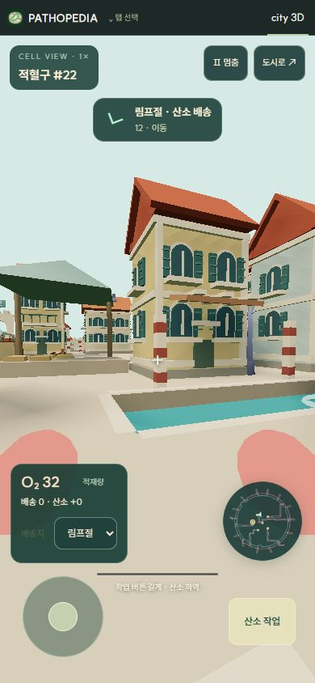
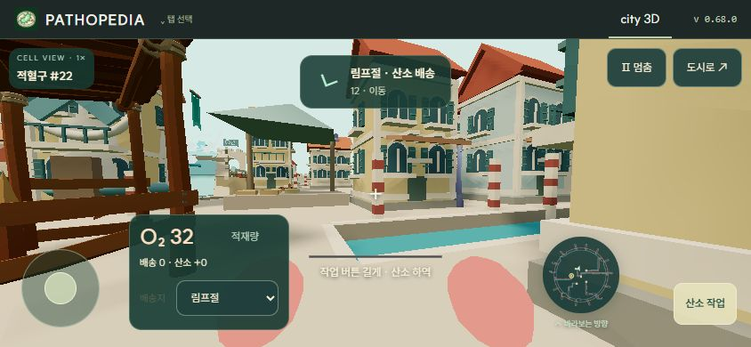

# Cell City 세포 체험

City 3D의 **세포 체험**에서 현재 도시의 호중구 또는 적혈구 한 개를 직접 조종한다. 테마 2의 혈관 수로와 테마 1의 격자 대로 모두 같은 저장 배치·세포·병원체·자원을 사용한다.

## 조작

| 환경 | 이동 | 시선 | 호중구 | 적혈구 |
| --- | --- | --- | --- | --- |
| PC | WASD, Shift 가속 | 드래그 또는 시선 고정, 방향키 | 클릭 / F / Space | 접안 후 E 길게 |
| 모바일 | 왼쪽 조이스틱 | 화면 드래그 | 오른쪽 공격 버튼 | 접안 후 산소 작업 버튼 길게 |

P 또는 멈춤 버튼으로 일시정지한다. Esc나 도시로 버튼은 조감도로 돌아간다. 화면을 벗어나면 일시정지하며, 조종 중에는 도시가 1배속으로 진행한다. 복귀하면 이전 배속으로 되돌린다.

## 실제 도시와 연결

- 조종할 세포를 새로 생성하지 않는다. 선택한 역할의 기존 세포를 인계받고 해당 세포의 AI만 잠시 멈춘다. 다른 세포와 감염은 계속 진행한다.
- 호중구의 근접 조준 공격은 실제 병원체 HP, 항체·보체 지원, 에너지, 공격 주기와 처치·잔해에 반영된다. 건물을 사이에 둔 공격과 상피 안쪽으로 들어오지 않은 내강 병원체 공격은 막는다. 가까운 병원체로부터 피해를 받고 심장 근처에서 회복한다.
- 적혈구는 폐에서 실제 운반 규칙에 따라 산소를 적재하고 선택한 장기에 전달한다. 장기에 남은 공간만 하역하며 남은 화물은 유지한다. 배달량은 실제 산소와 통계에 한 번만 반영한다.
- 적혈구 이동은 테마별 운반 경로와 장기 접안 구역을 따른다. 호중구는 조직 사이에서도 이동할 수 있다. 건물·주변 주택·도시 외벽은 통과하지 못한다.
- 목적지 표시, 짧은 바닥 경로와 미니맵은 현재 배치와 목적지를 사용한다. 안내 경로와 수동 이동은 동일한 충돌 지도를 사용한다.
- 조종 상태는 WeakMap에만 보관한다. 저장은 기존 도시 형식이며 재개·도시 복귀·탭 전환 시 세포를 정상 AI로 돌려준다. 화물과 체력은 유지한다.

## 구성과 에셋

기존 MIT Three.js, 절차 생성 세포와 도시 에셋을 재사용한다. 새 외부 패키지·모델·텍스처는 없다. 카메라 앞의 세포 손과 경로 표식은 작은 기본 도형이며 인스턴싱한다. 자신과 카메라에 너무 가까운 아군은 가림을 줄이기 위해 숨긴다.

| 파일 | 역할 |
| --- | --- |
| `src/city-pilot-state.mjs` | 일시적인 세포 소유권 |
| `src/city-pilot-world.mjs` | 두 테마의 충돌, 이동 범위, 경로 안내 |
| `src/city-pilot.mjs` | 이동·조준·배송·피해 상태 |
| `src/city-first-person.mjs`, `src/city-pilot.css` | 카메라, 키보드·다중 포인터 입력, 모바일 HUD |
| `src/city-engine.mjs` | AI 인계와 실제 전투·산소 반영 |
| `src/city-three-renderer.mjs`, `src/city-ui.mjs` | 장면·진입·복귀·배속 연결 |

## 확인 기록

- 핵심 테스트 8개: 두 테마의 세포 인계·저장, 모든 산소 목적지 연결, 직접 이동과 산소 적재·하역, 조준·재사용 대기시간·처치, 테마 전환과 세포 소실.
- 실제 브라우저: 테마 2에서 산소 작업 버튼으로 O₂ 32 적재, 조이스틱 이동·드래그 시선·복귀. 390×844 세로와 844×390 가로 화면에서 HUD와 터치 조작 확인.
- 테마 1에서 같은 세포 진입·이동·공격 입력 확인. 혈류로 유입한 MRSA에 유효 공격 2회와 HP 감소를 확인.
- 모바일 확인은 브라우저 화면 크기와 포인터 입력 기준이며 실제 휴대폰 하드웨어 측정은 포함하지 않는다.

