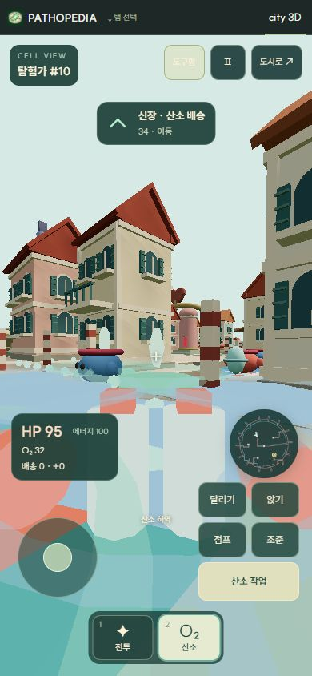
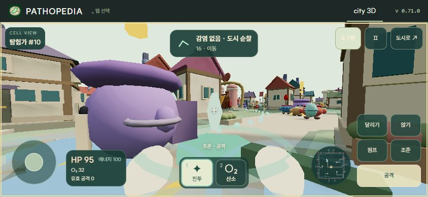

# Cell City 세포 체험

City 3D의 **세포 체험**에서 현재 도시의 세포 하나를 탐험가로 직접 조종한다. 역할 선택 없이 도구를 바꿔 전투와 산소 배송을 수행한다. 테마 2의 혈관 수로와 테마 1의 격자 대로 모두 같은 저장 배치·세포·병원체·자원을 사용한다.

## 조작

| 행동 | PC | 모바일 |
| --- | --- | --- |
| 이동·시선 | WASD · 마우스, 방향키 | 왼쪽 조이스틱 · 화면 드래그 |
| 도구 교체 | 1·2 / 휠 / Q | 아래 퀵슬롯 |
| 도구함·배송지 | I / Tab | 도구함 |
| 도구 사용 | 클릭 / E / F | 공격 / 산소 작업 길게 |
| 점프 | Space | 점프 |
| 달리기 | Shift 유지 | 달리기 전환 후 이동 |
| 앉기 | Ctrl 유지 / C 전환 | 앉기 전환 |
| 확대 조준 | 우클릭 유지 | 조준 유지 |
| 메뉴 | Esc / P | Ⅱ |

PC는 진입·계속하기에서 포인터 잠금을 자동 요청한다. 브라우저가 잠금을 거부하면 드래그로 시선을 조절하고 화면 클릭으로 다시 요청한다. 잠금 해제·화면 이탈은 일시정지하며 도구함도 도시를 멈춘다. 도시로 버튼으로 복귀하면 이전 배속을 복구한다.

## 실제 도시와 연결

- 기존 호중구를 우선 인계받으며 선택된 호중구·적혈구도 사용할 수 있다. 세포 종류와 원래 AI 화물을 변경하지 않고 직접 조종하는 세포의 AI만 잠시 멈춘다.
- 포식 글러브는 실제 병원체 HP, 항체·보체 지원, 에너지, 공격 주기와 처치·잔해에 반영된다. 건물 너머·상피 내강의 병원체 공격은 막는다. 확대 조준은 원거리 표적을 보여주지만 공격은 근접 범위다.
- 산소 캐리어는 폐에서 적재하고 선택한 장기에 전달한다. 정지한 채 사용을 유지해야 하며 장기에 남은 공간만 하역한다. 배달량은 실제 산소와 통계에 한 번만 반영한다.
- 도구·산소·배송지는 도시 저장의 `pilotInventory`에 보존한다. 도구를 바꾸거나 도시로 나갔다 돌아와도 적재량을 잃지 않는다. 직접 조종 상태는 WeakMap에만 두어 저장 복원 시 세포는 정상 AI로 시작한다.
- 두 도구 모두 수로·대로·조직 사이를 이동한다. 건물·주택·도시 외벽은 통과하지 못한다. 점프는 시점 높이를 올리며 건물 충돌을 해제하지 않는다.
- 가속·감속과 30 Hz 시뮬레이션 사이의 카메라 보간을 사용한다. 점프는 Shoot의 단발 입력과 중력을 참고하며 앉기·달리기·조준에 따라 높이·속도·시야각을 조절한다.
- 목적지, 바닥 경로, 미니맵은 현재 배치와 동일한 충돌 지도를 사용한다. 가까운 병원체는 피해를 주고 심장 근처에서는 회복한다.

## 구성과 에셋

기존 MIT Three.js, Shoot 입력 패턴, 절차 생성 세포와 도시 에셋을 재사용한다. 외부 패키지·모델·텍스처를 추가하지 않는다. 카메라 앞 손 2개, 산소 탱크 2개와 마개 2개, 목적지 고리 1개, 최대 100개의 인스턴스 경로 점을 사용한다. 자신과 카메라에 너무 가까운 아군은 가림을 줄이기 위해 숨긴다.

| 파일 | 역할 |
| --- | --- |
| `src/city-pilot-state.mjs` | 일시적인 세포 소유권, 인벤토리 형식 |
| `src/city-pilot-world.mjs` | 두 테마의 충돌과 경로 안내 |
| `src/city-pilot.mjs` | 이동·조준·도구·배송·피해 상태 |
| `src/city-first-person.mjs`, `src/city-pilot.css` | 카메라, 키보드·다중 포인터 입력, 도구함, 모바일 HUD |
| `src/city-engine.mjs` | AI 인계와 실제 전투·산소 반영 |
| `src/city-three-renderer.mjs`, `src/city-ui.mjs` | 장면·진입·복귀·배속 연결 |

## 확인 기록

- v0.71.0 핵심 테스트 10개: 두 테마의 세포 인계·저장, 모든 배송지 연결, 같은 호중구의 산소 적재·직접 이동·하역, 적혈구의 전투 도구 사용, 가속·감속·보간·달리기·앉기·점프, 도구 저장·복원과 세포 소실.
- 서비스 워커 회귀 확인 2개: 새 버전 캐시의 HTTP 캐시 우회, 새 도시 모듈 재검증과 이후 오프라인 사용. 배포 파일이 이전 버전의 HTTP 캐시로 채워지던 문제를 수정했다.
- 실제 브라우저: 탐험가 #10이 산소 32 적재 후 같은 세포에서 전투 도구로 전환. 도구함에서 배송지를 바꾸고 다시 산소 도구를 장착해도 적재량 유지.
- 테마 1에서도 같은 탐험가·산소 32를 유지하며 전투 도구 전환과 달리기 입력 확인. 세로 화면에서 조이스틱 이동·드래그 시선·점프·앉기, 가로 화면에서 조작 영역과 미니맵 배치 확인.
- 앱 내 확인용 브라우저는 `WrongDocumentError`로 포인터 잠금을 거부했다. 진입 시 자동 요청과 드래그 대체 조작은 확인했으며 해당 환경에서 잠금 완료는 검증하지 못했다.
- 모바일 확인은 390×844와 844×390 브라우저 화면 크기 및 포인터 입력 기준이며 실제 휴대폰 하드웨어 측정은 포함하지 않는다.

