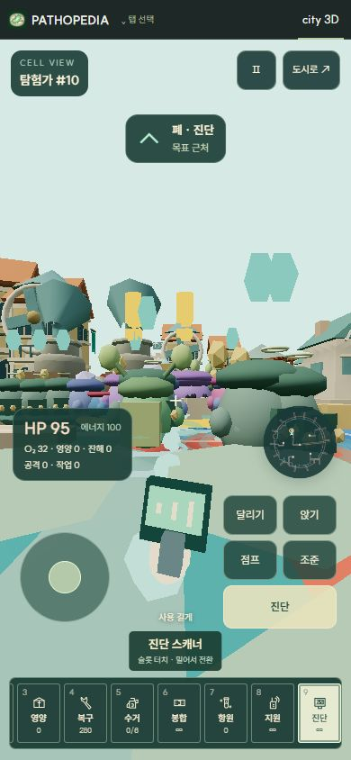
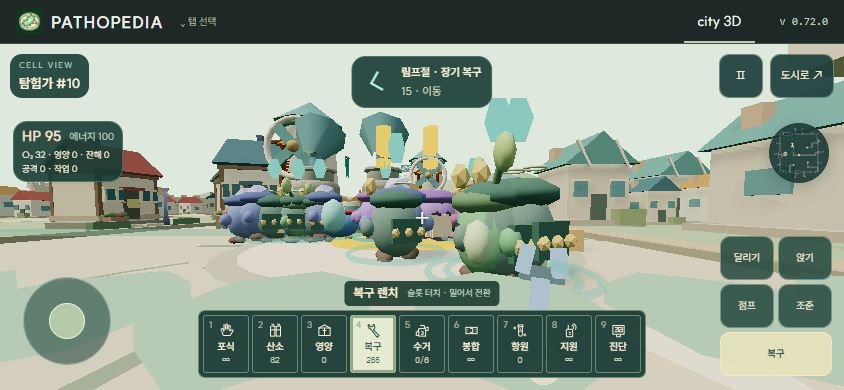
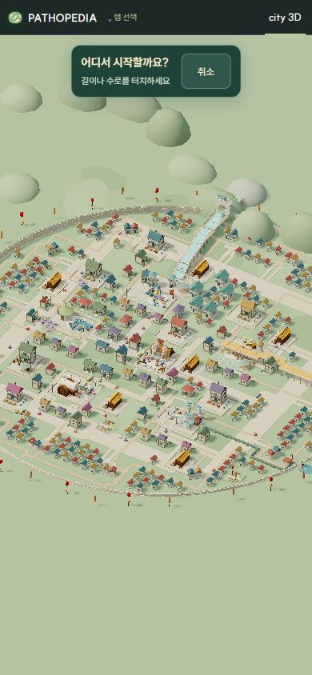
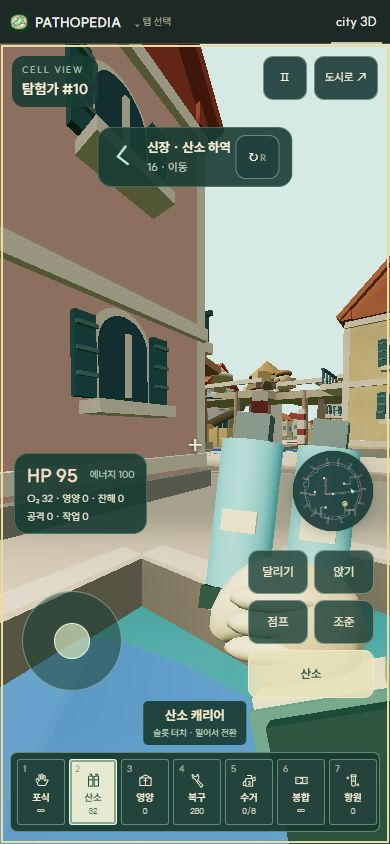
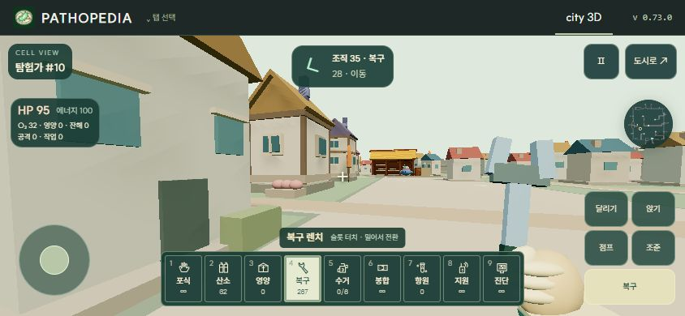
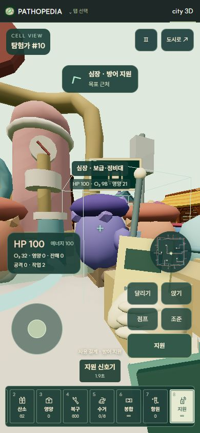
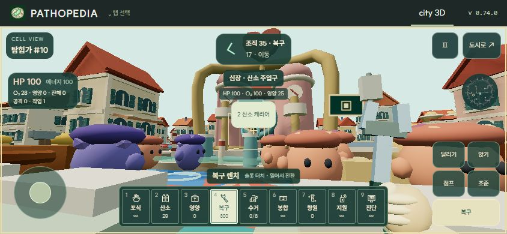

# Cell City 세포 체험

City 3D의 **세포 체험**에서 현재 도시의 세포 하나를 탐험가로 직접 조종한다. 테마 2의 혈관 수로와 테마 1의 격자 대로에서 같은 9개 도구를 사용한다. 도구함 창이나 역할 선택 없이 하단 퀵슬롯에서 즉시 교체한다.

1인칭 버튼을 누르면 조감도에서 시작 위치를 클릭·터치한다. 선택 중에는 도시가 잠시 멈추고 지도 드래그·확대는 유지한다. 기존 건물·주택·외벽 충돌을 통과한 정확한 지점으로 인계받은 세포를 이동한다. 지붕 클릭은 화면에 보이는 표면을 검사해 뒤쪽 길로 잘못 진입하지 않는다. 드래그·두 손가락 제스처는 시작 클릭으로 처리하지 않는다. 취소·Esc는 세포를 인계받지 않고 이전 배속으로 돌아간다.

## 조작

| 행동 | PC | 모바일 |
| --- | --- | --- |
| 이동·시선 | WASD · 마우스, 방향키 | 왼쪽 조이스틱 · 화면 드래그 |
| 도구 교체 | 휠 / 1–9 | 슬롯 터치 / 좌우 스와이프 |
| 직전 도구 | Q | 슬롯 터치 |
| 맞는 도구 장착 | F | 대상 카드의 도구 버튼 |
| 도구 사용 | 클릭 / E 유지 | 선택한 도구 버튼 유지 |
| 다음 배송지 | R | 목적지 옆 ↻ |
| 점프 | Space | 점프 |
| 달리기 | Shift 유지 | 달리기 전환 후 이동 |
| 앉기 | Ctrl 유지 / C 전환 | 앉기 전환 |
| 확대 조준 | 우클릭 유지 | 조준 유지 |
| 메뉴 | Esc / P | Ⅱ |

Shoot의 `play-ui.mjs`와 `play-engine.mjs`에서 휠·숫자 슬롯·직전 장비·스와이프 패턴을 재사용했다. 도구 교체는 도시를 멈추지 않는다. 사용을 누른 채 바꾸면 한 번 놓은 다음 다시 눌러야 새 도구가 작동한다. 작은 화면의 퀵슬롯은 가로로 이어지며 선택한 슬롯이 자동으로 보인다.

PC는 진입·계속하기에서 포인터 잠금을 자동 요청한다. 브라우저가 거부하면 드래그로 시선을 조절하고 화면 클릭으로 다시 요청한다. 잠금 해제·화면 이탈은 일시정지한다. 도시로 돌아가면 이전 배속을 복구한다.

## 도구와 실제 도시 상태

| 슬롯 | 도구 | 동작 |
| --- | --- | --- |
| 1 | 포식 글러브 | 실제 병원체의 HP 감소·처치·잔해 생성. 항체·보체 지원과 에너지·공격 주기 적용 |
| 2 | 산소 캐리어 | 폐 적재 → 산소가 부족한 장기에 하역. 실제 장기 산소와 통계 증가 |
| 3 | 영양 보급함 | 장의 창고에서 최대 20 적재 → 다른 장기의 보급 한도까지 하역. 창고 자원 차감 |
| 4 | 복구 렌치 | 손상된 장기·조직 HP 최대 +8. 재료 1–2와 에너지 2 소모. 기존 공사 주문은 유지 |
| 5 | 잔해 흡입기 | 실제 잔해 제거·국소 청소, 최대 6 운반 → 신장 집하장 하역 후 기존 여과 과정에서 처리 |
| 6 | 혈소판 패치 | 파손 피부를 HP 25까지 응급 봉합. 폐 장벽 보호도 가능. 에너지 4 소모 |
| 7 | 항원 채집기 | 미접수 병원체·잔해에서 항원 채집 → 림프절 접수. 기존 후천 면역 과정으로 연결 |
| 8 | 지원 신호기 | 가까운 장기로 방어 집결·15초 지원. 에너지 10 소모, 6초 재사용 대기 |
| 9 | 진단 스캐너 | 실제 장기 HP·산소·영양 또는 조준한 병원체 HP 확인 |

화물은 도구별로 따로 보존한다. 산소·영양·잔해·항원을 운반하다 다른 도구를 써도 사라지지 않는다. 산소·영양·복구·봉합은 멈춰서 사용을 유지한다. 먼 목표는 현재 배치의 경로와 미니맵으로 안내하며, 실제 작업은 조준한 객체에만 적용한다. 자원·거리·대상·도구·재사용 대기·장애물은 실제 상태 변경 시 다시 확인한다.

기존 산소 설비 6곳·보급과 집하 상자 6곳·림프절 항원 작업대 1곳을 작업 지점으로 사용한다. 건물 점유와 겹치는 설비는 바깥의 접근 가능한 지점으로 안내한다. 조준한 시설·잔해·병원체·손상 조직에는 이름과 현재 상태가 표시되고, 필요한 도구가 다르면 F 또는 대상 카드로 장착한다. 가까이 있다는 이유만으로 작업하지 않는다. 시선을 떼면 진행이 끊기고, 사용을 누른 채 다른 객체로 옮기면 놓았다가 다시 눌러야 한다.

사용 중에는 기존 설비에 붙은 밸브·상자 뚜껑이 움직인다. 조준 테두리와 진행 막대는 실제 대상 위치에 표시하고 완료 시 물자 이동 효과를 낸다. 가까운 시설 표식은 최대 3개만 보여 준다. 테마 변경이나 저장 복원은 별도 시설 상태를 만들지 않고 같은 도시 객체를 다시 연결한다.

기존 호중구를 우선 인계받고 선택된 호중구·적혈구도 사용할 수 있다. 세포 종류와 원래 AI 화물은 유지하며 조종하는 세포의 AI만 잠시 멈춘다. 저장 복원은 정상 AI로 시작하고 `pilotInventory`의 도구와 화물은 보존한다. v0.71의 산소 전용 저장도 기본값을 보충해 읽는다.

건물·주택·외벽 충돌, 점프·달리기·앉기·조준과 30 Hz 카메라 보간을 유지한다. 모든 도구로 수로·대로·조직 사이를 이동한다. 가까운 병원체는 피해를 주며 심장 근처에서는 회복한다.

## 구성과 에셋

기존 MIT Three.js, Shoot 입력·SVG 패턴, 도시 에셋을 재사용했다. 외부 모델·텍스처·패키지는 추가하지 않는다. 휴대 도구는 공유 기하 4종으로 만든 57개 메시 중 손·소매 8개와 현재 도구를 합쳐 최대 15개만 표시한다. 도시 뒤에 깊이 버퍼를 비우고 별도 카메라로 손을 그려 수면이나 건물에 가려지지 않으며, 프레임 비용 집계는 두 렌더링을 합산한다. 목적지 고리 1개, 최대 100개 인스턴스 경로 점을 유지하고 시작 위치 표시에는 기존 구역 고리를 재사용한다.

| 파일 | 역할 |
| --- | --- |
| `src/city-pilot-state.mjs` | 소유권, 도구 정의, 화물 저장과 검증, 재사용 대기 |
| `src/city-pilot-tasks.mjs` | 실제 대상 탐색·목적지·슬롯 수량 |
| `src/city-pilot-sites.mjs` | 기존 시설 좌표와 안전한 작업 접근 지점 |
| `src/city-pilot-interactions.mjs` | 조준 객체·거리·시선 차단·도구 추천 |
| `src/city-pilot-fixtures.mjs` | 설비 표식·밸브·상자 뚜껑·작업 효과 |
| `src/city-pilot-work.mjs` | 자원·복구·잔해·항원·지원·진단 처리 |
| `src/city-pilot-tools.mjs` | 9개 SVG 아이콘과 휴대 모델 |
| `src/city-pilot-world.mjs` | 두 테마의 충돌과 경로 |
| `src/city-pilot.mjs` | 이동·조준·도구 전환·작업 진행 |
| `src/city-first-person.mjs`, `src/city-pilot.css` | 카메라, 키보드·다중 포인터, 퀵슬롯과 모바일 HUD |
| `src/city-engine.mjs` | AI 인계와 실제 전투 연결 |

## 확인 기록

- v0.74.0 핵심 테스트 22개 통과. 두 테마의 시설 13곳 접근성·맞는 도구 선택·조준 이탈 중단·산소 작업과 저장·특정 잔해 선택·사용 중 대상 변경 방지·장애물 너머 자원 변경 차단을 확인했다.
- v0.74.0 브라우저: 테마 1 PC에서 F로 지원 신호기를 장착하고 실제 에너지 차감·작업 횟수 증가를 확인했다. 390×844에서 대상 카드의 도구 버튼과 터치 사용 버튼으로 같은 작업을 완료했다. 테마 2는 산소 밸브를 조준해 산소 하역·운반량 감소를 확인했다. 844×390에서 대상 카드·추천 도구·터치 버튼을 확인했고 브라우저 오류는 없었다. 카메라 회전은 YXZ 순서로 조준 판정 방향과 일치시켰다.
- v0.73.0 핵심 테스트 18개 통과. 두 테마의 정확한 시작 좌표·기존 세포와 화물 보존·건물과 경계 밖·비정상 좌표 거부를 추가 검증했다.
- v0.73.0 브라우저: 테마 2에서 지붕 클릭 거부·드래그와 시작 클릭 구분·Esc 취소 후 일시정지 복원·선택한 수로 진입·휠 전환 확인. 테마 1의 모바일 배치에서 시작 지점 선택과 기존 탐험가 #10·산소 32 보존 확인. 390×844의 산소통·손, 844×390의 렌치·손과 터치 버튼을 확인했고 브라우저 오류는 없었다.
- v0.72.0 핵심 테스트 14개 통과: 두 테마의 인계·충돌·산소 실제 운반·전투·이동, 9개 도구와 직전 도구 전환, 사용 중 교체 방지, 실제 보급·재료 소비·잔해 하역·봉합 한도·항원 중복 방지·지원 재사용 대기·진단·저장 호환.
- 브라우저에서 Shoot 휠·숫자키·Q 전환을 먼저 확인하고 도시에도 동일한 조작 적용. 실제 폐 HP·산소·영양 진단 결과 확인.
- 앱 내 확인용 브라우저의 포인터 잠금 거부에 대한 드래그 대체 조작은 유지한다. 해당 환경의 잠금 완료는 검증하지 못했다.
- 모바일 확인은 브라우저 화면 크기와 포인터 입력 기준이며 실제 휴대폰 하드웨어 측정은 포함하지 않는다.

- 테마 2 모바일 390×844에서 슬롯 스와이프·뒤쪽 슬롯 접근·진단 버튼 사용 확인. 테마 1의 844×390 화면에서 9칸 슬롯·이동·행동 영역을 확인하고 같은 탐험가 #10의 산소 32가 유지됨을 확인.

